# C-Engine

C-Engine is a paper-first, hardware-accelerated trading engine combining Alpaca market data (SIP / Algo Trader Plus, entitlement-verified; IEX retained as a compatibility profile), native C++ market and portfolio state, risk enforcement, an internal limit-order book, HDF5 persistence, strategy evaluation, and an Alpaca execution adapter.

The architecture uses Apple Metal as the primary broad-market numerical compute backend, Objective-C++ to manage GPU resources, C++ for authoritative state and execution-critical decisions, and Python for data acquisition, orchestration, and research.

**Implementation status (verified on Apple M5 Max, Python 3.11.8):**

- Native Objective-C++ Metal runtime, persistent pipeline cache and BufferPool — **complete** (Phase A).
- Native `DiscoveryEngine` (market ingestion, 1m/5m bar ring buffers, symbol id/generation, dirty tracking) — **complete**.
- **8 Metal shader files / 50 compiled kernels**; 12 host-callable, hardware-executed and CPU-parity-validated; **5 operationally consumed on the live discovery path**: `technical_features`, `screen_market`, `compact_entry_candidates`, `rank_candidates`, `market_breadth`.
- Market-wide ranking runs on the GPU (`rank_candidates`), output identical to the prior Python ranker (scores <1e-4, eligibility and order identical).
- **SIP is the verified operational feed** (`tools/sip_verify.py`: REST + WebSocket authenticated against the real account). Historical SIP certification harness (`tools/phase_b_certify.py`) has driven real SIP bars through the full pipeline; **real-time session certification is pending an eligible market session**.
- Regression suite: **353 tests passing**.

In progress / not yet certified: the adaptive four-tier subscription manager (current cap is a flat 250 symbols on SIP), full master-universe membership acquisition, operational portfolio-optimizer consumers, the remaining Metal kernels, the unified dashboard, and out-of-sample/live-readiness certification. Nodes marked *(target)* below are not certified production capabilities.

## Architecture

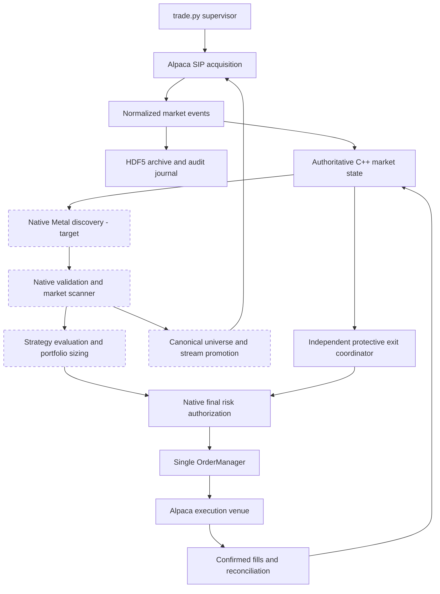

*Architecture overview: dashed nodes identify stages affected by the planned integration; they do not certify operational GPU execution.*

The engine does not invent prices, quantities, fills, or account state. Missing authoritative quote or account state blocks affected elective orders. GPU recommendations never bypass native risk authorization. The protective exit path must not depend on GPU availability, scanner rankings, or portfolio optimization.

## Repository and startup

Local repository: `/Users/blkpvnthr/C-engine`.

The sole operational entry point is `trade.py`:

```bash
cd /Users/blkpvnthr/C-engine
source .venv/bin/activate
python3 trade.py
```

If a shell alias selects a different interpreter, use `./.venv/bin/python trade.py`. No separate scanner, GPU worker, or dashboard startup command is intended. The Python package `cengine`, native module `_cengine_native`, Metal library `cengine.metallib`, and `CENGINE_` configuration prefix retain their existing names.

### Startup and runtime supervision (target)

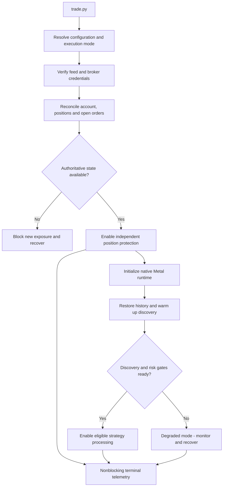

*Target startup sequence. Position protection must not wait for unrelated discovery warm-up.*

## Market-data feed

**Alpaca SIP (Algo Trader Plus) is the verified operational feed** (`wss://stream.data.alpaca.markets/v2/sip`), selected via `CENGINE_ALPACA_FEED=sip`. Entitlement is confirmed from actual account responses — `tools/sip_verify.py` authenticates SIP historical REST, SIP latest quote/trade, and the SIP WebSocket (evidence in `reports/alpaca_subscription_validation.json`); entitlement is derived from responses, never assumed from payment. The authoritative resolver in `market_data/feed.py` determines the feed, endpoint, and archive provenance. An omitted feed resolves to IEX (never a silent SIP upgrade); an unentitled SIP selection is surfaced, never silently downgraded. Startup verifies the actual endpoint against configuration; mismatches fail closed.

IEX remains an explicit compatibility profile (`CENGINE_ALPACA_FEED=iex`) with its applicable restrictions (including the 30-symbol streaming cap). Daily HDF5 files record provider and feed (for example, `alpaca-sip` and `sip`). Replay rejects incompatible feed combinations through `assert_feed_consistency`; SIP and IEX numerical histories are never mixed without an explicitly validated methodology.

### IEX limitations

IEX is a single exchange, not consolidated SIP coverage. Its quotes are exchange top-of-book, not NBBO; quote sizes and trade volume are exchange-specific. Inferred order flow is not consolidated market pressure. Neither IEX nor Alpaca SIP top-of-book data supplies full exchange-by-exchange Level-II depth. The engine must never fabricate depth. Signals requiring consolidated coverage are ineligible on IEX, and SIP-calibrated thresholds require revalidation.

### Discovery universe (target architecture)

The deduplicated master universe includes supported NASDAQ-listed equities, S&P 500 constituents, DJIA constituents, and configured instruments. Membership flags and versions preserve overlapping group identities. **Full master-universe membership acquisition is a target** (current discovery operates over the configured research universe).

Streaming capacity is feed-aware. Under Basic IEX a single WebSocket enforces a maximum of 30 unique symbols. Under SIP the provider imposes no documented symbol cap; the engine currently applies a **flat 250-symbol application safety limit** (`MARKET_SCAN_MAX_SUBSCRIPTIONS`), which is an internal capacity setting, not a provider restriction. The **target** is an adaptive four-tier subscription manager (Tier 1 full-universe bars → Tier 2 ranked trades → Tier 3 actionable quotes → Tier 4 protected instruments) with independent per-channel capacity, promotion/demotion hysteresis, and server-confirmed acknowledgement tracking. Held positions, pending orders and required references always receive priority.

REST sampling is not continuous streaming. Missing, stale, incomplete, and warming-up observations remain explicitly classified. Coverage and sweep latency must be measured against the shared request budget. No invented observations or feed substitution is permitted on the operational path.

### Market discovery and streaming allocation

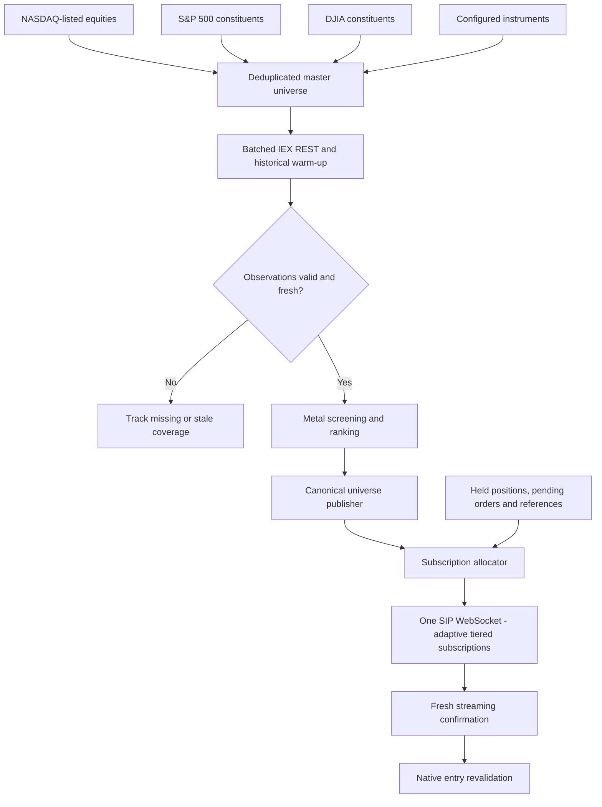

*Target discovery architecture. REST coverage is distinct from streaming coverage.*

### Feed configuration

SIP is the verified operational feed and is selected explicitly; feed selection is independent of paper versus live execution.

```text
CENGINE_ALPACA_FEED=sip
```

Alternatively:

```text
CENGINE_ALPACA_URL=wss://stream.data.alpaca.markets/v2/sip
```

The URL scheme, host and path are validated. Archive provenance is `alpaca-sip` under SIP; `CENGINE_ARCHIVE_PROVIDER_LABEL` is an explicit label override, not a change of feed. Set `CENGINE_ALPACA_FEED=iex` to run the Basic compatibility profile. Authentication failures never trigger automatic fallback.

## Native macOS build

Requirements: Python 3.11+, CMake 3.24+, a C++20 compiler, full Xcode and the Metal Toolchain for source shader compilation. Apple Silicon is the target GPU platform. The previously successful build used Python 3.11.8 and pybind11 3.1.0.

```bash
cd /Users/blkpvnthr/C-engine
# Create .venv only if it does not already exist or needs rebuilding.
python3 -m venv .venv
./.venv/bin/python -m pip install -e '.[dev]'
./.venv/bin/python -m pip install pybind11
```

Install Metal tooling if missing:

```bash
xcodebuild -downloadComponent MetalToolchain
xcrun --find metal
xcrun --find metallib
xcrun metal --version
```

Build the native extension and shaders from source:

```bash
cmake --fresh -S . -B build-metal \
  -DCENGINE_COMPILE_METAL=ON \
  -DPython_EXECUTABLE="$PWD/.venv/bin/python" \
  -Dpybind11_DIR="$(./.venv/bin/python -m pybind11 --cmakedir)" \
  && cmake --build build-metal -j "$(sysctl -n hw.logicalcpu)"
```

Use the same interpreter for dependencies, compilation, tests, and startup. After moving the repository, reconfigure CMake and verify virtual environment paths. Verify the runtime loads the intended native extension and newly compiled metallib, not stale artifacts.

```bash
./.venv/bin/python -m pytest -q
./.venv/bin/python -m ruff check .
```

A CPU-only diagnostic build remains available:

```bash
cmake -S . -B build -DCENGINE_BUILD_PYTHON=OFF -DCENGINE_COMPILE_METAL=OFF
cmake --build build -j
```

This is not the primary discovery architecture. The existing PyObjC Metal runtime is a transitional compatibility path; the planned native Objective-C++ host provides persistent device/queue ownership, cached pipelines, reusable buffers, asynchronous submission, completion handlers, versioned results, and validated native CPU fallback. Hardware execution and operational consumer integration require separate evidence from compilation.

### Native Metal compute pipeline (target)

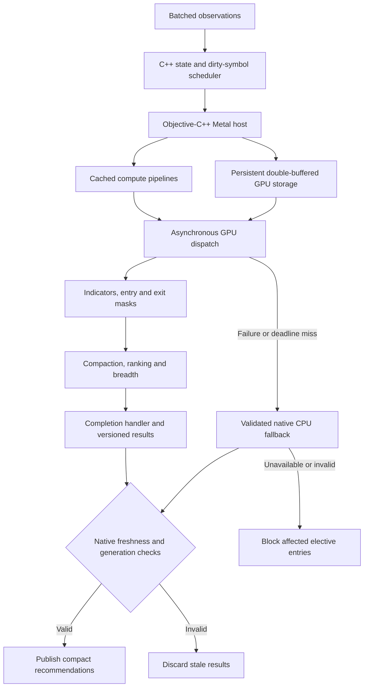

*The runtime, pipeline cache, buffers, and five of these kernels (`technical_features`, `screen_market`, `compact_entry_candidates`, `rank_candidates`, `market_breadth`) are operational and CPU-parity-validated on device; full-market scaling and the remaining kernels are target. Source compilation alone does not establish hardware execution or consumer integration — these are tracked as separate gates.*

### Build and kernel evidence lifecycle

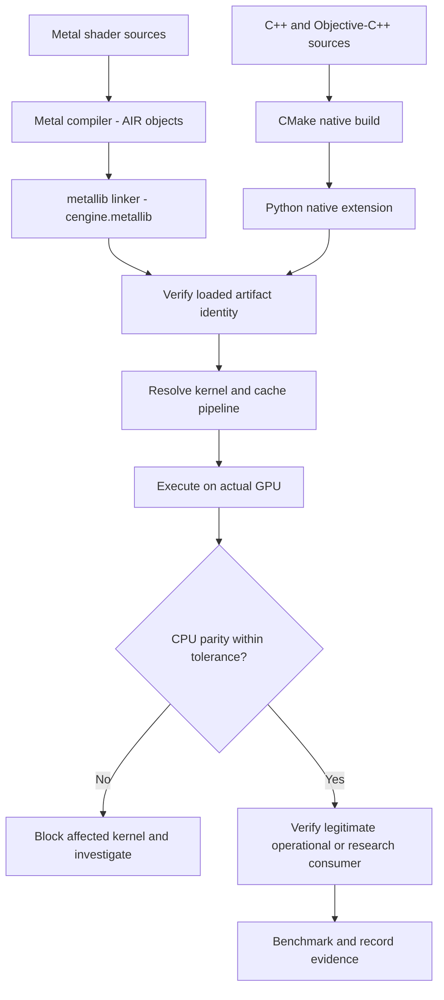

*Compilation, hardware execution, numerical parity and consumer integration are separate verification gates.*

## Strategy and risk architecture

The intended shared elective-entry gate requires valid market observations, completed five-minute DMI features with DI+ > DI−, price above at least one valid reference (session VWAP, five-minute SMA20, or Bollinger middle), and the latest valid developing one-minute price strictly above the immediately preceding completed one-minute close. Fresh streaming confirmation and native revalidation are required before order authorization.

The mandatory protective exit threshold is strictly `unrealized_return < -0.005`. Protection evaluates valid market updates with a five-second backstop and remains independent of discovery and GPU processing. It requests a full exit through the centralized execution path; it does not guarantee the realized loss will be limited to 0.5%.

The planned replacement path waits for confirmed exit fills and reconciled capital, then considers current qualified opportunities with seller exhaustion, positive momentum, liquidity, estimated net benefit, and portfolio/risk compatibility. Cash is retained if no replacement qualifies.

### Elective entry decision (target)

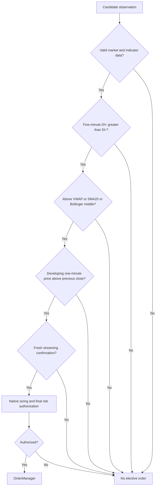

### Protective exit and replacement

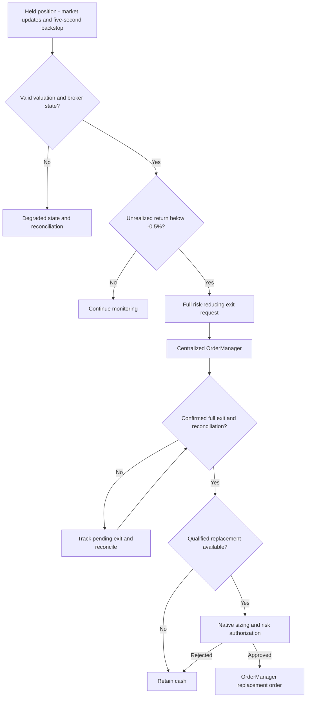

*Protection is independent of Metal and replacement discovery. The replacement branch is a target capability; the threshold is not a guaranteed realized-loss limit.*

### Opportunity lifecycle (target)

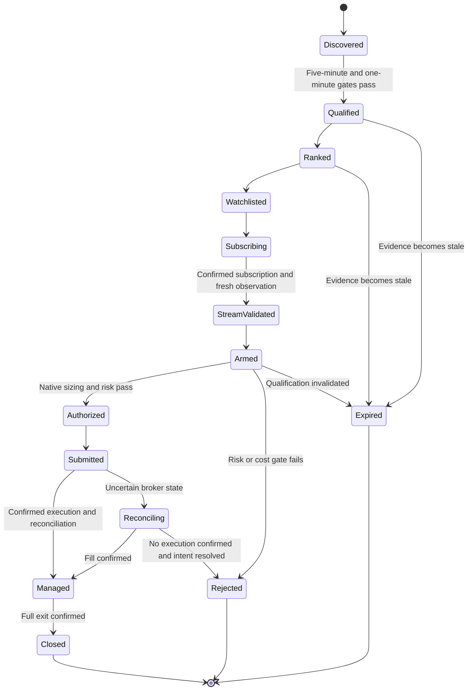

*Conceptual opportunity lifecycle; broker order state and partial fills must be tracked separately.*

## Paper configuration and reconciliation

Copy `.env.example` to `.env` and supply credentials locally. Keep `.env` ignored and never log credentials. Paper is the default execution mode (`https://paper-api.alpaca.markets`). Tests must never submit real orders.

The engine composition uses explicit `QuantityPolicy`, `ExitQuantityProvider`, and `ExecutionPolicy` contracts. `ENGINE_NATIVE_ADAPTER_MODULE=native_adapters` selects the native adapters in the existing configuration. The unified entry point owns application composition; do not restore the retired `run.py` or `start_engine.py` launch paths.

Existing operational configuration concepts include:

```text
--journal-path ./state/audit.jsonl
--max-feed-age-ns <provider-appropriate limit>
--max-bar-gap-ns <configured bar interval tolerance>
--reconciliation-interval-seconds <broker polling interval>
--session-timezone America/New_York
--session-open-minute 570
--session-close-minute 960
--session-weekdays 0,1,2,3,4
```

Verify supported options with `trade.py --help`; these are inherited configuration settings, not a guarantee that every legacy CLI flag is still exposed.

Startup reconciles Alpaca account, positions, and open orders. Unknown orders, inconsistent venue identifiers, stale snapshots, reversed cumulative fills, and reconciliation errors trigger fail-closed handling. Risk-reducing protection remains available where authoritative state and connectivity permit it.

Checksummed `portfolio_metrics` journal records include cash, equity, buying power, realized P/L, gross/net exposure, reserved notional, order/position counts, and high-water-mark drawdown.

### Order execution and fill reconciliation

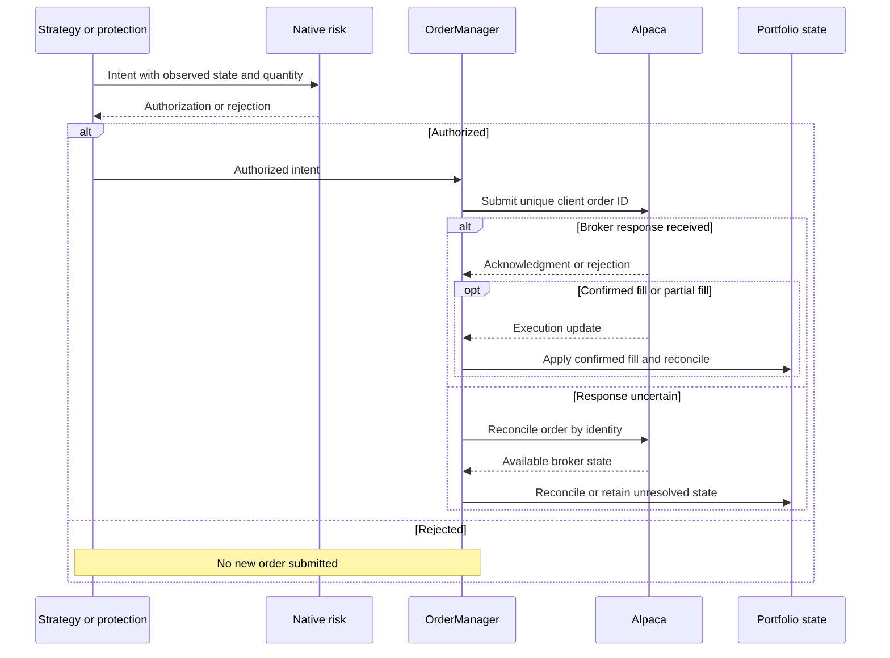

*Logical execution contract, not a claim about exact current function call ordering. Unknown orders must not be blindly resubmitted.*

## Persistence and replay

HDF5 archives preserve normalized event provenance. `cengine.replay.replay()` republishes normalized events in stable input order without synthesizing time or sleeping and rejects non-monotonic symbol sequences. Full execution replay, historical backtesting and out-of-sample certification remain development milestones unless supported by current test evidence.

### Daily NoSQL journal

Install MongoDB support:

```bash
./.venv/bin/python -m pip install -e '.[nosql]'
```

Configure locally:

```text
CENGINE_MONGODB_URI=mongodb://127.0.0.1:27017/?replicaSet=rs0
CENGINE_MONGODB_DATABASE=cengine
```

Supply the configured MongoDB timeout (`--mongodb-timeout-ms` where exposed). Verified records are persisted in timezone-aware daily collections such as `journal_20260921`, with a unique global sequence index and timestamp/kind index. Replay is idempotent; conflicting checksums fail closed. The local JSONL journal remains the write-ahead and recovery source and is backfilled at startup. Production deployments should use authenticated replica sets, encrypted transport, backups, and majority write concern.

### Event persistence and recovery

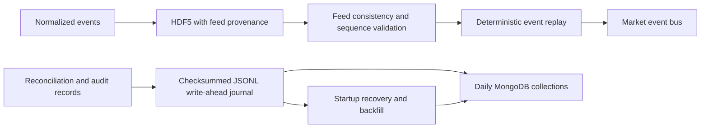

*Normalized event replay is distinct from full historical execution simulation.*

## Live execution gate

Paper and live execution are independent of market-data feed selection. Live construction requires the live endpoint and all three exact confirmations:

```text
ALPACA_TRADING_BASE_URL=https://api.alpaca.markets
CENGINE_ENABLE_LIVE=YES_I_ACCEPT_LIVE_TRADING_RISK
CENGINE_LIVE_CONFIRMATION=LIVE_ORDERS_MAY_LOSE_MONEY
CENGINE_LIVE_RECONCILIATION_CERTIFIED=PAPER_REPLAY_AND_BROKER_STATE_AGREE
```

Keep these values out of shell profiles and deployment defaults. Configuration gates do not constitute proof of strategy profitability or live readiness. No real live orders may be submitted for integration testing.

## Portfolio analytics and research

```bash
./.venv/bin/python -m pip install -e '.[research]'
```

`RegimeMarkowitzAllocator` uses CVXPY for constrained regime-weighted mean/variance advice. `NextSessionTideModel` supports explicit KNN/SVM training, and `PortfolioRiskManager` validates weights and predicted volatility. These components are currently described as advisory; operational integration must be demonstrated before claiming that optimizer output controls sizing.

The target pathway connects genuine historical returns to Metal covariance, EWMA covariance, correlation, and volatility analytics, then to versioned allocation recommendations and native quantity/risk authorization using reconciled equity. Research never writes broker orders directly. Monte Carlo, statistical arbitrage and reductions require legitimate consumers; depth-only kernels remain research-restricted without suitable data.

### Portfolio analytics integration (target)

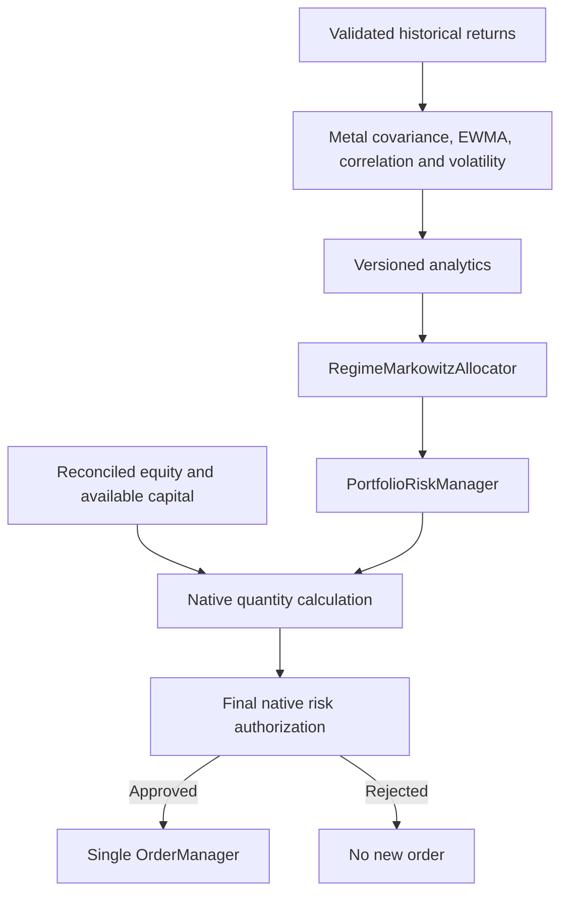

*Advisory analytics do not directly submit orders. Operational sizing integration remains unverified.*

## Implementation roadmap and validation

| Phase | Deliverable | Status |
| --- | --- | --- |
| A | Native Objective-C++ Metal runtime, registry, buffers, caching and hardware parity | **Complete** |
| B | GPU screening → features → compaction → ranking → breadth, consumed by the scanner | **Complete** (offline-verified; real-time SIP session certification pending) |
| SIP | Algo Trader Plus entitlement verification and feed migration | **Complete** |
| C | Full master universe, membership acquisition, adaptive subscriptions, REST budgeting, breadth, dynamic stream promotion | In progress |
| D | Operational covariance, allocation, quantity and replacement integration | Pending |
| E | Remaining kernels with legitimate operational or research consumers | Pending |
| F | Benchmarks, telemetry, fault injection, replay, OOS and paper certification | Pending |

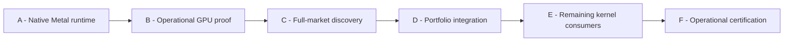

*Planned milestone order; completion requires independent evidence.*

The initial audit reported seven connected kernels out of 45 and no GPU live-screening consumer — a historical audit baseline, not a current measurement. **Current measurement:** 50 compiled kernels (45 baseline + 5 newly authored discovery kernels), 12 host-callable / hardware-executed / CPU-parity-validated, and 5 operationally consumed on the live discovery path. Compiled, hardware-executed, numerically validated, and consumer-connected kernels are tracked separately in `reports/metal_kernel_coverage.json` and `reports/operational_consumer_coverage.json`; a hardware-validated kernel is not counted as operationally consumed until a real live consumer dispatches it.

The unified terminal target is a one-second heartbeat displaying actual discovery coverage, ranked opportunities, strategy decisions, subscriptions, GPU activity, risk, positions, optimizer activity, orders and fills. It must not block critical processing.

The target validation CLI includes `--validate`, `--validate-metal`, `--benchmark-metal`, `--benchmark-discovery`, `--backtest`, `--replay`, `--research`, `--shadow`, and `--status`. Check `trade.py --help` and evidence reports for implemented commands; stubs are not completed functionality.

Maintain `MASTER_IMPLEMENTATION_SPEC.md`, `INTEGRATION.md`, and versioned evidence under `reports/`. Require actual hardware tests, CPU/Metal parity, operational consumer traces, subscription and REST budget checks, protective-path fault tests, chronological out-of-sample evaluation with costs, and paper validation before live readiness claims.

### Failure isolation and recovery (target)

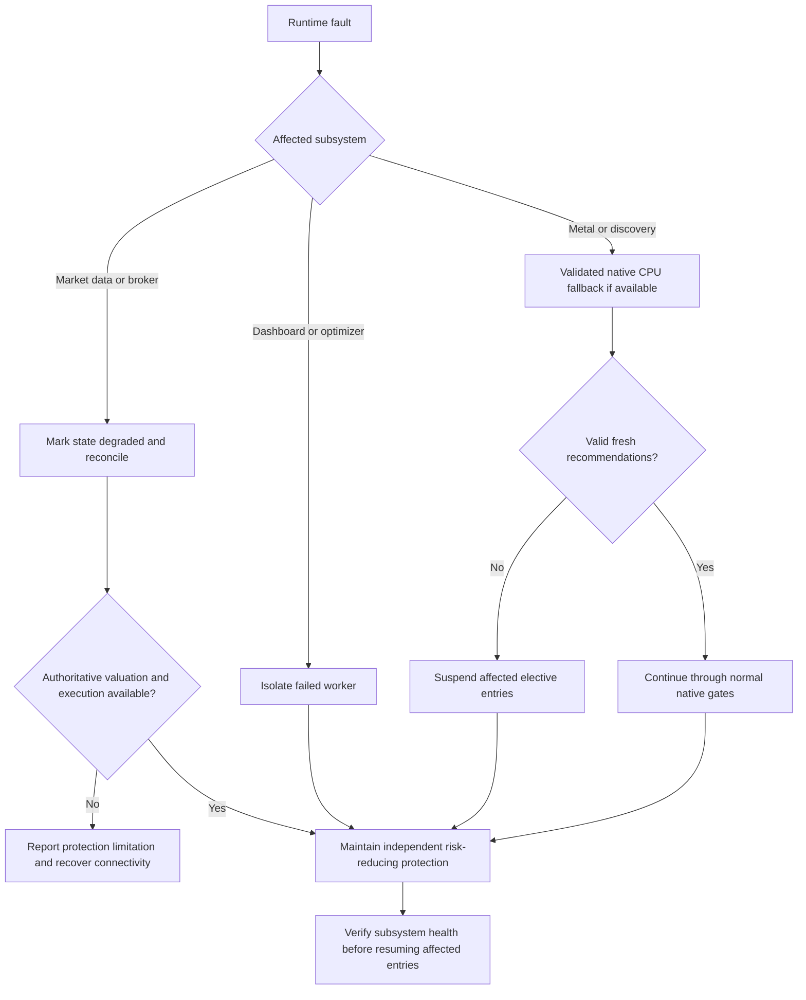

*Failure isolation must preserve protection whenever valid valuation and brokerage connectivity permit. No software path guarantees execution during an outage.*

## Credential notice

`.env.example` must contain only empty credential placeholders. Earlier commits reportedly contained an Alpaca paper key/secret and MongoDB Atlas URI. Rotate any previously exposed credentials, even if paper-only. Removing values from the current tree does not remove them from Git history. Any history rewrite or purge requires a separate authorized operational process.
