# C-Engine

C-Engine is a paper-first, hardware-accelerated trading engine combining Alpaca market data (SIP / Algo Trader Plus, entitlement-verified; IEX retained as a compatibility profile), native C++ market and portfolio state, risk enforcement, an internal limit-order book, HDF5 persistence, strategy evaluation, and an Alpaca execution adapter.

The architecture uses Apple Metal as the primary broad-market numerical compute backend, Objective-C++ to manage GPU resources, C++ for authoritative state and execution-critical decisions, and Python for data acquisition, orchestration, and research.

**Implementation status (verified on Apple M5 Max, Python 3.11.8):**

- Native Objective-C++ Metal runtime, persistent pipeline cache and BufferPool — **complete** (Phase A).
- Native `DiscoveryEngine` (market ingestion, 1m/5m bar ring buffers, symbol id/generation, dirty tracking) — **complete**.
- **8 Metal shader files / 50 compiled kernels**; 12 host-callable, hardware-executed and CPU-parity-validated; **5 operationally consumed on the live discovery path**: `technical_features`, `screen_market`, `compact_entry_candidates`, `rank_candidates`, `market_breadth`.
- Market-wide ranking runs on the GPU (`rank_candidates`), output identical to the prior Python ranker (scores <1e-4, eligibility and order identical).
- **SIP is the verified operational feed** (`tools/sip_verify.py`: REST + WebSocket authenticated against the real account). Historical SIP certification harness (`tools/phase_b_certify.py`) has driven real SIP bars through the full pipeline; **real-time session certification is pending an eligible market session**.
- **Adaptive subscriptions are provider-driven.** The `AdaptiveSubscriptionController` owns the single SIP socket and only treats a channel as subscribed on a genuine Alpaca `subscription` frame (`DESIRED → REQUESTED → PROVIDER_CONFIRMED → WARMING_UP → FRESH → STALE`) — never on send success. Reconnection re-confirms from scratch.
- **Promotion is momentum-gated and staged.** Full master → bars; preliminarily-ranked candidates → trades; only symbols whose momentum is confirmed from **fresh trade observations** → quotes. Protected (positions / pending) are exempt and receive every channel.
- **Full-market bar coverage.** The whole tradable master is registered into the native engine up front and the default bar cap (8192) covers it; the capacity benchmark (`reports/full_market_discovery_benchmark.json`) measured the full-set GPU screen at ~0.09 s. When demand exceeds a cap, elective coverage rotates deterministically (protected never rotated).
- **Continuous historical warm-up.** A persistent, bounded background scheduler warms the whole eligible master universe across prioritized batches (no permanent ceiling), with persistent progress, retry/backoff and restart recovery — never blocking mandatory protection.
- Regression suite: **450+ tests passing** (offline).

- **Operational discovery runs over the master universe.** The discovery source is the deduplicated master-universe membership — **5,994 members** (NASDAQ-listed ∪ S&P 500 ∪ DJIA ∪ 57 curated ETFs), **5,958 tradable** — from genuine, provenance-stamped sources (Alpaca assets; S&P 500 via datahub CSV; DJIA via the Wikipedia components table; `tools/fetch_index_constituents.py`). It feeds the GPU feature_provider (`screen_market` + `technical_features`), GPU `rank_candidates`, the sole `UniversePublisher`, and the exposure-authorization gate in `CandidateRouter`. A traceable path from membership → metadata → authorization → `OrderManager` → mock fill is validated per instrument category (equity / broad / sector / leveraged-bull / inverse / leveraged-inverse).

In progress / not yet certified: operational portfolio-optimizer consumers; the remaining Metal kernels; the regime engine and five-family strategy consolidation; the unified dashboard; and out-of-sample/**real-time SIP session** certification (live provider acks, live observation freshness, and full-market streaming capacity under load). Nodes marked *(target)* below are not certified production capabilities.

## System Architecture

This is the primary, high-level view of C-Engine: market data flows from Alpaca Algo Trader Plus through native compute infrastructure into GPU analytics, trading intelligence, and a risk-and-execution path whose confirmed fills feed authoritative state back to the market layer. The more detailed component diagrams in the sections below remain the authoritative reference for each subsystem.

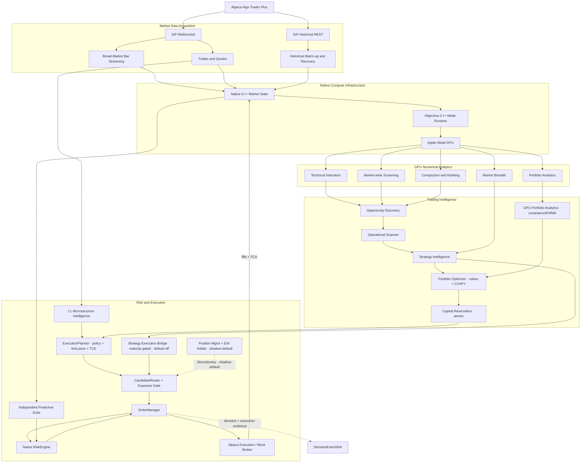

*High-level overview only — illustrating a component here is not a claim that it is production-certified. See the per-subsystem diagrams and the [implementation roadmap](#implementation-roadmap-and-validation) for the verified status of each stage.*

### Layer responsibilities

- **Python** — data acquisition (SIP WebSocket / historical REST), orchestration (`trade.py` supervisor), the operational scanner, strategy/portfolio glue, and research. Python never performs execution-critical risk arithmetic; it marshals events into native state and reads decisions back.
- **C++** — authoritative, execution-critical state and decisions: the native market state / `DiscoveryEngine` (1m/5m bar ring buffers, symbol id/generation, dirty tracking), the `RiskEngine`, the internal order book, and final order authorization. This layer owns correctness; GPU recommendations never bypass it.
- **Objective-C++** — the Metal runtime that manages GPU resources (device, command queues, persistent pipeline cache, `BufferPool`) and bridges C++ state to the GPU without GC pauses.
- **Apple Metal (GPU)** — broad-market numerical analytics only: technical indicators (`technical_features`), market-wide screening (`screen_market`), compaction and ranking (`compact_entry_candidates`, `rank_candidates`), and market breadth (`market_breadth`). Every GPU kernel has a CPU oracle and is advisory — it shapes discovery/ranking and never authorizes an order.

### Implementation status

Capabilities are tracked in four distinct states — **implemented & offline-validated** is not the same as **real-time certified**, and neither implies **economic validation** (out-of-sample edge):

| Capability | Status |
|---|---|
| Native Metal runtime / DiscoveryEngine / GPU kernels (screen, technical_features, rank, breadth, compaction) | ✅ Implemented · offline + hardware + CPU-parity validated |
| Full-scale native registration of the tradable master (~5,958) | ✅ Implemented · offline-validated |
| Master-universe membership (NASDAQ ∪ S&P 500 ∪ DJIA ∪ ETFs), provenance-stamped | ✅ Implemented · offline-validated |
| Adaptive subscription management on one SIP socket | ✅ Implemented · offline-validated |
| **Authoritative provider acknowledgements** (no optimistic ack-on-send) | ✅ Implemented · offline-validated (simulated frames) · ⏳ real-time cert pending |
| **Momentum-gated trade → quote promotion** | ✅ Implemented · offline-validated · ⏳ live momentum cert pending |
| **Continuous historical warm-up** (persistent, bounded, prioritized) | ✅ Implemented · offline-validated · ⏳ full live REST coverage pending |
| Full-market bar coverage (cap 8192) + deterministic rotation | ✅ Implemented · offline benchmark · ⏳ live streaming-capacity cert pending |
| Independent −0.5% protective exits | ✅ Implemented · offline-validated |
| Exposure authorization (geared/inverse gated) | ✅ Implemented · offline-validated |
| Real-time SIP session certification (live acks, live freshness, full-market load) | ⏳ Session-gated (market-hours) |
| Market regime engine (4 levels · 4 independent dimensions · hysteresis) | ✅ Implemented · offline-validated (advisory) |
| Five-family strategy architecture + arbitration + economic ranking | ✅ Implemented · offline-validated (advisory) |
| **Strategy → execution bridge** (maturity-gated; routes through existing authority) | ✅ Implemented · **mock-execution certified** · default-off |
| Isolated mock broker + full-path acceptance (5 families × instrument classes) | ✅ Implemented · offline-validated |
| Decision + execution evidence (full lifecycle, recoverable) | ✅ Implemented · offline-validated |
| **GPU portfolio analytics** (covariance/EWMA operationally consumed) | ✅ Implemented · on-device M5 Max · CPU parity <7e-11 |
| **Native + CVXPY portfolio optimizer** (constrained allocation, risk contributions) | ✅ Implemented · offline-validated |
| **Capital reservation** (atomic, no double-spend) + versioned PortfolioState | ✅ Implemented · offline-validated |
| **Portfolio → execution** (optimizer → reservation → existing authority) | ✅ **mock-execution certified** · default-advisory |
| Intelligent replacement (reconciliation-gated, no forced reinvest) | ✅ Implemented · offline-validated · wired to protective-exit fills |
| **Intelligent execution** (planner · 7 policies · fresh-quote limit prices) | ✅ **mock-execution certified** · default-advisory |
| **L1 microstructure intelligence** (OFI/microprice/Kyle/Amihud/exhaustion/adverse-selection) | ✅ Implemented · observed-vs-inferred · no L2 fabrication |
| **Transaction Cost Analysis** (expected estimator + realized shortfall/slippage) | ✅ Implemented · side-aware |
| Adaptive position mgmt + profit protection + exit arbitration | ✅ Implemented · research/shadow-default |
| GPU Monte-Carlo scenario risk (bound + consumed, parity <2e-7) | ✅ Implemented · on-device M5 Max |
| **Local ML/RL lakehouse** (bronze/silver/gold · Parquet+DuckDB · no cloud) | ✅ Implemented · analytical-only · off critical path |
| Point-in-time feature store + data quality + quarantine | ✅ Implemented · ASOF · leakage-guarded |
| Supervised + offline-RL datasets (censored labels · no fabricated reward) | ✅ Implemented · M5 builds, does not train |
| Historical SIP ingestion (bounded · resumable · no IEX fallback) | ✅ Implemented · 15,480 real bars ingested |
| Model governance metadata (NONE/UNAPPROVED) | ✅ Implemented · M5 records only, no training/promotion |
| **GPU-first learning layer** (MLX/Metal · recommendation-only · off critical path) | ✅ Implemented · MLX on M5 Max · documented CPU fallback |
| MLX supervised + sklearn baselines (baseline-gated promotion) | ✅ Implemented · trains on GPU · edge marginal, not promoted |
| Contextual bandits + constrained offline RL (BC/FQE/CQL/IQL) | ✅ Implemented · research-only · synthetic-fixture-validated |
| Model registry + maturity lifecycle (no auto-live · rollback) | ✅ Implemented · checksummed artifacts · explicit approval |
| GPU inference service + drift + daily cycle (wired to trade.py) | ✅ Implemented · shadow-only · abstaining fallback |
| Dataset eligibility gate + point-in-time certification | ✅ Implemented · honest INSUFFICIENT_DATA for outcome tasks |
| **Autonomous optimizer** (attribution→hypotheses→experiments→eval→memory) | ✅ Implemented · closed loop · shadow-only |
| Multi-timeframe historical replay (genuine 1m, 2020–2026) | ✅ Implemented · 6.76M real bars · purged OOS + reserved holdout |
| Protective-exit research (counterfactual + EXIT-00…15 matrix) | ✅ Implemented · −0.5% premature (~95% 60m recovery); incumbent retained |
| Adaptive exit candidate + native −3% emergency (inactive) | ✅ Implemented · production −0.5% preserved · M7 activates |
| Persistent optimization memory (dedup + TPE-informed selection) | ✅ Implemented · learns from prior experiments |
| Portfolio dashboard panel + decision evidence | ✅ Implemented · non-blocking |
| **M7 engineering + data-integrity certification** (103 modules 0-BLOCKED; 12.2M genuine bars, no look-ahead) | ✅ **CERTIFIED** · reproducible via `python -m cengine.certification` |
| **M7 economic certification** (strategy on sealed holdout, §8 baselines, frozen gates §20) | ❌ **NOT_CERTIFIED** — incumbent has negative net expectancy OOS (0/5); honest reject |
| **M7 capital/cost sensitivity (§21) + stress (§22)** (crash/bear) | ❌ **NOT_CERTIFIED** — negative even at 0 cost; break-even=None; negative across regimes |
| **M7 protective-exit (§25) + recovery reproduction** | ✅ CERTIFIED (contract) · 95.7% above-exit @60m (vs 47.7% above-entry) reproduced |
| **M7 native/Metal (§23) + failure injection (§24)** | ✅ CERTIFIED — risk gate sole authority, GPU/CPU exact parity, faults isolated |
| **M7 readiness classification (§32)** | 🟡 **RESEARCH_VALIDATED** — infrastructure sound; no economic edge; NOT_READY for capital |
| **M7 paper-trading framework** | ❌ **NOT_CERTIFIED** — needs ≥30 genuine forward sessions; no fabrication |
| **M7 staged live-deployment framework** | ⛔ **INACTIVE** — hard-gated behind full chain + external human authorization |
| **Continuous 24/7 runtime** (exchange-state machine · supervisor · launchd) | ✅ Implemented · off-session research · never auto-executes |

Illustrating a component in the diagram is **not** a claim that it is production-certified. Nodes marked *(target)* in the detailed diagrams below are not certified capabilities.

### Independent protective exit path

The protective exit path (`G → T → S → U → V`) is **deliberately separate** from elective opportunity discovery, strategy evaluation, and portfolio optimization. Protective exits are driven directly by authoritative native market state (`G`) into the Independent Protective Exits (`T`) and the `RiskEngine` (`S`) — they do **not** depend on GPU availability, scanner rankings, GPU analytics, or the portfolio optimizer. The strict **−0.5% protective exit invariant** is preserved: a position breaching −0.5% is exited through this independent path regardless of the state of any elective discovery, intelligence, or optimization component. It is never arbitrated, and it uses a **separate single-pending key** from elective strategy orders, so an in-flight elective order never blocks a mandatory close.

### Strategy execution bridge and maturity gating

The five-family regime intelligence is **advisory by default**. The `StrategyExecutionBridge` (`cengine/strategy_execution_bridge.py`) connects authorized recommendations to the **existing** execution authority (`CandidateRouter → exposure gate → native RiskEngine → OrderManager`) — it creates no parallel engine and bypasses no control. Two independent gates must both open before anything routes:

1. **`conditions_passed`** — the strategy/entry/regime conditions themselves passed (strict elective-long contract: `DI+5m > DI−5m AND (price > VWAP OR SMA20 OR BB-mid) AND developing_1m > prev_1m_close`), and
2. **maturity + authorization** — the family's independently-verified maturity permits the run's authorization.

Maturity (`cengine/strategy_maturity.py`) is a dedicated ladder — `RESEARCH` (default) → `SHADOW` → `REPLAY_VALIDATED` → `MOCK_EXECUTION` → `PAPER_ELIGIBLE` → `LIVE_ELIGIBLE` (plus `BLOCKED`/`DISABLED`) — **separate** from the advisory `EXECUTION` eligibility. The authorization context is `NONE` (default — routes nothing), `MOCK`, `PAPER`, or `LIVE`. Critically, **mock execution is isolated**: a `MOCK_EXECUTION` family is routable only under `MOCK` authorization and is *never* paper- or live-routable, so exercising a family through the isolated mock broker grants no production trading eligibility. `BLOCKED` is a hard stop that overrides every authorization. Nothing is auto-promoted; promotion requires regression tests **and** explicit operator assertion.

The bridge is wired into `trade.py` behind `CENGINE_STRATEGY_EXECUTION_AUTH` (default `none`), so the zero-argument engine remains advisory-only. The full production path — all five families → bridge → router → exposure gate → **real native C++ RiskEngine** → `OrderManager` → isolated mock broker → fill reconciliation → decision/execution evidence — is **mock-execution certified** across instrument classes (equity / broad / sector / leveraged-bull / inverse / leveraged-inverse) and scenarios (stale observations, unauthorized exposure, insufficient capital, partial fills, broker rejection, duplicate prevention). Mock certification is **not** economic validation and does **not** confer paper/live eligibility.

### GPU-accelerated portfolio intelligence

The portfolio layer (Milestone 3) sizes capital across qualified opportunities and routes through the **same** execution authority — it adds no parallel engine and reuses the existing CVXPY `RegimeMarkowitzAllocator`, exposure registry, reservation ledger, and native `RiskEngine`. Flow: GPU covariance (`cengine/portfolio_analytics.py` — operationally consuming the `covariance_matrix`/`ewma_covariance_matrix`/`column_means` Metal kernels, CPU-parity <7e-11 on M5 Max) → optimizer (`cengine/portfolio_optimizer.py` — native C++ risk-based allocator in `risk/portfolio_allocator.cpp`, or CVXPY mean-variance when reliable expected returns exist; heuristic scores are **never** converted to fabricated returns) → hard constraints (`cengine/portfolio_constraints.py`, §8, never silently relaxed) → atomic capital reservation (`cengine/capital_reservation.py` — prevents double-spend; unknown outcomes never release capital) → the existing `CandidateRouter` → exposure gate → native `RiskEngine` → `OrderManager`.

Authoritative, versioned `PortfolioState` (`cengine/portfolio_state.py`) is broker-reconciled and **fails closed** when stale/unreconciled; submitted sells are never treated as completed liquidations. Intelligent replacement (`cengine/portfolio_replacement.py`) evaluates new opportunities **only after** a mandatory exit has fully filled and reconciled, holds cash when nothing qualifies, and blocks immediate re-entry into a just-stopped symbol. The path is wired into `trade.py` behind `CENGINE_PORTFOLIO_EXECUTION_AUTH` (default `none` → advisory: it emits portfolio state + decision evidence and routes nothing). The independent **−0.5% protective exit is never deferred, suppressed, or vetoed** by the optimizer (re-verified under optimizer/GPU failure). The GPU covariance kernel is parity-validated but, being correctness-first (one-thread-per-cell), is not yet faster than numpy BLAS at tested sizes, so covariance runs on CPU below the (unreached) measured crossover; the GPU monte-carlo/reductions kernels remain compiled-but-unbound (a tracked future increment). See [docs/portfolio_intelligence.md](docs/portfolio_intelligence.md). **Mock-certified; not economically validated, paper-, or live-certified.**

### Intelligent execution, position management, and L1 microstructure

Milestone 4 turns authorized recommendations into cost-, liquidity-, and risk-aware broker orders — through the **same** OrderManager / native RiskEngine / CandidateRouter (no parallel execution authority). A **Level-1 Microstructure Intelligence Engine** (`cengine/microstructure.py`, reusing `order_flow_engine`) derives L1 features from genuine SIP top-of-book quotes + trades — quote imbalance, order-flow imbalance, microprice displacement, CVD, trade-arrival intensity, trade-size distribution, Kyle's lambda, Amihud illiquidity, seller/buyer exhaustion, adverse selection — with **observed quantities kept separate from inferred ones** and strict data-integrity rules (crossed/locked/stale flagged; unknowns stay `None`; **no fabricated Level-2 depth, hidden orders, queue position, or aggressor side**). The `ExecutionPlanner` (`cengine/execution_planner.py`) selects one of seven broker-compatible policies (passive / marketable / immediate / bounded-reprice / time-sliced / urgent-risk-reduction / mandatory-protective-exit) by urgency, spread, liquidity, expected cost, and momentum, and computes a tick-rounded limit price from fresh quotes bounded by a maximum elective slippage (never a fabricated price). A `TransactionCostEstimator` gives explicitly-qualified expected cost (spread crossing + Kyle's-lambda/participation impact + fees, with a conservative fallback), and `analyze_execution` produces side-aware realized **Transaction Cost Analysis** (implementation shortfall, slippage, adverse movement, latencies). `AdaptivePositionManager` + `ExitArbiter` (`cengine/position_management.py`) add discretionary profit-protection policies (ATR-trailing, break-even, momentum-deterioration, time-based, technical-invalidation) that are **research/shadow by default** and gated by maturity/authorization; the **exit-priority hierarchy always ranks the mandatory −0.5% protective exit above every discretionary decision**, re-verified under planner/microstructure/optimizer/GPU failure. The GPU **Monte-Carlo** scenario kernels (`gme::correlate_normals` + `gme::portfolio_scenario_pnl`) are now bound and operationally consumed for portfolio VaR/ES (host-seeded, CPU-parity <2e-7). A **tick-scale reconciliation** unified the whole system on `DEFAULT_PRICE_SCALE` (10,000), fixing a pre-existing venue cents-vs-market-data mismatch that limit prices would otherwise have mis-serialized. Wired into `trade.py` behind `CENGINE_PORTFOLIO_EXECUTION_AUTH` (default advisory — emits plans + microstructure + TCA evidence, routes nothing). See [docs/intelligent_execution.md](docs/intelligent_execution.md). **Mock-certified; not economically validated, paper-, or live-certified.**

### Local adaptive ML/RL data platform

Milestone 5 adds an entirely **local** lakehouse (`cengine/lakehouse/`) — Parquet + PyArrow + DuckDB, **no cloud / no MongoDB Atlas / no Supabase** — that continuously accumulates market observations, engine decisions, execution experience, and realized outcomes so a **future** milestone can train supervised / contextual-bandit / offline-RL models on reproducible, point-in-time-correct datasets. It is **analytical only**: the authoritative financial journal (`cengine/journal.py`) stays separate (Parquet is never the order-management DB), and capture is nonblocking, bounded, and loss-accounted so it **can never block or delay the order path, native `RiskEngine`, broker reconciliation, or the mandatory −0.5% protective exit**. A three-layer medallion lakehouse — **bronze** (immutable raw source/engine/execution events wrapped in a canonical versioned `EventEnvelope` that distinguishes *market-event time* from *availability time*), **silver** (DuckDB-typed, deduplicated-by-`event_id`, incremental), **gold** (FIFO position outcomes, supervised datasets with **censored labels / no fabricated labels**, and offline-RL transitions with **NULL action-probability, closed-only reward, mandatory-exits-as-environment-dynamics, no double-counted costs**) — is written with atomic (`tmp`+`fsync`+`os.replace`), content-hash-idempotent, manifested, recoverable Parquet publication. A `PointInTimeFeatureStore` serves leakage-free `ASOF` feature snapshots; a data-quality framework (pk-uniqueness, required/point-in-time timestamps, `DEFAULT_PRICE_SCALE`=10,000 scale consistency, referential integrity) quarantines bad records instead of discarding them; daily attribution carries a loss-source taxonomy with an explicit causal-uncertainty stance. Historical ingestion reuses the existing Alpaca **SIP** REST fetcher (no new websocket, **no silent SIP→IEX fallback**), is bounded, tiered, and resumable, and records the as-of universe snapshot (no survivorship bias). Operable via `python -m cengine.lakehouse <pipeline|historical|storage|compact|quality|warehouse>` and wired live into `trade.py` behind `CENGINE_LAKEHOUSE` (detached drain task + `LAKEHOUSE` dashboard panel). Model governance records dataset/model metadata only (`promotion_status=NONE` / `approval_status=UNAPPROVED`) — **M5 does not train or promote any model**. Evidence: a genuine bounded SIP run ingested 15,480 AAPL/MSFT/SPY 5-min bars (0 point-in-time violations, fully resumable); 23 dedicated tests (744 total) green. See [docs/lakehouse/](docs/lakehouse/README.md).

### GPU-first adaptive ML / constrained offline-RL learning

Milestone 6 adds a **GPU-first** (Apple **Metal** via **MLX**), entirely **local** learning layer (`cengine/learning/`) that learns from the lakehouse's accumulated market data, engine decisions and realized outcomes to **improve ranking and eligible-policy selection only** — **no cloud, no CUDA, no external model APIs**. Everything is **recommendation-only**: models submit no orders, open no broker connection, never bypass the native financial authority, and the strict elective-entry contract + the mandatory −0.5% protective exit stay fully independent of MLX/Metal/GPU, model training/inference, the registry and the lakehouse. A GPU-first `DevicePolicy` picks the Metal GPU for large workloads with a **documented, measurable CPU fallback** (never a silent GPU claim). The layer spans: hardware capability inspection; a **data-sufficiency eligibility gate** + point-in-time dataset certification (chronological purged/embargoed splits, leakage verification); look-ahead-free feature engineering; **MLX neural models** (regression / classification / quantile-for-uncertainty) with independent sklearn/constant **baselines** a model must beat before promotion; **contextual bandits** (LinUCB + neural) over *authorized* actions (no IPS when behavior probabilities are unknown — never fabricated); **constrained offline RL** (BC/FQE/CQL/IQL) with mandatory exits treated as environment dynamics; calibration + dependence-aware economic evaluation + OPE; a deterministic **replay environment**; an operational **model registry** (checksummed artifacts, a UNTRAINED→…→RETIRED maturity lifecycle with **no auto-promotion to live** and always-legal rollback); a **GPU inference service** (batched, abstaining, safe fallback) wired into `trade.py` as shadow inference; drift monitoring; and a session-aware **daily adaptive cycle**. Operable via `python -m cengine.learning <hardware|profile-datasets|train-supervised|replay|registry|promote|rollback|daily-cycle|benchmark|…>`. **Honest data reality**: only forward-return prediction has enough genuine data (262,586 real SIP bars) to train + evaluate on the Metal GPU, and its out-of-sample edge is **marginal** (rank-IC ~0.01–0.02 — it did **not** beat the sklearn baseline, so it stayed `TRAINED`, never shadow-promoted); every outcome/execution/bandit/RL task is `INSUFFICIENT_DATA` and remains research-only, its infrastructure validated on explicitly-labeled synthetic fixtures. **No positive economic expectancy is claimed.** Evidence: 124 dedicated tests (868 total) green; 28 measured reports; CPU/GPU parity validated. See [docs/learning/](docs/learning/architecture.md). **M6 trains no live model and enables no automatic live promotion — Milestone 7 independently certifies economic performance, paper and controlled live deployment.**

### Autonomous performance-driven optimization (closed loop)

Milestone 6B turns the learning layer into a **governed, closed-loop optimizer** (`cengine/optimization/`) that measures actual trading-system performance, diagnoses economically-significant weaknesses, generates + prioritizes improvement hypotheses, plans + runs **bounded, memory-informed experiments** (random / grid / successive-halving / TPE) on genuine data, evaluates candidates on **independent transaction-cost-adjusted economics** (mandatory risk gates + a baseline hierarchy), remembers every experiment (persistent **optimization memory** that de-dups and informs later cycles), and promotes qualified candidates into **shadow only**. It optimizes the *learning process itself*, not just model weights. The **primary research environment is multi-timeframe historical replay** over **~6.76M genuine 1-minute bars** (AAPL/SPY/QQQ/MSFT/NVDA, 2020–2026; 1m canonical, 5m strategic), with conservative fills (stop-before-target, gap-through-at-open), chronological **purged/embargoed** train/validation splits, and an **untouched certification holdout** the optimizer never accesses. The **protective-exit research** is the empirical core: counterfactual analysis of genuine −0.5% exits shows they are **frequently premature** (cross-sectional **~95% recovery above the exit price within 60 min** across five symbols), and the EXIT-00…15 matrix shows wider stops out-score the −0.5% baseline *in exit-isolation* — yet the autonomous **out-of-sample** cycle **rejected** every candidate (none beat the incumbent OOS under risk gates), so the production **−0.5% exit is retained**. A candidate adaptive policy (−0.5% reassessment → HOLD/REDUCE/EXIT/REPLACE, volatility-adjusted stops + risk-normalized sizing) and an **inactive** native-C++ −3% emergency stop are implemented but never activated. **Invariants:** the production −0.5% exit is preserved untouched, the native C++ RiskEngine remains the sole financial authority, and there is **no live activation, no risk expansion, no hard-stop tuning, no live exploration, and no self-code-modification**; inputs reaching SQL are validated. Operable via `python -m cengine.optimization <attribute|data-sufficiency|counterfactual|exit-matrix|optimize|memory|validation-windows|emergency-check>`. **Honest result:** engineering is complete and the loop runs repeatedly unattended, but **no economic improvement is demonstrated** — all candidates were rejected and the incumbent retained; outcome/execution/bandit/RL tasks remain `INSUFFICIENT_DATA`. Evidence: 26 dedicated tests (894 total) green; 8 measured reports (incl. a §36 engineering report answering all 15 research questions). See [docs/optimization/](docs/optimization/README.md). **Milestone 7 owns independent economic certification, paper trading, and controlled live deployment.**

### Comprehensive certification + continuous 24/7 operation (Milestone 7)

Milestone 7 is an **independent certification** layer (`cengine/certification/`) over everything above — it **rebuilds nothing** and grants **no new financial authority**; it measures what is built, against **frozen gates**, on a **sealed holdout** of genuine data, and renders honest verdicts (including `INSUFFICIENT_DATA` and `NOT_CERTIFIED`). It certifies: the **engineering audit** (M7A — 103 modules, 0 BLOCKED, status derived mechanically from import/test/runtime-consumption signals), **historical data integrity** (M7B — 12.2M genuine SIP bars: 0 duplicates, strictly monotonic, no availability look-ahead, 100% NYSE trading-day coverage, 1m→5m reconciliation 99.99%), the **mandatory −0.5% protective exit** (§25 — long/short-symmetric, fires at `ret ≤ −0.5%`, independent of ML/GPU/scanner; the native −3% emergency candidate is inactive and its clamp can never widen risk), the **entry contract** (§26 — deterministic + look-ahead-free), **native/Metal** (§23 — the C++ `RiskEngine` is the sole financial authority; GPU EMA/APO reproduce the CPU oracle exactly; documented CPU fallback), and **failure injection** (§24 — learning/GPU/data/broker faults are isolated and never cascade into protection or execution). The **economic** certification is deliberately unforgiving and **falsification-first**: on the **sealed holdout** the production incumbent (−0.5% exit + momentum entry) has **negative net expectancy for every canonical symbol** (expectancy ≈ −0.001/trade, PF ≈ 0.6, Sharpe ≈ −0.2), **negative even at zero cost** (break-even cost = *None*, §21), and **negative across the 2020 crash and 2022 bear** stress windows (§22) — it fails to beat buy-and-hold and, on several symbols, even a random-entry placebo. The **recovery reproduction** independently confirms the ~95% figure (**95.7%** of −0.5% exits recover above the exit level within 60 min, block-bootstrap CI [95.4%, 95.9%], 20,572 events) **but** only **47.7%** recover above the *entry* price — so a high above-exit rate is **not** evidence the exit is economically wrong. The learning layer is engineering-sound and recommendation-only, but strategy/bandit/RL learning is `INSUFFICIENT_DATA` (no realized-outcome layers). **Readiness (§32): `RESEARCH_VALIDATED`** — infrastructure sound, **no certified economic edge**, **NOT_READY for capital**; the **paper** framework is `NOT_CERTIFIED` (needs ≥30 genuine forward sessions; no fabrication) and the **staged live** framework is **hard-INACTIVE** (SHADOW→PILOT_TINY→SCALED, gated behind the full chain + an external human authorization token the software cannot mint). The **continuous 24/7 runtime** (`cengine/runtime/`) keeps C-Engine running across sessions via an exchange-calendar operating-state machine + a supervisor over the reused workers (P0–P9 GPU priority ladder — P0 protection never gated), running off-session optimization (shadow-only), acquisition (dry-run by default), and continuous governance, with single-instance locking, atomic checkpoints, DEGRADED-on-regression + auto-recover, and a macOS **launchd** LaunchAgent — **continuous operation is not continuous execution** (elective orders stay confined to `REGULAR_SESSION` behind an authorized runner absent by default). Operable via `python -m cengine.certification <audit|data|native|failure|protective-exit|entry|strategy|sensitivity|stress|portfolio|execution|learning|holdout|full|report>` and `python -m cengine.runtime <status|once|run>`. **Honest conclusion: REJECT the current strategy as a deployable edge; ACCEPT the platform as a sound research + execution substrate.** All economic results are historical-replay simulations on genuine bars — **not** live performance and **not** a profitability claim; **no live orders were placed.** Evidence: 64 dedicated tests (968 total) green; the §36 final report + per-domain evidence under [`reports/`](reports/). See [docs/certification/](docs/certification/README.md) and [docs/operations/](docs/operations/continuous_runtime.md).

## Runtime data-flow overview

This complementary view centers on the `trade.py` supervisor and the runtime event flow; see [System Architecture](#system-architecture) above for the primary layered view.

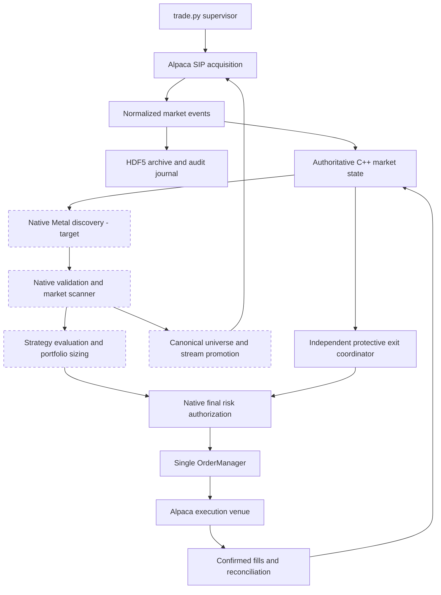

*Architecture overview: dashed nodes identify stages affected by the planned integration; they do not certify operational GPU execution.*

The engine does not invent prices, quantities, fills, or account state. Missing authoritative quote or account state blocks affected elective orders. GPU recommendations never bypass native risk authorization. The protective exit path must not depend on GPU availability, scanner rankings, or portfolio optimization.

## Repository and startup

Local repository: `/Users/blkpvnthr/C-engine`.

The sole operational entry point is `trade.py`:

```bash
cd /Users/blkpvnthr/C-engine
source .venv/bin/activate
python3 trade.py
```

If a shell alias selects a different interpreter, use `./.venv/bin/python trade.py`. No separate scanner, GPU worker, or dashboard startup command is intended. The Python package `cengine`, native module `_cengine_native`, Metal library `cengine.metallib`, and `CENGINE_` configuration prefix retain their existing names.

### Startup and runtime supervision (target)

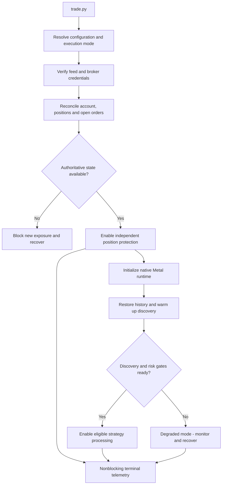

*Target startup sequence. Position protection must not wait for unrelated discovery warm-up.*

## Market-data feed

**Alpaca SIP (Algo Trader Plus) is the verified operational feed** (`wss://stream.data.alpaca.markets/v2/sip`), selected via `CENGINE_ALPACA_FEED=sip`. Entitlement is confirmed from actual account responses — `tools/sip_verify.py` authenticates SIP historical REST, SIP latest quote/trade, and the SIP WebSocket (evidence in `reports/alpaca_subscription_validation.json`); entitlement is derived from responses, never assumed from payment. The authoritative resolver in `market_data/feed.py` determines the feed, endpoint, and archive provenance. An omitted feed resolves to IEX (never a silent SIP upgrade); an unentitled SIP selection is surfaced, never silently downgraded. Startup verifies the actual endpoint against configuration; mismatches fail closed.

IEX remains an explicit compatibility profile (`CENGINE_ALPACA_FEED=iex`) with its applicable restrictions (including the 30-symbol streaming cap). Daily HDF5 files record provider and feed (for example, `alpaca-sip` and `sip`). Replay rejects incompatible feed combinations through `assert_feed_consistency`; SIP and IEX numerical histories are never mixed without an explicitly validated methodology.

### IEX limitations

IEX is a single exchange, not consolidated SIP coverage. Its quotes are exchange top-of-book, not NBBO; quote sizes and trade volume are exchange-specific. Inferred order flow is not consolidated market pressure. Neither IEX nor Alpaca SIP top-of-book data supplies full exchange-by-exchange Level-II depth. The engine must never fabricate depth. Signals requiring consolidated coverage are ineligible on IEX, and SIP-calibrated thresholds require revalidation.

### Discovery universe (target architecture)

The deduplicated master universe includes supported NASDAQ-listed equities, S&P 500 constituents, DJIA constituents, and configured instruments. Membership flags and versions preserve overlapping group identities. **Full master-universe membership acquisition is a target** (current discovery operates over the configured research universe).

Streaming capacity is feed-aware. Under Basic IEX a single WebSocket enforces a maximum of 30 unique symbols. Under SIP the provider imposes no documented symbol cap; the engine currently applies a **flat 250-symbol application safety limit** (`MARKET_SCAN_MAX_SUBSCRIPTIONS`), which is an internal capacity setting, not a provider restriction. The **target** is an adaptive four-tier subscription manager (Tier 1 full-universe bars → Tier 2 ranked trades → Tier 3 actionable quotes → Tier 4 protected instruments) with independent per-channel capacity, promotion/demotion hysteresis, and server-confirmed acknowledgement tracking. Held positions, pending orders and required references always receive priority.

REST sampling is not continuous streaming. Missing, stale, incomplete, and warming-up observations remain explicitly classified. Coverage and sweep latency must be measured against the shared request budget. No invented observations or feed substitution is permitted on the operational path.

### Market discovery and streaming allocation

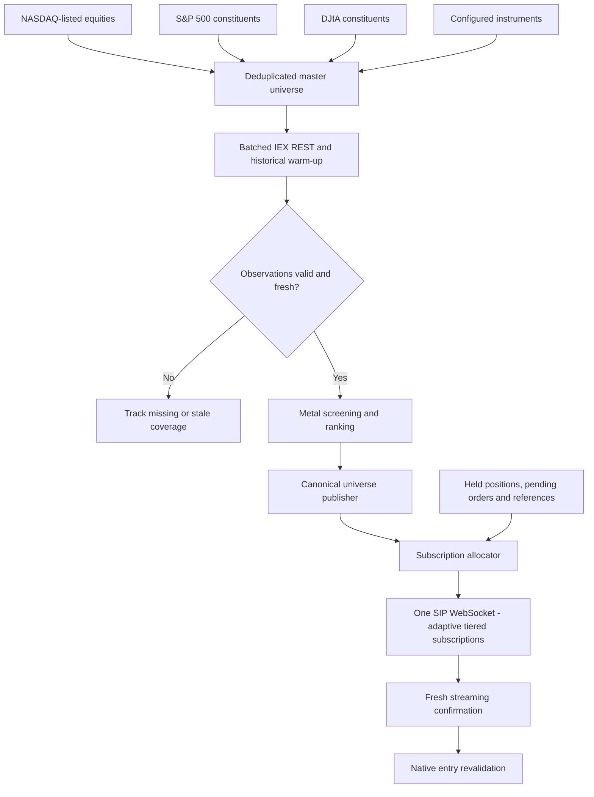

*Target discovery architecture. REST coverage is distinct from streaming coverage.*

### Feed configuration

SIP is the verified operational feed and is selected explicitly; feed selection is independent of paper versus live execution.

```text
CENGINE_ALPACA_FEED=sip
```

Alternatively:

```text
CENGINE_ALPACA_URL=wss://stream.data.alpaca.markets/v2/sip
```

The URL scheme, host and path are validated. Archive provenance is `alpaca-sip` under SIP; `CENGINE_ARCHIVE_PROVIDER_LABEL` is an explicit label override, not a change of feed. Set `CENGINE_ALPACA_FEED=iex` to run the Basic compatibility profile. Authentication failures never trigger automatic fallback.

## Native macOS build

Requirements: Python 3.11+, CMake 3.24+, a C++20 compiler, full Xcode and the Metal Toolchain for source shader compilation. Apple Silicon is the target GPU platform. The previously successful build used Python 3.11.8 and pybind11 3.1.0.

```bash
cd /Users/blkpvnthr/C-engine
# Create .venv only if it does not already exist or needs rebuilding.
python3 -m venv .venv
./.venv/bin/python -m pip install -e '.[dev]'
./.venv/bin/python -m pip install pybind11
```

Install Metal tooling if missing:

```bash
xcodebuild -downloadComponent MetalToolchain
xcrun --find metal
xcrun --find metallib
xcrun metal --version
```

Build the native extension and shaders from source:

```bash
cmake --fresh -S . -B build-metal \
  -DCENGINE_COMPILE_METAL=ON \
  -DPython_EXECUTABLE="$PWD/.venv/bin/python" \
  -Dpybind11_DIR="$(./.venv/bin/python -m pybind11 --cmakedir)" \
  && cmake --build build-metal -j "$(sysctl -n hw.logicalcpu)"
```

Use the same interpreter for dependencies, compilation, tests, and startup. After moving the repository, reconfigure CMake and verify virtual environment paths. Verify the runtime loads the intended native extension and newly compiled metallib, not stale artifacts.

```bash
./.venv/bin/python -m pytest -q
./.venv/bin/python -m ruff check .
```

A CPU-only diagnostic build remains available:

```bash
cmake -S . -B build -DCENGINE_BUILD_PYTHON=OFF -DCENGINE_COMPILE_METAL=OFF
cmake --build build -j
```

This is not the primary discovery architecture. The existing PyObjC Metal runtime is a transitional compatibility path; the planned native Objective-C++ host provides persistent device/queue ownership, cached pipelines, reusable buffers, asynchronous submission, completion handlers, versioned results, and validated native CPU fallback. Hardware execution and operational consumer integration require separate evidence from compilation.

### Native Metal compute pipeline (target)

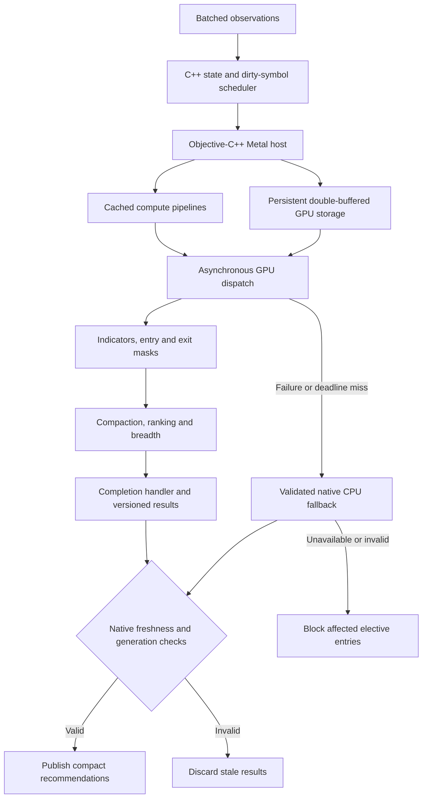

*The runtime, pipeline cache, buffers, and five of these kernels (`technical_features`, `screen_market`, `compact_entry_candidates`, `rank_candidates`, `market_breadth`) are operational and CPU-parity-validated on device; full-market scaling and the remaining kernels are target. Source compilation alone does not establish hardware execution or consumer integration — these are tracked as separate gates.*

### Build and kernel evidence lifecycle

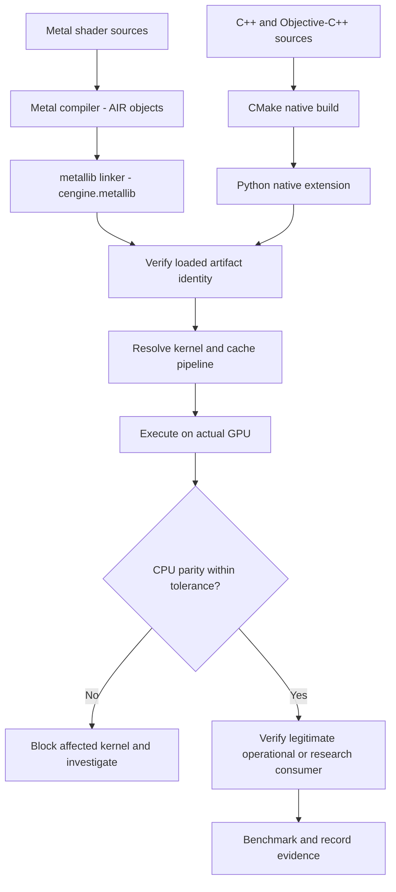

*Compilation, hardware execution, numerical parity and consumer integration are separate verification gates.*

## Strategy and risk architecture

The intended shared elective-entry gate requires valid market observations, completed five-minute DMI features with DI+ > DI−, price above at least one valid reference (session VWAP, five-minute SMA20, or Bollinger middle), and the latest valid developing one-minute price strictly above the immediately preceding completed one-minute close. Fresh streaming confirmation and native revalidation are required before order authorization.

The mandatory protective exit threshold is strictly `unrealized_return < -0.005`. Protection evaluates valid market updates with a five-second backstop and remains independent of discovery and GPU processing. It requests a full exit through the centralized execution path; it does not guarantee the realized loss will be limited to 0.5%.

The planned replacement path waits for confirmed exit fills and reconciled capital, then considers current qualified opportunities with seller exhaustion, positive momentum, liquidity, estimated net benefit, and portfolio/risk compatibility. Cash is retained if no replacement qualifies.

### Elective entry decision (target)

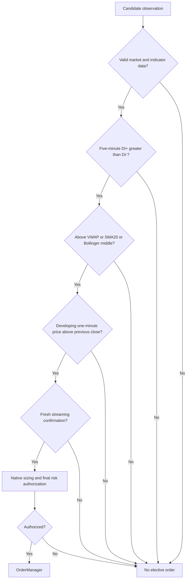

### Protective exit and replacement

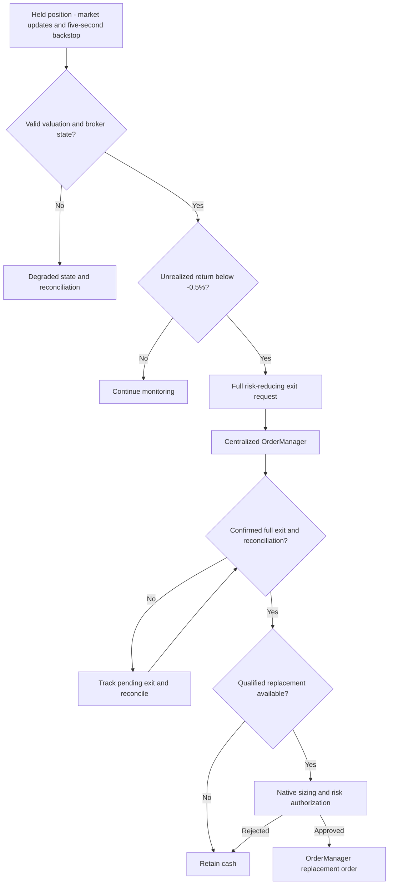

*Protection is independent of Metal and replacement discovery. The replacement branch is a target capability; the threshold is not a guaranteed realized-loss limit.*

### Opportunity lifecycle (target)

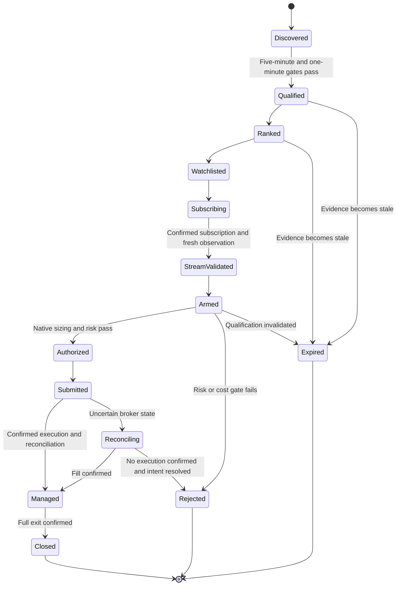

*Conceptual opportunity lifecycle; broker order state and partial fills must be tracked separately.*

## Paper configuration and reconciliation

Copy `.env.example` to `.env` and supply credentials locally. Keep `.env` ignored and never log credentials. Paper is the default execution mode (`https://paper-api.alpaca.markets`). Tests must never submit real orders.

The engine composition uses explicit `QuantityPolicy`, `ExitQuantityProvider`, and `ExecutionPolicy` contracts. `ENGINE_NATIVE_ADAPTER_MODULE=native_adapters` selects the native adapters in the existing configuration. The unified entry point owns application composition; do not restore the retired `run.py` or `start_engine.py` launch paths.

Existing operational configuration concepts include:

```text
--journal-path ./state/audit.jsonl
--max-feed-age-ns <provider-appropriate limit>
--max-bar-gap-ns <configured bar interval tolerance>
--reconciliation-interval-seconds <broker polling interval>
--session-timezone America/New_York
--session-open-minute 570
--session-close-minute 960
--session-weekdays 0,1,2,3,4
```

Verify supported options with `trade.py --help`; these are inherited configuration settings, not a guarantee that every legacy CLI flag is still exposed.

Startup reconciles Alpaca account, positions, and open orders. Unknown orders, inconsistent venue identifiers, stale snapshots, reversed cumulative fills, and reconciliation errors trigger fail-closed handling. Risk-reducing protection remains available where authoritative state and connectivity permit it.

Checksummed `portfolio_metrics` journal records include cash, equity, buying power, realized P/L, gross/net exposure, reserved notional, order/position counts, and high-water-mark drawdown.

### Order execution and fill reconciliation

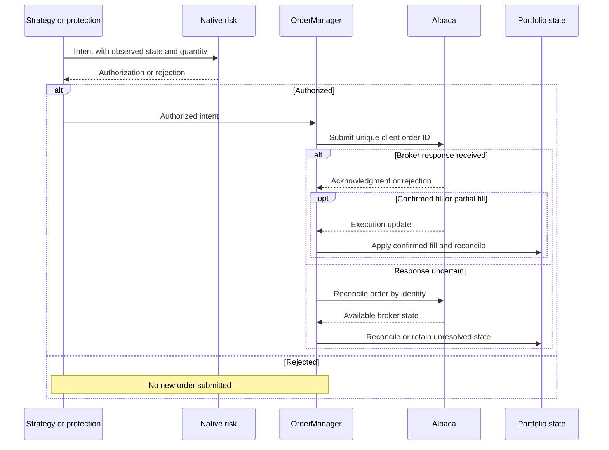

*Logical execution contract, not a claim about exact current function call ordering. Unknown orders must not be blindly resubmitted.*

## Persistence and replay

HDF5 archives preserve normalized event provenance. `cengine.replay.replay()` republishes normalized events in stable input order without synthesizing time or sleeping and rejects non-monotonic symbol sequences. Full execution replay, historical backtesting and out-of-sample certification remain development milestones unless supported by current test evidence.

### Daily NoSQL journal

Install MongoDB support:

```bash
./.venv/bin/python -m pip install -e '.[nosql]'
```

Configure locally:

```text
CENGINE_MONGODB_URI=mongodb://127.0.0.1:27017/?replicaSet=rs0
CENGINE_MONGODB_DATABASE=cengine
```

Supply the configured MongoDB timeout (`--mongodb-timeout-ms` where exposed). Verified records are persisted in timezone-aware daily collections such as `journal_20260921`, with a unique global sequence index and timestamp/kind index. Replay is idempotent; conflicting checksums fail closed. The local JSONL journal remains the write-ahead and recovery source and is backfilled at startup. Production deployments should use authenticated replica sets, encrypted transport, backups, and majority write concern.

### Event persistence and recovery

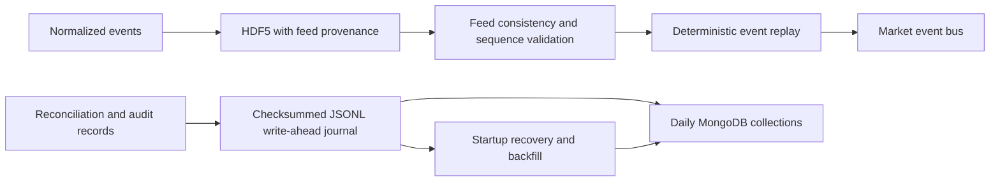

*Normalized event replay is distinct from full historical execution simulation.*

## Live execution gate

Paper and live execution are independent of market-data feed selection. Live construction requires the live endpoint and all three exact confirmations:

```text
ALPACA_TRADING_BASE_URL=https://api.alpaca.markets
CENGINE_ENABLE_LIVE=YES_I_ACCEPT_LIVE_TRADING_RISK
CENGINE_LIVE_CONFIRMATION=LIVE_ORDERS_MAY_LOSE_MONEY
CENGINE_LIVE_RECONCILIATION_CERTIFIED=PAPER_REPLAY_AND_BROKER_STATE_AGREE
```

Keep these values out of shell profiles and deployment defaults. Configuration gates do not constitute proof of strategy profitability or live readiness. No real live orders may be submitted for integration testing.

## Portfolio analytics and research

```bash
./.venv/bin/python -m pip install -e '.[research]'
```

`RegimeMarkowitzAllocator` uses CVXPY for constrained regime-weighted mean/variance advice. `NextSessionTideModel` supports explicit KNN/SVM training, and `PortfolioRiskManager` validates weights and predicted volatility. These components are currently described as advisory; operational integration must be demonstrated before claiming that optimizer output controls sizing.

The target pathway connects genuine historical returns to Metal covariance, EWMA covariance, correlation, and volatility analytics, then to versioned allocation recommendations and native quantity/risk authorization using reconciled equity. Research never writes broker orders directly. Monte Carlo, statistical arbitrage and reductions require legitimate consumers; depth-only kernels remain research-restricted without suitable data.

### Portfolio analytics integration (target)

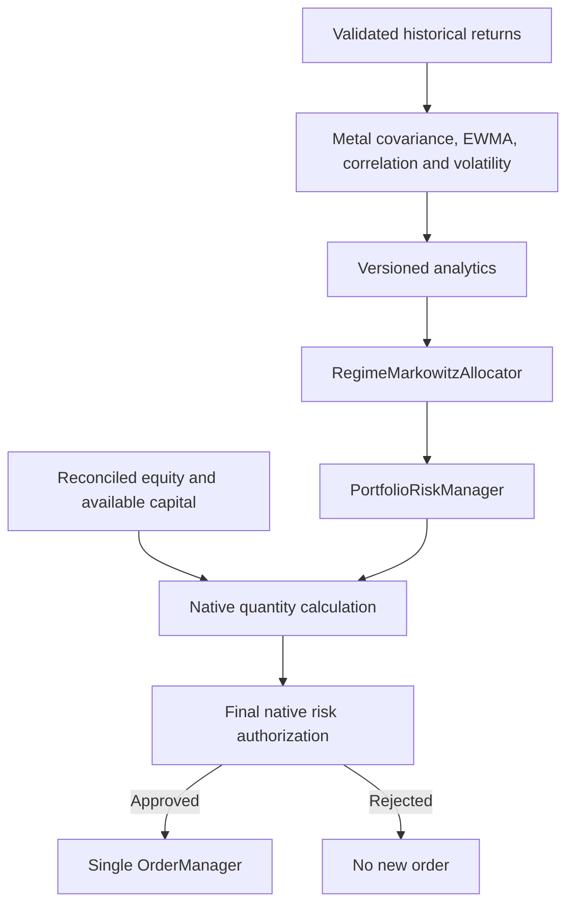

*Advisory analytics do not directly submit orders. Operational sizing integration remains unverified.*

## Implementation roadmap and validation

| Phase | Deliverable | Status |
| --- | --- | --- |
| A | Native Objective-C++ Metal runtime, registry, buffers, caching and hardware parity | **Complete** |
| B | GPU screening → features → compaction → ranking → breadth, consumed by the scanner | **Complete** (offline-verified; real-time SIP session certification pending) |
| SIP | Algo Trader Plus entitlement verification and feed migration | **Complete** |
| C | Full master universe, membership acquisition, adaptive subscriptions, REST budgeting, breadth, dynamic stream promotion | In progress |
| D | Operational covariance, allocation, quantity and replacement integration | Pending |
| E | Remaining kernels with legitimate operational or research consumers | Pending |
| F | Benchmarks, telemetry, fault injection, replay, OOS and paper certification | Pending |

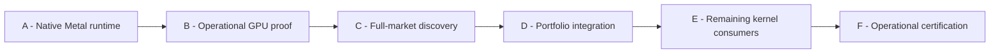

*Planned milestone order; completion requires independent evidence.*

The initial audit reported seven connected kernels out of 45 and no GPU live-screening consumer — a historical audit baseline, not a current measurement. **Current measurement:** 50 compiled kernels (45 baseline + 5 newly authored discovery kernels), 12 host-callable / hardware-executed / CPU-parity-validated, and 5 operationally consumed on the live discovery path. Compiled, hardware-executed, numerically validated, and consumer-connected kernels are tracked separately in `reports/metal_kernel_coverage.json` and `reports/operational_consumer_coverage.json`; a hardware-validated kernel is not counted as operationally consumed until a real live consumer dispatches it.

The unified terminal target is a one-second heartbeat displaying actual discovery coverage, ranked opportunities, strategy decisions, subscriptions, GPU activity, risk, positions, optimizer activity, orders and fills. It must not block critical processing.

The target validation CLI includes `--validate`, `--validate-metal`, `--benchmark-metal`, `--benchmark-discovery`, `--backtest`, `--replay`, `--research`, `--shadow`, and `--status`. Check `trade.py --help` and evidence reports for implemented commands; stubs are not completed functionality.

Maintain `MASTER_IMPLEMENTATION_SPEC.md`, `INTEGRATION.md`, and versioned evidence under `reports/`. Require actual hardware tests, CPU/Metal parity, operational consumer traces, subscription and REST budget checks, protective-path fault tests, chronological out-of-sample evaluation with costs, and paper validation before live readiness claims.

### Failure isolation and recovery (target)

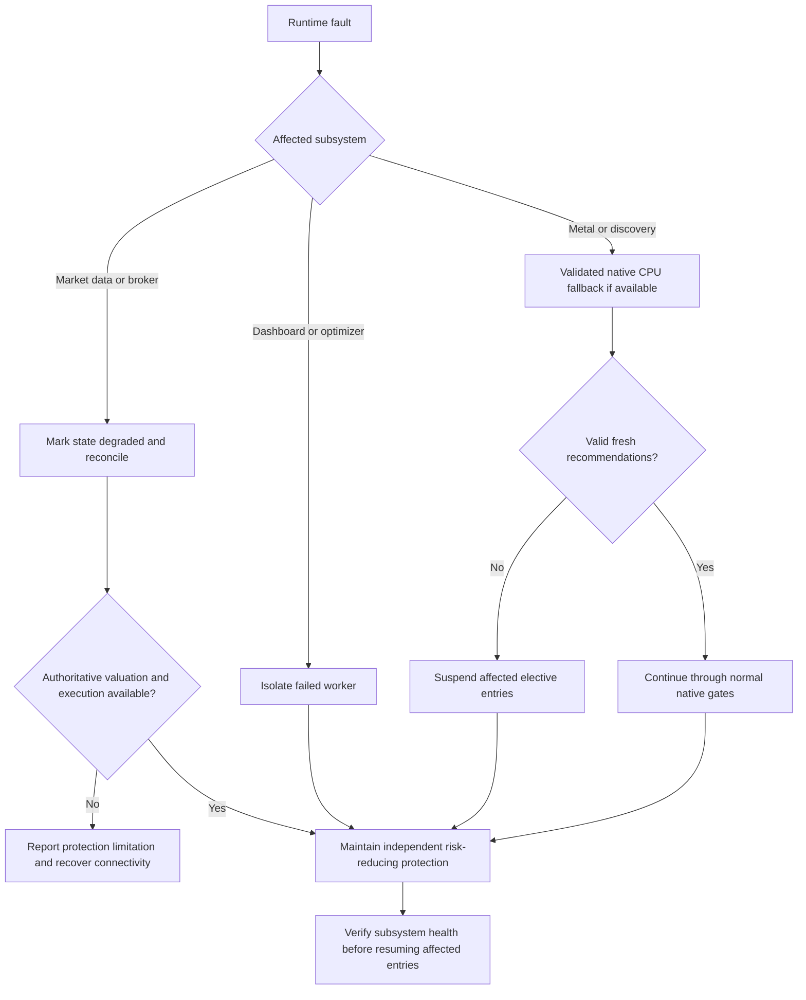

*Failure isolation must preserve protection whenever valid valuation and brokerage connectivity permit. No software path guarantees execution during an outage.*
