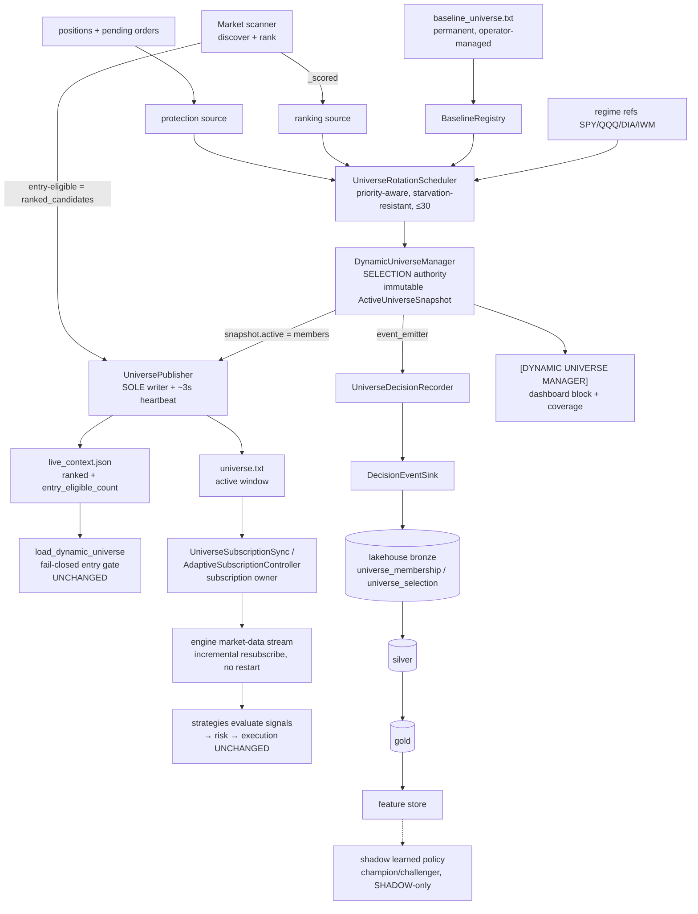

# Dynamic Universe Management & Opportunity Rotation

A selection/rotation layer that maintains a **permanent baseline** of securities
while continuously discovering, ranking, promoting, demoting, and reassessing
additional securities — keeping at most **30 unique tickers in the active
scanning window** without permanently restricting the engine to 30.

This is a *gap-driven extension*: it reuses the existing scanner/ranking,
subscription owners, lakehouse, learning, and M7 calendar. It introduces **no**
second socket, no competing publisher, and no parallel engine. It is gated OFF by
default (`CENGINE_DYNAMIC_UNIVERSE_ROTATION=1` to enable); the legacy publish path
is byte-for-byte unchanged when disabled.

## Authority separation

The design separates three authorities so the fail-closed entry gate stays intact:

- **`DynamicUniverseManager` = sole SELECTION authority.** Produces an immutable
  `ActiveUniverseSnapshot` (monotonic generation id) for the active window
  (≤30, protection-inclusive). Writes **no files**. Rotates at most every
  `refresh_interval_seconds`.
- **`UniversePublisher` = sole WRITER.** Unchanged single writer of `universe.txt`
  + `live_context.json` and the ~3s mtime heartbeat. Each publish it consumes the
  manager's snapshot as the active-window membership (`members`), while the
  entry-eligible ranking (`ranked_candidates`) still drives `entry_eligible_count`.
- **`UniverseSubscriptionSync` / `AdaptiveSubscriptionController` = subscription
  owner.** Unchanged; reconciles the live stream to `universe.txt` (one owner per
  runtime mode), always protecting held positions and pending orders.

The heartbeat (~3s) is independent of the rotation cadence (default 60s): between
rotations the publisher re-publishes the same cached snapshot, keeping the file
fresh without churning membership. A `None`/empty snapshot or a raising manager is
fail-closed — the scanner falls back to its own entry-eligible top-N and flags an
error (scanner unhealthy → entries blocked), never a stale window.

## Four universe layers (spec §3)

| Layer | Meaning |
|---|---|
| Baseline | Permanent, operator-managed membership in `baseline_universe.txt` (spec-30; `UPRO` is dynamic-only). Only operator edits change it; the Opportunity Finder never does. Permanence = membership, not continuous subscription. |
| Opportunity | Dynamically discovered + scored candidates (scanner `_scored`). |
| Master | Dedup union of baseline ∪ opportunity ∪ held ∪ pending. |
| Active | Current scanning window (≤30), computed by the rotation scheduler. |

## Data flow

## Rotation algorithm (spec §6)

Priority precedence (highest first), deduped, hard-capped at `active_universe_size`:

1. **Protected** — open positions + pending entry/exit + incomplete executions +
   unresolved reconciliation (never dropped unless they alone exceed the cap →
   `degraded`, excess reported, never silently truncated).
2. **References** — mandatory regime proxies (SPY/QQQ/DIA/IWM).
3. **Residence hold** — incumbents still within `candidate_min_residence_seconds`
   (anti-churn; only an emergency bypasses).
4. **Baseline revisit** — baseline past `baseline_max_revisit_seconds` since last
   evaluation (starvation resistance).
5. **Top opportunities** — highest-scored non-baseline, up to `opportunity_target_slots`.
6. **Baseline by staleness then rank**, then fill remaining slots with eligible
   baseline, then leftover opportunities.

`last_eval_s` advances only when a symbol is actually placed active, so a
rotated-out baseline symbol grows progressively "stale" until the revisit
guarantee re-schedules it.

## Lifecycle (spec §8)

`DISCOVERED → ELIGIBLE → RANKED → ACTIVE → ROTATED_OUT → REASSESSMENT →
ACTIVE | EXPIRED`. Baseline membership is permanent — baseline symbols may be
ROTATED_OUT / REASSESSMENT but never EXPIRED.

## Configuration

`UNIVERSE_CONFIG` (via `UniverseRotationConfig`, env-overridable `CENGINE_UNIVERSE_*`):

| Key | Default | Meaning |
|---|---|---|
| `active_universe_size` | 30 | Hard cap on the active scanning window |
| `baseline_target_slots` | 20 | Target (not quota) baseline slots |
| `opportunity_target_slots` | 10 | Target (not quota) opportunity slots |
| `refresh_interval_seconds` | 60 | Rotation cadence |
| `opportunity_refresh_seconds` | 300 | Discovery cadence |
| `baseline_max_revisit_seconds` | 300 | Baseline revisit deadline (starvation) |
| `candidate_min_residence_seconds` | 180 | Anti-churn minimum residence |

Gate + path env vars: `CENGINE_DYNAMIC_UNIVERSE_ROTATION` (default off),
`CENGINE_BASELINE_UNIVERSE_PATH`, `CENGINE_DYNAMIC_UNIVERSE_STATE`.

## Persistence & observability

- Universe-selection decisions (per-cycle summary + per-symbol promotion/demotion/
  baseline-revisit, with baseline membership, opportunity score, reason, regime,
  model version) flow through the existing nonblocking `DecisionEventSink` →
  bronze (`universe_membership` / `universe_selection`) → silver → gold →
  feature-store. No fabricated outcomes; downstream performance is linked via the
  existing per-symbol `REALIZED_OUTCOME` events.
- Terminal `[DYNAMIC UNIVERSE MANAGER]` block + structured logs for every
  promotion/demotion/rotation; baseline symbols that miss the revisit deadline are
  reported (coverage status `HEALTHY` / `STALE_BASELINE` / `DEGRADED`).

## Status

Implemented & tested: baseline permanence, 4-layer model, rotation scheduler,
candidate lifecycle, manager + restart-recoverable state, scanner/publisher
integration, decision persistence, observability. Shadow-only learned policy and
the static-vs-dynamic replay comparison are tracked as the remaining phases.
