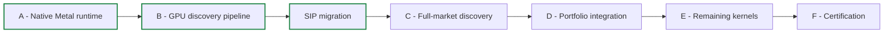

# C-Engine Implementation Roadmap

Living status document. Distinguishes **done + verified** from **target**. Treat
reported numbers as measurements recorded in `reports/`, not aspirations.

Last updated: Milestone-1 documentation refresh (HEAD after `213a26d`).

## Verified checkpoint (Apple M5 Max, Python 3.11.8)

| Metric | Value | Evidence |
| --- | --- | --- |
| Regression tests | 353 passing | `pytest -q` |
| Compiled kernels | 50 (45 baseline + 5 new) | `reports/metal_kernel_coverage.json` |
| Host-callable / hardware-executed / CPU-parity | 12 / 12 / 12 | `reports/metal_hardware_validation.json`, `metal_cpu_parity.json` |
| Operationally consumed | 5 | `reports/operational_consumer_coverage.json` |
| Market-data feed | SIP (Algo Trader Plus), entitlement verified | `reports/alpaca_subscription_validation.json` |

Operational GPU consumers: `technical_features`, `screen_market`,
`compact_entry_candidates`, `rank_candidates`, `market_breadth`.

## Phase status

- **Phase A — complete.** Native Obj-C++ Metal runtime, pipeline cache, BufferPool, registry, hardware parity.
- **Phase B — complete (offline-verified).** `DiscoveryEngine` ingestion; `technical_features`, `screen_market`, `compact_entry_candidates`, `rank_candidates`, `market_breadth` hardware-executed, CPU-parity-validated, and consumed by the real scanner (`cengine/gpu_scanner_bridge.py` → `MarketScanner` → `UniversePublisher`). Market-wide ranking runs on the GPU with output identical to the prior Python ranker. **Real-time SIP session certification is pending** an eligible market session; `tools/phase_b_certify.py` has validated the pipeline on genuine SIP historical data (78,709 bars).
- **SIP migration — complete.** Entitlement verified read-only (`tools/sip_verify.py`); feed-aware config; `CENGINE_ALPACA_FEED=sip`; IEX retained as compat profile; no silent downgrade.
- **M2 regime + five-family intelligence — complete (advisory, merged PR #4).** Market regime engine (4 levels, 4 independent dimensions, hysteresis), five-family registry, arbitration, economic ranking, decision-event contract; wired as an advisory loop in `trade.py` that routes nothing by default.
- **M2 execution certification — complete (mock-certified, merged PR #5).** `StrategyExecutionBridge` connects authorized recommendations to the existing `CandidateRouter → exposure gate → native RiskEngine → OrderManager`; `MaturityState`/`ExecutionAuthorization` gate it with mock isolated from paper/live; `SimulatedBroker` + full-path acceptance across five families × instrument classes; execution-lifecycle decision evidence + journal recovery; protective-exit independence re-verified. Default-off (`CENGINE_STRATEGY_EXECUTION_AUTH=none`). See [strategy_execution_bridge.md](strategy_execution_bridge.md).
- **M4 intelligent execution + L1 microstructure — complete (mock-certified, this package).** ExecutionPlanner (7 broker-compatible policies + fresh-quote limit prices + TransactionCostEstimator), L1 Microstructure Intelligence Engine (reuses order_flow_engine; OFI/microprice/Kyle/Amihud/exhaustion/adverse-selection; observed-vs-inferred; no L2 fabrication), realized Transaction Cost Analysis, AdaptivePositionManager + ExitArbiter (profit-protection research/shadow-default; mandatory exit always top priority), GPU Monte-Carlo scenario kernels bound + consumed (parity <2e-7; 10 consumed kernels), covariance-optimization benchmark + reductions documented-deferred, system-wide tick-scale unification on DEFAULT_PRICE_SCALE, replacement wired to protective-exit fills. Default-advisory (`CENGINE_PORTFOLIO_EXECUTION_AUTH`). 720 tests, ruff clean, native+Metal clean (M5 Max). See [intelligent_execution.md](intelligent_execution.md). **Economic validation (genuine OOS), paper, and live certification remain separate, pending milestones; tiled covariance + GPU reductions deferred with measured justification.**
- **M3 GPU portfolio intelligence — complete (mock-certified, this package).** GPU covariance/EWMA operationally consumed (parity <7e-11 on M5 Max); native C++ constrained risk-based allocator (`risk/portfolio_allocator.cpp`) + reused CVXPY mean-variance; hard constraints (§8); versioned broker-reconciled `PortfolioState` (fail-closed); atomic capital reservation (no double-spend, unknown-outcome safe); `PortfolioRecommendation` contract + sizing; reconciliation-gated replacement (no forced reinvest / no immediate re-entry); portfolio decision events + non-blocking dashboard panel; wired into `trade.py` behind `CENGINE_PORTFOLIO_EXECUTION_AUTH` (default advisory); full-path mock certification through the real native RiskEngine + mock broker; protective-exit independence re-verified under optimizer/GPU failure. 638 tests, ruff clean. See [portfolio_intelligence.md](portfolio_intelligence.md). **Economic validation (genuine OOS) and paper/live certification remain separate, pending milestones; GPU monte-carlo/reductions kernels remain compiled-but-unbound.**
- **M5 local adaptive ML/RL data platform — complete (this package).** Entirely local bronze/silver/gold lakehouse (`cengine/lakehouse/` — Parquet + PyArrow + DuckDB; **no cloud/MongoDB/Supabase**) accumulating market observations, engine decisions, execution experience, and realized outcomes for future learning. Canonical versioned `EventEnvelope` separating market-event time from availability time; atomic + content-hash-idempotent + manifested + recoverable Parquet publication; DuckDB-typed, deduplicated, incremental silver; FIFO position outcomes, censored-label supervised datasets, and offline-RL transitions (NULL action-probability, closed-only reward, mandatory-exits-as-environment-dynamics, no double-counted costs); point-in-time `ASOF` feature store; data-quality framework + quarantine; daily attribution + loss-source taxonomy; compaction/retention; storage monitoring; model-governance metadata (`NONE`/`UNAPPROVED` — **M5 does not train or promote**). Bounded/resumable/tiered historical **SIP** ingestion reusing the existing fetcher (no new websocket, no silent SIP→IEX fallback); as-of universe snapshots (no survivorship bias). **Analytical-only and strictly off the critical path** — capture is nonblocking/bounded/loss-accounted and can never block the order path, native RiskEngine, reconciliation, or the mandatory −0.5% protective exit; the authoritative journal stays separate. Operable via `python -m cengine.lakehouse …` and wired live into `trade.py` behind `CENGINE_LAKEHOUSE` (detached drain + `LAKEHOUSE` dashboard panel). Evidence: a genuine bounded SIP run ingested 15,480 AAPL/MSFT/SPY 5-min bars (0 point-in-time violations, fully resumable). 744 tests (23 dedicated), ruff clean, native + Metal clean (M5 Max). See [lakehouse/README.md](lakehouse/README.md). **Unrestricted model training and live RL are explicitly deferred to the next milestone.**
- **M6 GPU-first adaptive ML + constrained offline RL — complete (this package).** Entirely local, **GPU-first** (Apple **Metal** via **MLX 0.32.4**) learning layer (`cengine/learning/`) over the M5 lakehouse — **no cloud, no CUDA, no external model APIs**. Recommendation-only: models submit no orders, open no broker connection, never bypass the native financial authority; the strict elective-entry contract and the mandatory −0.5% protective exit stay fully independent of MLX/Metal/GPU/training/inference/registry/lakehouse. GPU-first `DevicePolicy` with a documented/measurable CPU fallback (never a silent GPU claim). Spans hardware inspection; a data-sufficiency **eligibility gate** + point-in-time dataset **certification** (chronological purged/embargoed splits, leakage verification); look-ahead-free feature engineering; **MLX** neural regression/classification/quantile models + independent sklearn/constant baselines with **baseline-gated promotion**; **contextual bandits** (LinUCB + neural, no IPS when behavior probs unknown); **constrained offline RL** (BC/FQE/CQL/IQL, mandatory exits as environment dynamics); calibration + dependence-aware economic evaluation + OPE; deterministic **replay env**; operational **model registry** (checksummed artifacts, UNTRAINED→…→RETIRED maturity, **no auto-live promotion**, always-legal rollback); **GPU inference service** (batched, abstaining, safe fallback) + **drift** monitoring + session-aware **daily cycle**, all wired into `trade.py` behind `CENGINE_LEARNING` (detached, off the event loop, `LEARNING` dashboard panel). Operable via `python -m cengine.learning …`. **Honest data reality**: only forward-return prediction has sufficient genuine data (262,586 real SIP bars) to train+evaluate on the GPU, and its OOS edge is **marginal** (rank-IC ~0.01–0.02; did NOT beat the sklearn baseline → kept `TRAINED`, not shadow-promoted); all outcome/execution/bandit/RL tasks are `INSUFFICIENT_DATA`, research-only, validated on labeled synthetic fixtures. **No positive economic expectancy is claimed.** 868 tests (124 dedicated), ruff clean, native + Metal clean, CPU/GPU parity validated; 28 measured reports. See [learning/architecture.md](learning/architecture.md). **M6 trains no live model and enables no automatic live promotion — Milestone 7 independently certifies economic performance, paper and controlled live deployment.**

## Remaining work

| Phase | Deliverable | Notes |
| --- | --- | --- |
| C | Adaptive four-tier subscription manager | Current cap is a flat 250 on SIP; per-channel capacity + promotion/demotion state machine is the target |
| C | Master-universe membership acquisition | NASDAQ-listed ∪ S&P 500 ∪ DJIA ∪ configured; provenance, generations, dedup |
| C | Full-market historical warm-up + SIP REST budgeting | Incremental, cached, coverage-classified |
| C | Per-group market breadth | NASDAQ / S&P / DJIA / configured / combined (no double-count) |
| D | Operational portfolio intelligence | Covariance/EWMA consumers, `RegimeMarkowitzAllocator`, sizing, confirmed-fill replacement |
| E | Remaining ~38 kernels | Monte Carlo, reductions, L1 imbalance, statarb — legitimate consumers only; L2-depth kernels remain data-blocked |
| F | Dashboard, benchmarks, replay/backtest/OOS, fault injection, readiness | — |

## Invariants (never regress)

- Mandatory protective exit at `unrealized_return < -0.005`, independent of GPU/discovery/optimizer.
- Entry contract unchanged; GPU results advisory until native authorization.
- Single OrderManager; single `UniversePublisher`; one shared SIP stock-data socket.
- No invented prices/fills/account state; no silent SIP↔IEX mixing; no live orders in tests.
- Registry honesty: `operationally_consumed` set only when a real live consumer dispatches the kernel.
