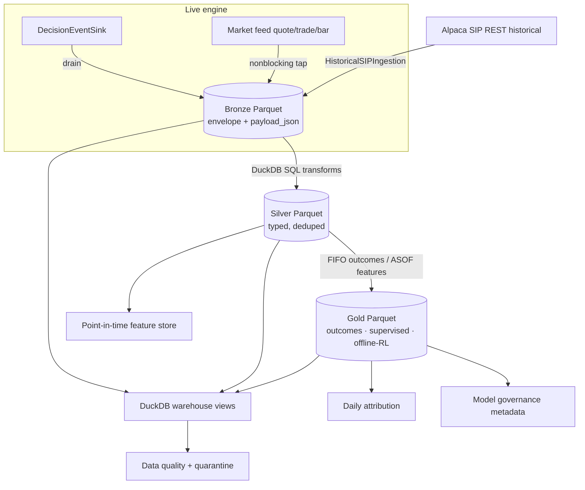

# Lakehouse Architecture

A three-layer medallion lakehouse built over the engine's existing decision-event
stream and raw market feed, materialized as partitioned Parquet and queried through
DuckDB.

## Layers

### Bronze — immutable raw capture (`bronze.py`)
`AnalyticalIngestionSink` drains the existing `DecisionEventSink` (reusing its
`drain()` / `to_row()`) and taps raw market observations. Each record is wrapped in the
canonical `EventEnvelope` (see [event-envelope.md](event-envelope.md)) and written to a
per-concern bronze dataset. Bronze is append-only and immutable: corrections are
appended as explicit records (`record_correction`), never in-place rewrites.

- **Nonblocking + bounded + loss-accounted.** `IngestionStats` tracks
  `ingested / written / dropped / quarantined` plus explicit `losses`. If disk is low
  or a storage cap is hit, `LakehouseConfig.accepts_writes()` fails closed and the
  drop is recorded — the order path is never affected.
- Event→dataset routing is the `_EVENT_DATASET` table.

### Silver — validated, typed, deduplicated (`silver.py`)
`SilverTransformer` runs DuckDB SQL over the bronze Parquet: it extracts typed columns
from the JSON payload (`json_extract_string(payload_json, '$.field')`), deduplicates by
`event_id` (`QUALIFY row_number() … = 1`), and writes per-concern silver datasets.
Transforms are **incremental** via a per-dataset high-water checkpoint on
`availability_timestamp_ns`. Observed L1 values are kept distinct from inferred
microstructure features; no L2 depth/aggressor/queue is ever fabricated.

### Gold — learning datasets (`gold.py`, `feature_store.py`)
`GoldBuilder` reconstructs **position outcomes** via FIFO lot attribution from silver
fills, then builds **supervised** datasets (recommendations → realized outcomes, with
censored labels) and **offline-RL** transition datasets. `PointInTimeFeatureStore`
serves leakage-free as-of feature snapshots via DuckDB `ASOF` joins.

## Data flow



## Orchestration (`pipeline.py`)
`LakehousePipeline.run()` chains the batch stages idempotently and with failure
isolation:

```
drain → silver → gold → quality → attribution → maintenance → storage → register views
```

Each stage is wrapped so one failure never aborts the rest, and a run record is
appended to `_checkpoints/pipeline_runs.jsonl`.

## Separation of concerns
The lakehouse is strictly downstream and analytical. The authoritative financial
journal (`cengine/journal.py`) is untouched and remains the system of record; the
lakehouse references the same identifiers but never replaces them.
