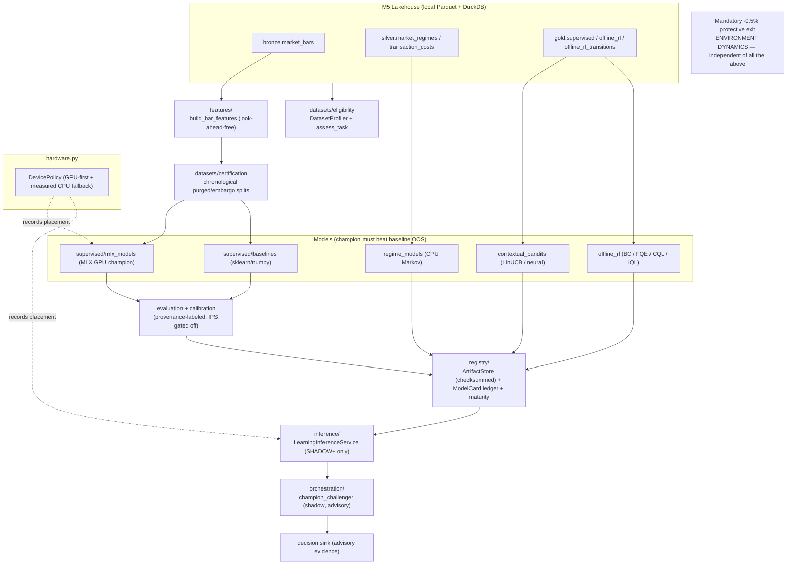

# Milestone 6 — Learning-Layer Architecture

The M6 learning layer (`cengine/learning/`) is a **GPU-first, locally operated adaptive
ML / constrained offline-RL platform**. It learns from historical market data, the
engine's own decisions, portfolio allocations, execution policies and realized outcomes
for exactly one purpose: **to improve RANKING and ELIGIBLE-POLICY SELECTION**. It is
recommendation-only. No module here submits an order, opens a broker connection, runs a
parallel order manager, or bypasses the native financial authority.

Package version constants (`cengine/learning/__init__.py`):

| Constant | Value |
|---|---|
| `LEARNING_PLATFORM_VERSION` | `learning-platform-1.0.0` |
| `FEATURE_SCHEMA_VERSION` | `feature-schema-1.0.0` |
| `LABEL_DEFINITION_VERSION` | `label-def-1.0.0` |
| `HARDWARE_REPORT_VERSION` | `learning-hardware-1.0.0` |

The MLX runtime story (DevicePolicy, import-guard, where MLX is used vs. sklearn
baselines) is documented separately in [`mlx_architecture.md`](./mlx_architecture.md).

---

## 1. Non-negotiable invariants

These are enforced structurally in code, not merely by convention. Every subpackage
docstring restates the ones it touches.

1. **Recommendation-only.** Models never submit orders, open a broker connection, run a
   parallel order manager, or bypass the native financial authority (RiskEngine /
   constraints / reservations / exposure authorization).
2. **Entry qualification preserved.** The strict elective-entry contract
   (`DI+ > DI-` AND `price > VWAP | SMA20 | BB-mid` AND `developing-1m > prev-1m-close`)
   is untouched. Learning can only re-rank or select among *already-eligible* candidates;
   it can never make an ineligible candidate eligible.
3. **Protective exit is environment dynamics.** The mandatory **-0.5% protective exit**
   stays fully independent of MLX / Metal / GPU, model training/inference, the registry,
   and the lakehouse. It is modeled as environment dynamics — never a learnable agent
   action — and no reward, forecast, or policy may suppress or defer it. The threshold
   `PROTECTIVE_EXIT_THRESHOLD = -0.005` lives in
   `cengine/learning/environment/replay.py`, and the reserved-action set
   `MANDATORY_EXIT_ACTIONS` in `cengine/learning/offline_rl/transitions.py` excludes it
   from every learnable action space.
4. **No fabricated evidence.** No fabricated labels, rewards, or behavior-policy
   probabilities. `action_probability_if_known` is *always* `None`; because behavior
   probabilities are unknown, IPS / doubly-robust estimators that need them are gated off
   (see `cengine/learning/evaluation/ope.py` and `contextual_bandits/__init__.py`).
   Insufficient evidence yields an `UNTRAINED` / research-only model, never a promoted one.
5. **GPU-first, honest fallback.** GPU-first with a documented, observable, measurable CPU
   fallback. The platform never silently claims GPU acceleration when work ran on the CPU —
   every placement is recorded by `DevicePolicy` with a reason.
6. **No auto-promotion to live.** The maturity state machine (`registry/maturity.py`)
   forbids any model from auto-promoting itself to live execution; LIVE_APPROVED / ACTIVE
   require explicit operator approval, and rollback is always legal. **M6 does not promote
   to live** — M7 certifies.

The authoritative analytical data interface is the M5 lakehouse (`cengine/lakehouse/`);
the authoritative financial journal remains separate and untouched.

---

## 2. Subpackage map

Everything is local-only: Parquet / PyArrow / DuckDB for data, MLX for GPU compute,
numpy / scikit-learn / scipy for baselines and statistics. No cloud, no CUDA, no external
model APIs.

### `hardware.py` — hardware inspection + device policy
Runtime inspection of actual Apple-silicon / Metal / MLX capability (never hardcoded) and
the GPU-first `DevicePolicy` with its observable CPU fallback. Key API:
`inspect_hardware()` → `HardwareCapabilities`; `mlx_available()`; `DevicePolicy.choose()`
→ `PlacementDecision`. Honors `CENGINE_LEARNING_FORCE_CPU`. See `mlx_architecture.md`.

### `datasets/` — profiling, eligibility, certification
- `eligibility.py`: `DatasetProfiler` profiles each learning dataset straight from
  lakehouse Parquet via DuckDB; `assess_task` / `assess_all` assign a per-task
  `EligibilityState` (`INSUFFICIENT_DATA`, `DATA_QUALITY_FAILED`, `RESEARCH_ELIGIBLE`,
  `TRAINING_ELIGIBLE`, `VALIDATION_ELIGIBLE`). `default_task_specs()` declares what each
  task actually needs (labeled outcomes, instruments, sessions, action support). Raw bar
  counts are explicitly *not* treated as independent trading outcomes.
- `certification.py`: `certify_training_dataset` produces an immutable
  `DatasetCertificate` with a content checksum, schema/label versions, a source manifest,
  and **chronological** purged + embargoed train / validation / out-of-sample splits. It
  refuses to certify a randomly-shuffled split of temporally dependent observations and
  verifies feature availability against decision timestamps (no look-ahead).

### `features/` — point-in-time feature engineering
- `schema.py`: `FeatureSchema` pins the exact ordered feature columns (`BAR_FEATURE_COLUMNS`,
  13 look-ahead-free technical features: returns, momentum, volatility, SMA ratios, range,
  RSI-14, volume ratio, VWAP distance) and a `fingerprint()` compatibility key.
- `builder.py`: `build_bar_features` constructs a look-ahead-free `(X, y_return,
  y_positive, timestamps, symbols)` matrix from bronze `market_bars` using DuckDB window
  functions partitioned by `(symbol, session)` so no window spans instruments or overnight
  gaps. `gold_training_frame` pulls realized strategy outcomes from the gold `supervised`
  dataset (distinct from the theoretical forward-bar return).

### `supervised/` — MLX neural models + independent baselines
- `base.py`: the uniform `LearningModel` contract (fit / predict /
  `predict_with_uncertainty` / `params` / `load_params`), `Standardizer` (fit on TRAIN
  only), `TrainConfig`, and shared `regression_metrics` / `classification_metrics`.
- `mlx_models.py`: GPU-first `MLXRegressor`, `MLXBinaryClassifier`,
  `MLXQuantileRegressor` (pinball loss → point + uncertainty + downside).
- `baselines.py`: independent CPU baselines — `SklearnRegressor` / `SklearnClassifier`
  (HistGradientBoosting), `ConstantBaseline`, `HistoricalMeanBaseline`. Every neural model
  must beat the appropriate baseline out-of-sample before promotion.
- `trainer.py`: `train_forward_return_model` ties it together and emits a `TrainingReport`.

### `regime_models/` — probabilistic regime extension
`transition_model.py`: `RegimeTransitionModel` / `fit_regime_transition_model` — a
first-order, Laplace-smoothed Markov transition-frequency model over the observed
`direction / trend / volatility / liquidity` labels in silver `market_regimes`. It is a
*probabilistic extension* of the deterministic `cengine.regime_engine.MarketRegimeEngine`,
which stays the transparent baseline + fallback and remains the sole labeler of regimes.
Predicted probabilities never overwrite observed labels. CPU-only
(`gpu_supported=False`), recorded via `DevicePolicy`.

### `contextual_bandits/` — offline bandits over authorized actions
- `dataset.py`: `build_bandit_dataset` builds `(context, selected_action, reward)` rows
  from the gold `offline_rl` dataset; `OFF_POLICY_CORRECTION_SUPPORTED` is `False` with a
  documented reason (behavior probabilities unknown).
- `linucb.py`: `LinUCB` — numpy/CPU batched per-action ridge reward model (the baseline).
- `neural_bandit.py`: `NeuralBanditRewardModel` — MLX GPU-first per-action reward model
  with a masked loss (only the taken action's head learns per row). Direct reward-model
  scoring only; no IPS/propensity path.

### `offline_rl/` — constrained offline-RL research
- `transitions.py`: `TransitionLoader` / `TransitionDataset` load versioned logged
  transitions from gold `offline_rl_transitions`; `TrainingGuard` refuses training on
  insufficient data and marks synthetic-as-real results non-promotable
  (`InsufficientDataError`, `SyntheticDataError`); `ActionSpace` excludes
  `MANDATORY_EXIT_ACTIONS`.
- `bc.py` (`BehaviorCloner`), `fqe.py` (`FittedQEvaluator`), `cql_iql.py`
  (`ConservativeQLearner`, `ImplicitQLearner`) — conservative, data-sized learners, each
  MLX GPU-first with a numpy CPU fallback. None require behavior probabilities.
- `_nets.py`: shared `MLXMLP`, numpy fallback helpers, and `_RLBase` (standardizer +
  device bookkeeping).

### `calibration/` — probability calibration + uncertainty
`calibration.py`: CPU-only (numpy / scikit-learn) post-processing — Brier / log loss,
reliability curves, ECE / MCE, `IsotonicCalibrator` + `TemperatureScaler` (fit on
validation only), prediction-interval / quantile coverage, and a justified-abstention
helper. `CALIBRATION_DEVICE` documents the deliberate CPU placement.

### `evaluation/` — independent evaluation + OPE
- `economic.py`: `economic_metrics` over per-decision NET returns with dependence-aware
  (moving-block / stationary) bootstrap CIs and honest effective-sample-size reporting.
  Every output carries a `DATA_LABEL_REAL` / `DATA_LABEL_SYNTHETIC` provenance label —
  synthetic evidence can never claim profitability.
- `ope.py`: `DirectMethodEvaluator` + Fitted-Q hooks, action-support / extrapolation
  audit, and candidate-vs-baseline comparison on identical decisions. `ips_value` /
  `doubly_robust_value` exist but are **gated off** when behavior probabilities are unknown.

### `registry/` — operational registry + maturity governance
- `maturity.py`: the `ModelMaturity` state machine (`UNTRAINED` … `RETIRED`), legal
  transitions, `requires_explicit_approval`, `is_live`, and `check_transition` (raises
  `PromotionError` on illegal/unauthorized transitions).
- `artifacts.py`: `ArtifactStore` publishes checksummed npz/json blobs atomically
  (temp + fsync + `os.replace` + sha256), verifies on load (`ArtifactVerificationError`),
  and loads npz with `allow_pickle=False`. Blobs live under
  `<lakehouse_root>/_learning_models/` and are never committed to Git.
- `model_registry.py`: `LearningModelRegistry` — append-only JSONL ledger at
  `<root>/_learning_models/registry.jsonl`, rich GPU-aware `ModelCard`s with full
  reproducibility provenance, `champion` / `challenger` selection, `transition`,
  `approve`, and always-legal `rollback`.

### `inference/` — versioned contract + GPU/CPU service
- `contract.py`: `InferenceRequest` / `InferenceResponse` carrying model + feature-schema
  versions, observation time and availability time; `Applicability` enum; `abstain()`
  universal fallback.
- `loader.py`: `load_model` reconstructs a verified `LearningModel` from a `ModelCard`
  (checksum-verified weights; typed `ModelLoadError`).
- `service.py`: `LearningInferenceService` with cached loading, batched cross-sectional
  GPU inference, schema/staleness/applicability gating, uncertainty outputs, and a hard
  guarantee that it **always returns a response** (any failure → reasoned abstention,
  never a raise). Only SHADOW-or-later models serve.

### `monitoring/` — advisory drift detection
`drift.py`: `DriftMonitor` compares a live inference batch to a train-time
`ReferenceDistribution` and maps it onto a severity-ordered `DriftState`
(`HEALTHY < WARNING < ABSTAIN < DEGRADED < BLOCKED < ROLLBACK_REQUIRED`) using PSI, KL,
Jensen-Shannon, missing-feature rate, OOD score, and (only when real labels exist) ECE
deterioration. `DriftReport.grants_trading_authority` is hard-wired `False`. CPU-only.

### `environment/` — deterministic replay
`replay.py`: `ReplayEnvironment` replays genuine historical SIP bars in strict time order
to produce **labeled simulated** experience (offline-RL transitions + realized P&L). No
future leakage, conservative fills, and the -0.5% protective exit enforced every bar as
environment dynamics. Every transition is labeled `execution_environment='replay_simulated'`.
It is an explicitly approximate simulator (`REPLAY_ENV_VERSION`), never a silent
replacement for the native RiskEngine + OrderManager path.

### `orchestration/` — daily cycle + champion/challenger
- `daily_cycle.py`: `DailyLearningCycle` / `run_daily_cycle` — the failure-isolated,
  idempotent post-session workflow. Runs OFF the trading-critical path.
- `champion_challenger.py`: `ChampionChallengerHarness` runs champion, challenger, and
  (implicitly) the deterministic baseline over identical observations, recording
  prediction/ranking differences and estimated financial impact when realized outcomes
  exist. Shadow-only; never auto-promotes.

### `benchmarks/` — GPU/CPU benchmark certification
`gpu_benchmarks.py`: `benchmark_training_throughput`, `benchmark_inference_latency`,
`benchmark_memory`, `run_all_benchmarks` — correctly-synchronized (`mx.eval()` before
timing stops, warm-up excluded) measurements that report GPU acceleration *including*
workloads where the GPU is slower (small / sync-dominated), honestly.

### CLI (`cli.py`, `__main__.py`)
`python -m cengine.learning <command>` — all commands non-ordering:
`hardware`, `profile-datasets`, `validate-datasets`, `train-supervised`, `train-bandit`,
`train-offline-rl`, `replay`, `registry`, `compare-models`, `shadow`, `promote`
(explicit `--approve` for live), `rollback`, `daily-cycle`, `benchmark`.

---

## 3. Data flow: lakehouse → features → models → registry → inference → shadow

The learning layer reads from the M5 lakehouse and writes only its own artifacts
(model blobs + registry ledger) back under `_learning_models/`. It never writes to the
bronze/silver/gold datasets or the financial journal.

```
  bronze.market_bars / silver.* / gold.* (Parquet, read via DuckDB)
        │
        ▼  features/builder.build_bar_features  (DuckDB window fns, look-ahead-free)
  BarFeatureMatrix  (X, y_return, y_positive, timestamps, symbols)
        │
        ▼  datasets/certification.certify_training_dataset
  DatasetCertificate  (checksum + chronological purged/embargoed splits)
        │
        ▼  supervised/trainer.train_forward_return_model
  MLX GPU champion  +  independent sklearn/numpy baseline   (fit on TRAIN, eval OOS)
        │                                    │
        │  beats baseline OOS?  ────────────┘
        ▼
  registry (ArtifactStore checksummed npz  +  ModelCard JSONL ledger, maturity-gated)
        │
        ▼  inference/service.LearningInferenceService  (SHADOW+ only, GPU-first batch)
  InferenceResponse  (prediction + uncertainty + applicability, or reasoned abstention)
        │
        ▼  orchestration/champion_challenger  (shadow comparison, OFF the order path)
  advisory evidence → decision sink   (never an order, never the protective exit)
```



> `EXIT` is drawn as an isolated node on purpose: the mandatory -0.5% protective exit has
> **no inbound or outbound edge** to any learning component. It is independent environment
> dynamics — nothing in the learning layer can reach it, feed it, suppress it, or defer it.

### Model maturity lifecycle

Maturity is an independent dimension from strategy maturity and from financial-execution
authorization (`registry/maturity.py`):

```
UNTRAINED → RESEARCH → TRAINED → VALIDATED → SHADOW → PAPER_ELIGIBLE
          → PAPER_CERTIFIED → LIVE_ELIGIBLE → LIVE_APPROVED → ACTIVE
  (safety sinks reachable from most states:  DEGRADED, BLOCKED, RETIRED[terminal])
```

- `TRAINED → VALIDATED → SHADOW` is the automatic path *only when a challenger genuinely
  beats the baseline out-of-sample* (handled inside `trainer._register`).
- `LIVE_ELIGIBLE → LIVE_APPROVED` and `LIVE_APPROVED → ACTIVE` require explicit operator
  approval (`requires_explicit_approval`). **M6 never crosses into live.**
- Only SHADOW-or-later models are permitted to serve predictions
  (`inference/service._SERVING`).
- `rollback` to the last approved model or the deterministic baseline is always legal.

---

## 4. Honest data reality (as-built, not aspirational)

Documenting what the committed infrastructure actually did on real data, per the M6
ground truth:

- **`forward_return_prediction`** is the only task with enough real data to train and
  evaluate: ~**262k** real SIP bars (bronze `market_bars`). Its out-of-sample edge is
  **marginal** (rank-IC ≈ 0.01–0.02) and it **did not beat the sklearn baseline**
  out-of-sample, so it **stayed `TRAINED` and was NOT shadow-promoted**. No economic edge
  is claimed.
- **All outcome / execution / bandit / RL tasks are `INSUFFICIENT_DATA`** and remain
  research-only (they need genuine realized execution lifecycles / reward + action
  support that do not yet exist). Their infrastructure is validated on **labeled synthetic
  fixtures** only, and that provenance is carried through every evaluation
  (`DATA_LABEL_SYNTHETIC`).
- Because behavior-policy probabilities are unknown, IPS / doubly-robust estimators are
  gated off; only direct reward-model scoring and clearly-labeled offline Thompson
  sampling are exposed.

This honesty is structural: `EligibilityState`, the `TrainingGuard`, the baseline-gated
promotion in `trainer`, and the provenance labels in `evaluation` all exist specifically
so that insufficient or synthetic evidence can never produce a promoted model.

---

## 5. Configuration

| Environment variable | Effect |
|---|---|
| `CENGINE_LAKEHOUSE_ROOT` | Lakehouse root (default `./data/lakehouse`); learning artifacts live under `<root>/_learning_models/`. Also settable via `--root` on the CLI. |
| `CENGINE_LEARNING_FORCE_CPU` | When set (non-empty, non-`0`), `DevicePolicy` forces all placements to CPU and records `forced_cpu` — the explicit, observable way to disable GPU. |

Lakehouse storage knobs (`CENGINE_LAKEHOUSE_COMPRESSION`, `_ZSTD_LEVEL`, `_ROW_GROUP`,
`_BATCH`, `_MAX_GIB`, `_MIN_FREE_GIB`, `_RETENTION_DAYS`) are inherited from
`cengine/lakehouse/config.py` and govern the data the learning layer reads.
