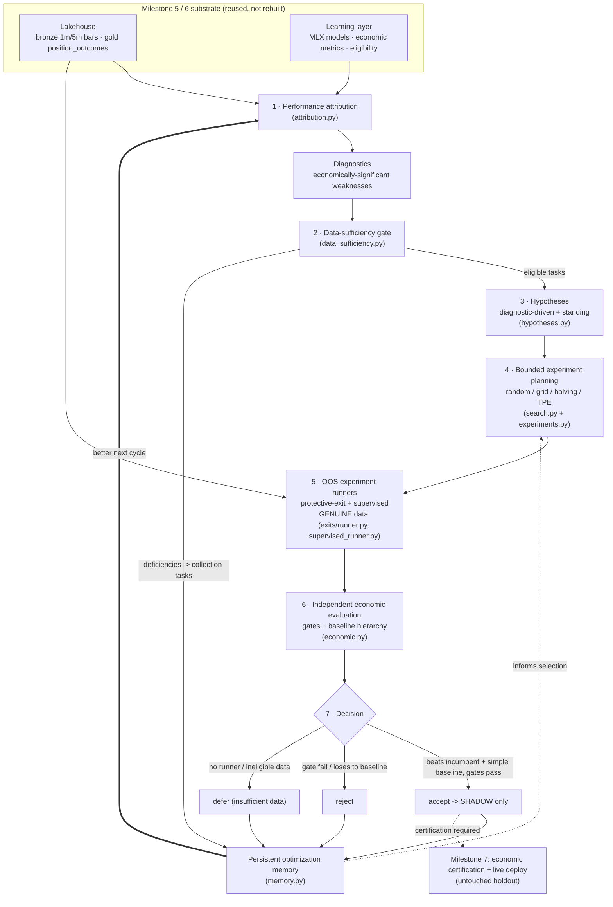

# C-Engine Autonomous Optimization Platform (Milestone 6B)

A **governed, closed-loop, performance-driven ML/RL optimization platform** that
continuously measures how C-Engine actually behaved, diagnoses economically-significant
weaknesses, proposes and runs **bounded experiments on genuine data**, judges candidates on
independent transaction-cost-adjusted economics, remembers every experiment, and promotes
only qualified candidates into **SHADOW** — never live.

It lives in `cengine/optimization/` (plus `cengine/optimization/exits/` and the native
candidate header `risk/protective_exit_candidate.hpp`). Package version constant
(`cengine/optimization/__init__.py`):

| Constant | Value |
|---|---|
| `OPTIMIZATION_PLATFORM_VERSION` | `optimization-platform-1.0.0` |

## What it is (and is not)

- **Builds on, does not rebuild.** It sits on top of the Milestone 5 lakehouse
  (`cengine/lakehouse/` — Parquet + DuckDB) and the Milestone 6 learning layer
  (`cengine/learning/` — MLX models, economic metrics, dataset eligibility). Nothing here
  re-implements storage, feature building, or model training.
- **Entirely local.** Parquet / DuckDB / MLX only. No cloud, no CUDA, no external APIs.
  GPU-first via MLX on Apple Metal, with a documented, observable CPU fallback.
- **Research / shadow only.** No command activates a live policy, expands risk, relaxes the
  production **-0.5% protective exit**, enables live exploration, or modifies its own
  executable code. Accepted candidates become *shadow-eligible only*. **Milestone 7** owns
  independent economic certification and controlled live deployment.
- **Honest about evidence.** Historical-replay results are **simulated, not actual trading
  performance**. Where genuine evidence is missing (execution / outcome / bandit / RL
  lifecycles), the platform emits `INSUFFICIENT_DATA` and a collection task rather than
  fabricating data, orders, rewards, or behavior probabilities. No economic edge is claimed.

## The closed loop

The platform's core deliverable is a persistent control loop (`controller.MetaOptimizer`,
orchestrated by `orchestration.AutonomousOptimizationCycle`). Each cycle:



The loop **optimizes the learning process, not just model weights**: it consults prior
experiment outcomes so it never repeats work, deprioritizes repeatedly-failing regions, and
scores the effectiveness of its own experiment selection.

## The empirical core: protective-exit research

The most-developed research area is the **production -0.5% protective exit**
(`cengine/optimization/exits/`). The question: *is the unconditional -0.5% liquidation
frequently premature?*

- **Counterfactual analysis** (`counterfactual.py`) on genuine 1-minute bars shows that
  after a hypothetical -0.5% exit, price frequently recovers above the exit level — a
  cross-sectional **~95% recovery-above-exit within 60 minutes** across the five symbols.
- The **EXIT-00..EXIT-15 matrix** (`experiment_matrix.py`) shows that, *in exit-isolation*,
  several wider-stop policies out-score the -0.5% baseline (EXIT-00) on historical replay.
- **But** the autonomous OOS cycle **REJECTED** the candidates: on out-of-sample
  train/validation windows under the mandatory risk gates, none beat the incumbent. The
  **production -0.5% exit is RETAINED.** A favorable in-sample recovery is not proof that
  holding was the superior *portfolio* decision, and shadow eligibility is not live approval.

This is the discipline the platform is built to enforce: an attractive in-sample result is
destroyed by out-of-sample, cost-adjusted, risk-gated evaluation before it can touch
anything.

## Invariants (enforced in code, not by convention)

These are restated in module docstrings and enforced structurally — most by
`config.OptimizationConfig.validate()`, the native header, and the evaluation gates.

1. **Production -0.5% exit preserved untouched.** `config.production_exit_pct` must equal
   `-0.005` or the config is rejected; `exits/adaptive.py` keeps `PRODUCTION_EXIT_PCT =
   -0.005` as the control / fallback / rollback. Candidate adaptive policies are separate and
   shadow-only.
2. **Native C++ RiskEngine is the sole financial authority.** Everything in this package is a
   *recommendation*; nothing submits an order, opens a broker connection, or runs a parallel
   order manager.
3. **Candidate native emergency stop (-3%) is INACTIVE.** `risk/protective_exit_candidate.hpp`
   (`evaluate_emergency_exit`, exposed as `_cengine_native.evaluate_emergency_exit`) is a
   pure, stateless, crash-independent trigger that is **not wired into `RiskEngine::evaluate`
   or any live path**. It never overrides a tighter active stop
   (`overrides_tighter_stop = false`), and `clamp_emergency_threshold` guarantees the
   optimizer can only *tighten*, never loosen, it. Milestone 7 certifies activation.
4. **No live activation, no risk expansion, no hard-stop tuning, no live exploration.**
   `validate()` hard-rejects `production_activation_enabled`, `autonomous_live_activation`,
   `autonomous_risk_expansion`, `hard_stop_optimization`, and `live_exploration`. Hard risk
   limits and mandatory protection are **not members of any search space** (`search.py`).
5. **No self-code-modification.** The optimizer may improve its selection *policy* from the
   memory ledger; it never rewrites its own executable code.
6. **No fabricated evidence.** No fabricated data, orders, rewards, or behavior
   probabilities. Deficiencies become prioritized collection tasks; insufficient evidence
   yields `DEFERRED` / `INSUFFICIENT_DATA`, never a faked conclusion.
7. **Strict OOS discipline.** Chronological, purged, embargoed train/validation splits
   (`validation.py`), with an **untouched certification holdout the optimizer never
   accesses** — reserved for Milestone 7.
8. **Simulated, not live.** All historical-replay numbers carry the `historical_replay` data
   label; synthetic data is never treated as genuine economic evidence.

## Genuine data

The primary research environment is **multi-timeframe historical replay** over the
lakehouse's genuine market data: **~6.76M real 1-minute bars** across
**AAPL / SPY / QQQ / MSFT / NVDA (2020–2026)**. 1-minute is canonical; 5-minute is the
strategic timeframe for entry generation. Outcome / execution / bandit / RL learning tasks
remain `INSUFFICIENT_DATA` — their infrastructure is validated but untrained and
research-only, because no genuine execution lifecycles exist yet.

## Documentation map

| Doc | Covers |
|---|---|
| [README.md](README.md) | This overview, the closed loop, and the invariants |
| [architecture.md](architecture.md) | Full local-data + autonomous-optimization architecture; subpackage map; data flow |
| [meta_optimization_cycle.md](meta_optimization_cycle.md) | The `MetaOptimizer` control loop, hypothesis processing, memory-informed planning, runner contract |
| [performance_attribution.md](performance_attribution.md) | Performance attribution engine and the diagnostic contract |
| [data_sufficiency.md](data_sufficiency.md) | Eligibility gate, learning-task states, collection tasks |
| [reward_optimization.md](reward_optimization.md) | What the optimizer is allowed to tune in the constrained-RL reward and how it is gated |
| [counterfactual_exits.md](counterfactual_exits.md) | Counterfactual post -0.5%-exit recovery analysis on genuine 1m bars |
| [adaptive_exit_state_machine.md](adaptive_exit_state_machine.md) | Adaptive candidate policy, deterministic state machine, EXIT-00..15 matrix |
| [native_risk_authority.md](native_risk_authority.md) | Native C++ financial authority and the inactive candidate emergency stop |
| [metal_gpu_compute.md](metal_gpu_compute.md) | GPU-first MLX compute on Apple silicon with the documented CPU fallback |
| [milestone7_boundary.md](milestone7_boundary.md) | The hard line between M6B research/shadow and M7 certification + live deploy |
| [operations.md](operations.md) | The `python -m cengine.optimization` CLI, `CENGINE_OPT_*` env vars, run outputs |
| [daily_workflow.md](daily_workflow.md) | The daily/weekly operational cadence of the closed loop |

## Quick start

```bash
# Everything is read-only research; nothing trades.
python -m cengine.optimization attribute               # weakness diagnostics
python -m cengine.optimization data-sufficiency        # eligibility + collection tasks
python -m cengine.optimization counterfactual --symbol AAPL
python -m cengine.optimization exit-matrix --symbol SPY --risk-normalized
python -m cengine.optimization validation-windows --symbol QQQ
python -m cengine.optimization optimize --symbol AAPL  # one full autonomous cycle (OOS)
python -m cengine.optimization memory                  # optimizer self-effectiveness
python -m cengine.optimization emergency-check --unrealized-return -0.031   # INACTIVE candidate
```

Configuration is read from `CENGINE_OPT_*` environment variables and the lakehouse root from
`CENGINE_LAKEHOUSE_ROOT` (see [operations.md](operations.md)). The governed-config invariants
enforced by `OptimizationConfig.validate()` are summarized above and detailed in
[milestone7_boundary.md](milestone7_boundary.md).
</content>
</invoke>
