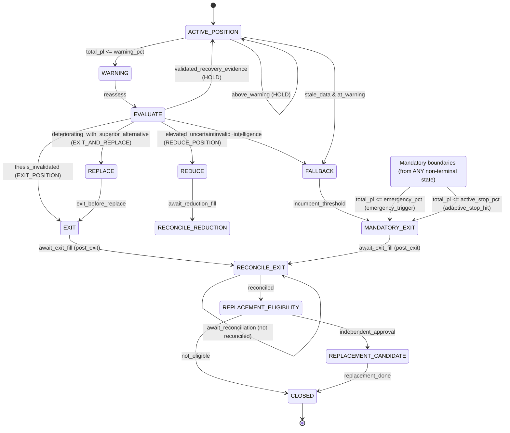

# Adaptive Protective-Exit Policy & State Machine (Milestone 6B, §14–§17, §38)

> **Status:** candidate / shadow-research only. Every policy here is a **recommendation** — the
> native C++ `RiskEngine` retains sole execution authority and submits all orders. The production
> **unconditional `-0.5%` protective exit is preserved untouched** as control, fallback, and
> rollback. The honest bottom line (see §7): the autonomous out-of-sample cycle **rejected** the
> candidates and the `-0.5%` exit is **retained**. No economic edge is claimed.

| Component | Module | Version constant |
|---|---|---|
| Adaptive policy | [`cengine/optimization/exits/adaptive.py`](../../cengine/optimization/exits/adaptive.py) | `adaptive-exit-1.0.0` |
| State machine | [`cengine/optimization/exits/state_machine.py`](../../cengine/optimization/exits/state_machine.py) | `exit-state-machine-1.0.0` |
| Experiment matrix | [`cengine/optimization/exits/experiment_matrix.py`](../../cengine/optimization/exits/experiment_matrix.py) | `exit-experiment-matrix-1.0.0` |
| OOS runner | [`cengine/optimization/exits/runner.py`](../../cengine/optimization/exits/runner.py) | — |
| Native emergency candidate | [`risk/protective_exit_candidate.hpp`](../../risk/protective_exit_candidate.hpp) | `kCandidateEmergencyThreshold = -0.03` |

---

## 1. The candidate idea (§14)

The incumbent sells unconditionally at `-0.5%`. The candidate re-frames that same `-0.5%` level
as a **mandatory reassessment threshold** (`warning_pct`) rather than an automatic liquidation,
and asks: given *independently-validated* recovery evidence, should the position **HOLD**,
**REDUCE**, **EXIT**, or **EXIT-AND-REPLACE** — bounded at all times by an adaptive stop and an
independent emergency trigger that can never be bypassed?

Two unit conventions run throughout, and they are deliberately distinct:

- **Signed P/L fractions** (negative = loss): `warning_pct = -0.005`, `initial_stop_pct = -0.010`,
  `max_stop_pct = -0.025`, `emergency_pct = -0.030`.
- **Stop *distances*** (positive fractions of price): what
  `volatility_adjusted_stop(...)` and the matrix `_stop_for(...)` return.

### `ExitAction` (the four decisions)

```python
class ExitAction(str, Enum):
    HOLD            = "hold"
    REDUCE_POSITION = "reduce_position"
    EXIT_POSITION   = "exit_position"
    EXIT_AND_REPLACE = "exit_and_replace"
```

### `AdaptiveExitConfig` defaults

| Field | Default | Role |
|---|---|---|
| `warning_pct` | `-0.005` | the preserved `-0.5%` reassessment trigger (`PRODUCTION_EXIT_PCT`) |
| `initial_stop_pct` | `-0.010` | default adaptive stop (`-1.0%`) |
| `max_stop_pct` | `-0.025` | widest adaptive stop (`-2.5%`) |
| `emergency_pct` | `-0.030` | independent final trigger (`-3.0%`, `EMERGENCY_EXIT_PCT`) |
| `atr_multiplier` | `1.5` | ATR scaling for the volatility-adjusted stop |
| `asset_class` | `"large_cap"` | selects the stop-distance range |
| `tightening_only` | `False` | allow tightening, never widening, after entry |
| `fixed_at_entry` | `False` | freeze the stop at position open |
| `min_recovery_probability` | `0.6` | HOLD gate on recovery evidence |
| `max_acceptable_downside` | `-0.02` | downside the policy will tolerate before forcing action |
| `allow_replace` | `True` | permit EXIT-AND-REPLACE routing |

---

## 2. Volatility-adjusted stops & risk-normalized sizing (§14.5–§14.6)

### Volatility-adjusted stop distance

```python
volatility_adjusted_stop(atr, reference_price, *, asset_class,
                         atr_multiplier=1.5, min_stop=None, max_stop=None) -> float
```

Returns a **positive** stop distance `clip(atr_multiplier * ATR / reference_price, [lo, hi])`,
where `[lo, hi]` is the per-asset-class range (overridable by `min_stop`/`max_stop`). ATR and
`reference_price` must share units. If either is non-positive it degrades to the lower bound
`lo` — never a nonsensical or unbounded stop.

Per-asset-class ranges (`_ASSET_CLASS_RANGES`, positive fractions):

| Asset class | Min distance | Max distance |
|---|---|---|
| `broad_etf` | 0.50% | 1.00% |
| `large_cap` *(default)* | 0.75% | 1.50% |
| `high_vol` | 1.00% | 2.00% |
| `leveraged_etf` | 1.25% | 2.50% |

`AdaptiveExitPolicy.initial_stop(atr, reference_price)` converts this to a signed stop and
**bounds it to `[max_stop_pct, warning_pct]`**: never wider than the `-2.5%` max, never tighter
than the `-0.5%` warning. With no ATR/price it falls back to `initial_stop_pct` (`-1.0%`).

### Risk-normalized sizing — a wider stop must *not* add risk

```python
risk_normalized_notional(allowable_position_risk, stop_distance_fraction) -> float
    # = allowable_position_risk / stop_distance_fraction   (0 if distance <= 0)
```

Position notional is set so a stop-out loses ≈ `allowable_position_risk`. Therefore a **wider
stop yields a SMALLER position** — *risk*, not notional, is held constant. This is the
mechanism that makes "give the trade more room" safe: it can never increase capital at risk.
Callers must still clamp by liquidity / buying-power / leverage / exposure / concentration.

---

## 3. The adaptive decision logic (`AdaptiveExitPolicy.decide`)

`decide(*, total_pl_frac, active_stop_pct, intelligence=None, replacement_available=False)`
returns an `ExitDecision(action, reason, active_stop_pct, emergency, fallback, evidence, version)`.
It consumes plain dicts, so it is fully testable without the live engine and never touches
orders. Precedence (first match wins):

1. **Emergency trigger** — `total_pl_frac <= emergency_pct` → `EXIT_POSITION`,
   reason `"emergency_trigger"`, `emergency=True`. Never bypassed.
2. **Adaptive stop hit** — `total_pl_frac <= active_stop_pct` → `EXIT_POSITION`,
   reason `"adaptive_stop_hit"`. The policy never authorizes holding beyond the active stop.
3. **Above warning** — `total_pl_frac > warning_pct` → `HOLD`, reason `"above_warning"`.
4. **At/under warning, above the stop → reassess with intelligence:**
   - **Invalid / unavailable intelligence** (`not valid`) → `EXIT_POSITION`,
     reason `"fallback_incumbent_exit"`, `fallback=True`. This is the critical safety default:
     **fall back to incumbent `-0.5%` behavior** whenever evidence is missing or untrusted.
   - Read `recovery_probability`, `downside_prediction`, and three boolean confirmations
     (`seller_exhaustion`, `momentum_confirmation`, `order_flow_confirmation`);
     `confirmations = sum(...)`.
   - **Strong recovery** (`recovery >= min_recovery_probability` **and** `confirmations >= 2`
     **and** `downside >= max_acceptable_downside`) → `HOLD`,
     reason `"validated_recovery_evidence"`.
   - **Superior alternative** (`allow_replace` and `replacement_available` and
     `downside < max_acceptable_downside`) → `EXIT_AND_REPLACE`,
     reason `"deteriorating_with_superior_alternative"`.
   - **Elevated uncertainty** (`recovery >= 0.4` and `confirmations >= 1`) → `REDUCE_POSITION`,
     reason `"elevated_uncertainty"`.
   - **Otherwise** → `EXIT_POSITION`, reason `"thesis_invalidated"`.

### Safety rules enforced in the policy

- Never authorize holding beyond the active adaptive stop.
- Never **widen** an active stop after entry unless explicitly in `fixed_at_entry` or
  `tightening_only` mode (`prohibit_unapproved_stop_widening`).
- A wider stop never increases capital at risk (§2, risk-normalized sizing).
- On invalid/unavailable intelligence, **fall back to incumbent `-0.5%`**.
- Recommendations only — native C++ retains execution authority; nothing here submits orders.

---

## 4. The deterministic state machine (§15)

`ProtectiveExitStateMachine` composes the policy into an explicit, testable machine that
guarantees deterministic precedence, idempotent transitions, duplicate-event protection,
stale-data / invalid-prediction handling (→ fallback to incumbent), and reconciliation before
replacement. It **emits intended actions, never orders**.

- `ExitEvent(event_id, total_pl_frac, active_stop_pct, now_ns, intelligence={},
  replacement_available=False, reconciliation_ok=True, stale=False)`
- `Transition(from_state, to_state, action, reason)` — every step is recorded in `history`.
- `_seen_events` makes `step` **idempotent**: a repeated `event_id` returns `"duplicate_event"`
  without advancing.
- Terminal set: `{CLOSED}`.

### Mandatory precedence

From **any** non-terminal state, before anything else, `step` checks the hard boundaries:

- `total_pl_frac <= emergency_pct` → `MANDATORY_EXIT` (`"emergency_trigger"`)
- `total_pl_frac <= active_stop_pct` → `MANDATORY_EXIT` (`"adaptive_stop_hit"`)

A triggered boundary always wins. Only then does the machine consider staleness, the warning
threshold, and the adaptive policy. `stale and at_warning` routes `FALLBACK → MANDATORY_EXIT`
(`"incumbent_threshold"`); a `fallback` decision does the same with reason
`"invalid_intelligence"`.

### State diagram



### Reconciliation-before-replacement tail

`post_exit(event)` drives the tail after an `EXIT` / `MANDATORY_EXIT`: it enters
`RECONCILE_EXIT` (`"await_exit_fill"`), then `_reconcile` advances only on confirmed fills.
`RECONCILE_EXIT` waits (`"await_reconciliation"`) until `reconciliation_ok`, then moves to
`REPLACEMENT_ELIGIBILITY`. A replacement is pursued **only** when both
`replacement_available` and `reconciliation_ok` hold (→ `REPLACEMENT_CANDIDATE`,
`"independent_approval"`); otherwise it goes straight to `CLOSED`. This guarantees the machine
never opens a replacement before the exit it depends on has actually reconciled.

---

## 5. The EXIT-00..15 experiment matrix (§17 / §38)

`run_exit_matrix(config, symbol, *, asset_class="large_cap", cost_frac=0.0004, start_ns=None,
end_ns=None, window="all", risk_normalized=False) -> ExitMatrixResult`

Multi-timeframe **historical replay on genuine 1-minute bars**: strategic long entries are
generated on completed **5-minute-aggregated** features (look-ahead-free: `mom5 > 0.0008`,
`close > previous-20-bar SMA`, warmup ≥ 30 bars, 5-min cadence, capped to 3000 entries), and
each position's exit is simulated **tactically on the 1-minute path** under each candidate
policy. If a window yields `< 500` bars or `< 30` entries the matrix returns
`INSUFFICIENT_DATA` per policy — never a fabricated metric.

### Conservative simulation assumptions (`_simulate`)

- Entry at the next 1m **open plus costs**; exit-side cost applied too (`cost_frac` both sides).
- A stop fills **at the stop level**, or at the **bar open if price gapped through** it
  (`min(bar_open, level)`).
- Within a bar, a stop is assumed to trigger **before** any favorable target (no
  favorable-first assumption).
- An **independent `-3%` emergency** trigger (`EMERGENCY_PCT = 0.03`) overlays every policy.
- Unexited positions hit a **time-stop** at the `max_hold` (120-bar) close.

### The matrix

| ID | Kind | Parameters | Notes |
|---|---|---|---|
| **EXIT-00** | `fixed` | stop 0.50% | **production incumbent / baseline** |
| EXIT-01 | `fixed` | stop 0.75% | |
| EXIT-02 | `fixed` | stop 1.00% | |
| EXIT-03 | `fixed` | stop 1.50% | |
| EXIT-04 | `fixed` | stop 2.00% | |
| EXIT-05 | `atr` | mult 2.0 | ATR-scaled, clipped [0.5%, 2.5%] |
| EXIT-06 | `volatility` | mult 2.5 | realized-vol scaled, clipped [0.5%, 2.5%] |
| EXIT-07 | `regime` | calm 0.8% / volatile 1.5% | switch on realized vol |
| EXIT-08 | `research_only` | — | needs trained recovery-probability model |
| EXIT-09 | `research_only` | — | needs trained constrained-RL exit policy |
| EXIT-10 | `research_only` | — | needs trained hybrid ML/RL policy |
| EXIT-11 | `research_only` | — | needs seller-exhaustion model + replacement ctx |
| EXIT-12 | `holding_period` | base 1.5%, tighten 0.005%/bar | time-decaying stop |
| EXIT-13 | `research_only` | — | needs portfolio context |
| EXIT-14 | `asset_class` | — | 2×ATR clipped to the asset-class range |
| EXIT-15 | `tightening_only` | initial 2.0%, floor 0.5% | monotonically tightening |

Deterministic stop-based policies are run **genuinely**; the five ML/RL/portfolio-aware entries
(EXIT-08/09/10/11/13) are honestly marked `RESEARCH_ONLY` until their models/context exist —
infrastructure validated, conclusion withheld. Each completed policy's per-trade net returns go
through `evaluate_candidate(..., data_label=DATA_LABEL_HISTORICAL_REPLAY)`, producing economic
metrics, a gated score, and bootstrap CIs. Results carry
`data_label = "historical_replay_simulated"` and the standing caveat: *historical-replay
simulation on genuine 1m bars; NOT actual trading performance.*

### Eval A vs Eval B

- **Eval A — exit-policy isolation.** Identical entries and **fixed size** across all policies,
  so the only difference is the exit rule. This is where wider stops look best.
- **Eval B — risk-normalized portfolio.** Position size scaled by `1 / stop-distance`
  (`size = risk_budget / max(entry_stop_dist, 1e-4)`) so a wider stop does **not** raise capital
  at risk. This removes the free leverage that a wider stop otherwise enjoys in Eval A, and is
  the economically fair comparison.

Run via CLI:

```bash
python -m cengine.optimization exit-matrix --symbol AAPL                 # Eval A
python -m cengine.optimization exit-matrix --symbol AAPL --risk-normalized  # Eval B
```

---

## 6. Out-of-sample evaluation (the runner, §38)

`make_exit_runner(symbol, ...)` plugs the `protective_exit` search space into the
`MetaOptimizer`. It enforces genuine OOS discipline via `oos_windows(...)`:

- **Chronological** split: `train_frac=0.6`, `validation_frac=0.2`, with a `3`-day **embargo**
  between segments (purged + embargoed).
- Candidate configs are fit/selected on the **TRAIN** window, then scored on the
  **VALIDATION** window, always against the **EXIT-00 (`-0.5%`) incumbent** *and* a simple
  baseline (`fixed 1.0%`) on the **same** window.
- An **UNTOUCHED certification holdout** (the reserved final segment) is **never accessed** by
  the optimizer — Milestone 7 owns it (`holdout_RESERVED` in `OOSWindows.to_dict`).
- Research-only policies (`recovery_prob`, `rl`, `hybrid`) cause the runner to **decline**
  (deferred), and a candidate that cannot produce ≥ 30 train trades returns `None`.

Independent economic judging (`economic.py`): `compare_to_baselines` recommends
`eligible_for_shadow` **only if** the candidate passes its mandatory risk gates *and* beats both
the incumbent and the simple baseline on score. Otherwise `reject`. Mandatory gates (a high
return can never buy past them) include a 25% max-drawdown ceiling, a `min_sample` of 30, and
no unauthorized risk expansion. Promotion stops at **shadow** — never live (M7 certifies).

---

## 7. The honest OOS result: `-0.5%` is RETAINED

The empirical core of Milestone 6B, stated without embellishment:

- **In exit-isolation (Eval A), wider stops out-score the `-0.5%` baseline.** This matches the
  counterfactual ~95% recovery finding — a tight unconditional stop sells into dips that
  reverse (see [`counterfactual_exits.md`](./counterfactual_exits.md)).
- **Under the fair, risk-normalized, out-of-sample test, the candidates did not survive.** The
  autonomous OOS cycle **rejected** them: none beat the incumbent out-of-sample under the risk
  gates and baseline hierarchy.
- **Therefore the production `-0.5%` exit is RETAINED, untouched.** No economic edge is claimed.
  The Eval A advantage was, in effect, compensated leverage that the risk-normalized and
  out-of-sample discipline removed.

This is the research mission working as designed: a strategy starts false, the burden of proof
is on the candidate, and a finding that *looks* profitable in isolation is correctly rejected
when it fails to survive cost-adjusted, risk-gated, out-of-sample falsification.

---

## 8. The native emergency candidate (`-3%`) — INACTIVE

A separate, crash-independent emergency trigger lives in native C++ so it can remain operational
even if Python / MLX / GPU / model-loading fail:

- [`risk/protective_exit_candidate.hpp`](../../risk/protective_exit_candidate.hpp) — a pure,
  stateless, side-effect-free `evaluate_emergency_exit(unrealized_return, emergency_threshold =
  -0.03)` returning `EmergencyExitDecision{triggered, unrealized_return, threshold,
  overrides_tighter_stop}`.
- Exposed to Python via `_cengine_native.evaluate_emergency_exit(...)` and
  `_cengine_native.clamp_emergency_threshold(proposed, current)` (`bindings/python_bindings.cpp`).
- `clamp_emergency_threshold` returns the **more protective** (tighter) of two thresholds — the
  optimizer can **never loosen** it (more-negative = wider = looser is rejected).
- `overrides_tighter_stop` is **always `false`**: a tighter active stop always wins.

Hard invariants:

- **INACTIVE.** It is **not** wired into `RiskEngine::evaluate` or any live path.
- It is a **liquidation level, not a guaranteed realized maximum loss** (gaps / halts / partial
  fills can produce worse fills).
- No ML/RL recommendation may override an activated trigger; the threshold may be **tightened,
  never loosened**; Milestone 7 certifies any activation.

```bash
python -m cengine.optimization emergency-check --unrealized-return -0.031
# -> {"triggered": true, "threshold": -0.03, "overrides_tighter_stop": false,
#     "note": "native candidate emergency exit (INACTIVE; M7 certifies)"}
```

---

## 9. Governance invariants (§24)

Enforced structurally by `OptimizationConfig.validate()` (overridable via `CENGINE_OPT_*` env
vars — `CENGINE_OPT_ENABLED`, `CENGINE_OPT_DEVICE`, `CENGINE_OPT_SEARCH`,
`CENGINE_OPT_MAX_CONFIGS`, `CENGINE_OPT_TRAIN_IN_SESSION`):

- `production_exit_pct` must equal `-0.005` — the `-0.5%` exit is **preserved** (validation
  rejects any other value).
- `candidate_emergency_pct` may not be loosened beyond `-3%`.
- `production_activation_enabled`, `autonomous_live_activation`, `autonomous_risk_expansion`,
  `hard_stop_optimization`, `live_exploration` are all **hard-off**; `milestone_7_certification_required`
  is `True`; outputs are `shadow_recommendations` only.
- GPU-first via MLX with a documented CPU fallback; the exit runner reports `device: "cpu"` for
  its vectorized DuckDB/NumPy replay path.
- Hard risk limits and the mandatory emergency protection are **not in any search space**
  (`search.py`); only bounded, approved parameters are tunable.

**Bottom line:** the adaptive policy, state machine, matrix, and OOS runner are a validated
research apparatus. They motivated a real hypothesis, tested it fairly and out-of-sample, and
honestly concluded **REJECT** — the production `-0.5%` protective exit stands.
