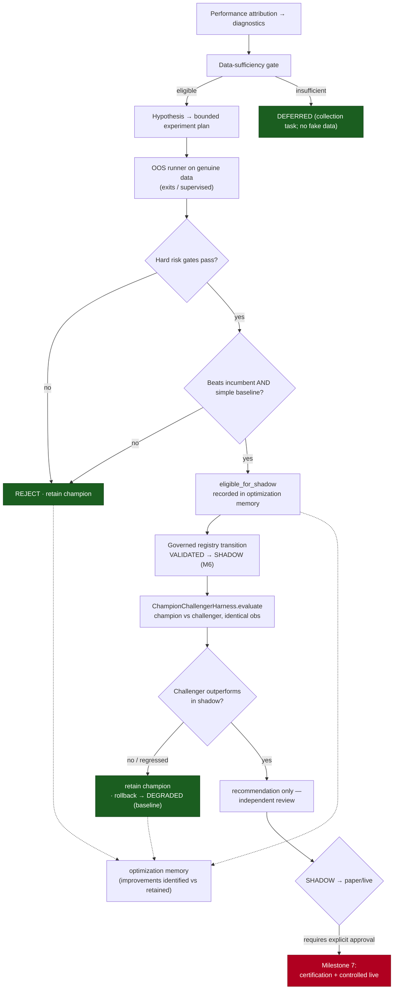

# Champion / Challenger & Maturity Lifecycle (Milestone 6B)

How a candidate the autonomous optimizer *likes* becomes a **challenger** that
runs beside the incumbent **champion** in shadow — and how it is kept there,
rejected, or rolled back, without ever touching live capital. This is the
Milestone 6B extension of the Milestone 6 champion/challenger harness and the
independent model-maturity state machine. It builds on those modules; it does
not rebuild them.

The governing rule, stated once: **nothing in this loop promotes anything to
live.** The optimizer produces *shadow-eligible* verdicts; the registry governs
*maturity*; the harness produces *shadow comparisons*. Live financial authority
is granted only by explicit operator approval, and economic certification plus
controlled live deployment are owned by Milestone 7.

> **Status.** Model / RL / execution challengers for the
> outcome-dependent tasks are untrained and research-only — those tasks are
> `INSUFFICIENT_DATA` (no genuine execution lifecycles yet). The protective-exit
> research *did* produce real out-of-sample challengers on genuine 1-minute bars:
> the EXIT-00..15 matrix shows wider stops out-score the −0.5% baseline in
> *exit-isolation*, but the autonomous OOS cycle **rejected** every candidate
> (none beat the incumbent out-of-sample under the risk gates), so the production
> −0.5% exit is **retained**. No economic edge is claimed; replay results are
> simulated, not actual trading performance.

---

## 1. The two lifecycles it coordinates

Milestone 6B sits on top of two *independent* dimensions from Milestone 6. They
are intentionally orthogonal — a model can be mature without being authorized,
and authorization is never a side effect of training.

**Model maturity** (`cengine/learning/registry/maturity.py`,
`ModelMaturity`): a strict state machine.

```
UNTRAINED → RESEARCH → TRAINED → VALIDATED → SHADOW
          → PAPER_ELIGIBLE → PAPER_CERTIFIED
          → LIVE_ELIGIBLE → LIVE_APPROVED → ACTIVE
safety sinks (reachable from any live/non-terminal state):
          DEGRADED · BLOCKED · RETIRED      (RETIRED is terminal)
```

- Legal transitions are whitelisted in `_LEGAL`; `can_transition` enforces them.
- `LIVE_ELIGIBLE → LIVE_APPROVED` and `LIVE_APPROVED → ACTIVE` are in
  `_APPROVAL_REQUIRED`: `check_transition(..., approved=False)` raises
  `PromotionError` — *"live financial authority is never granted
  automatically."*
- `is_live` is `{LIVE_APPROVED, ACTIVE}`; everything the optimizer produces stays
  strictly below that line (at or before `SHADOW`).

**Champion / challenger selection** (`cengine/learning/registry/model_registry.py`):

- `registry.champion(model_type)` → latest `ACTIVE` card, falling back to the
  latest `SHADOW` card. (In Milestone 6B, with nothing `ACTIVE`, the champion is
  the incumbent baseline / latest shadow.)
- `registry.challenger(model_type)` → latest `VALIDATED` / `SHADOW` card of the
  same type that is **not** the champion.

---

## 2. The shadow evaluation harness (Milestone 6 base)

`cengine/learning/orchestration/champion_challenger.py::ChampionChallengerHarness.evaluate`
runs the champion and the challenger over **identical observations** and records,
through the non-blocking decision sink, how they differ:

- `mean_abs_prediction_diff`, `rank_correlation`, `sign_disagreement_rate`.
- When realized outcomes are available, an `economic_metrics`-based
  select-if-positive paper P/L for each (`champion_economic`,
  `challenger_economic`), with the honest `data_label`
  (`real` vs `synthetic`).
- `recommendation` from `_recommend`: `challenger_outperforms_shadow` only when
  the challenger's `net_expectancy` exceeds the champion's — and even then the
  code comment is explicit: *"never auto-promote; only a recommendation for
  independent review."*

It is **shadow-only** by construction: it generates no duplicate real orders, and
a challenger that fails validation simply stays inactive.

---

## 3. The Milestone 6B extension — how optimizer candidates reach shadow

The Milestone 6B optimizer does not reach into the registry or run the harness
itself (verified: `cengine/optimization/` imports no registry / maturity /
harness code). Instead it produces an **independent, gated, baseline-ranked
verdict** and records it; the registry transition into `SHADOW` — which is what
makes a card a champion/challenger participant — remains a governed Milestone 6
operation subject to the maturity state machine above. The handshake:

1. **Candidate evaluated.** A runner
   (`exits/runner.py` on genuine 1m bars, or `supervised_runner.py` on genuine
   bars) returns a `CandidateEvaluation` plus a baseline set.
2. **Gates, then baseline hierarchy.** `economic.compare_to_baselines` requires
   `gates_passed` *and* that the candidate's score beats the **incumbent** and a
   **simple baseline** (`simple_statistical` or `deterministic`). Only then does
   the recommendation become `eligible_for_shadow` — otherwise `reject`.
   The note is baked in: *"NEVER promoted to live here; shadow-eligible only (M7
   certifies)."*
3. **Decision recorded, best kept.** `MetaOptimizer._process_hypothesis` records
   the outcome in persistent optimization memory as
   `ExperimentStatus.ELIGIBLE_FOR_SHADOW` or `REJECTED`, and keeps the
   highest-scoring shadow-eligible candidate per hypothesis as `accepted`.
4. **Outer-loop accounting.** `OptimizationMemory.effectiveness` separates
   `improvements_identified` (shadow-eligible verdicts) from
   `improvements_retained` (`shadow_retained is True`) — the optimizer scores its
   *own* selection process, not just the candidates.

So "accept" in Milestone 6B means **shadow-eligible recommendation**, not a
live promotion and not an automatic registry transition. The maturity ladder is
the gate that stands between that recommendation and anything routable.

---

## 4. Promotion gates

A candidate must clear **every** layer below. The ordering matters: a failure at
any layer stops it, and a high return never compensates for a failed risk gate.

| Layer | Enforced by | Must hold |
| ----- | ----------- | --------- |
| OOS discipline | `validation.oos_windows` / `purged_walk_forward` | Chronological **purged + embargoed** train/validation; certification holdout reserved, never accessed. |
| Hard risk gates | `economic.EconomicScoreConfig` | `max_drawdown_limit` (0.25), `min_sample` (30), `require_no_risk_expansion`. |
| Baseline hierarchy | `economic.compare_to_baselines` | Beats the **incumbent** *and* a **simple** baseline on the fixed economic score. |
| Statistical support | `bootstrap_metric_ci` | Dependence-aware net-return confidence interval attached. |
| Data honesty | `data_label` | Synthetic data is never genuine evidence (shadow-eligible on synthetic is still non-promotable). |
| Maturity transition | `maturity.check_transition` | `VALIDATED → SHADOW` is the ceiling here; `SHADOW →` paper/live requires separately-validated, explicit operator approval (Milestone 7). |

Everything above `SHADOW` is **out of scope** for the autonomous loop. There is
no code path by which the optimizer, the harness, or the registry auto-advances a
card into `LIVE_APPROVED` / `ACTIVE`.

---

## 5. Shadow-only invariant

- The harness emits recommendations and decision evidence; it **routes nothing**
  and never duplicates real orders.
- Milestone 6B adds **no** new routing surface. The native C++ `RiskEngine`
  remains the sole financial authority; the candidate native emergency stop
  (`risk/protective_exit_candidate.hpp`) is **INACTIVE**.
- The production −0.5% protective exit is preserved untouched. It is environment
  dynamics, never a tunable policy, and no challenger can relax it.
- Config invariants (`OptimizationConfig.validate`) keep
  `production_activation_enabled`, `autonomous_live_activation`,
  `autonomous_risk_expansion`, `hard_stop_optimization`, and `live_exploration`
  hard-off.

---

## 6. Rollback

Rollback is **always legal** — it is a safety sink, not a gated promotion.

- `model_registry.rollback(model_id, to_reference=...)` demotes a card to
  `DEGRADED` and records a `rollback_reference` — the **last approved model** or
  the **deterministic baseline**. From `DEGRADED` the only forward moves are back
  to `ACTIVE` or `SHADOW` (`_LEGAL[DEGRADED]`), so recovery is itself re-gated.
- `BLOCKED` is a hard stop reachable from any non-terminal state; `RETIRED` is
  terminal.
- The protective-exit result is rollback-by-default in spirit: because the OOS
  cycle rejected every challenger, the system **stays on the incumbent** −0.5%
  exit. "Do nothing and keep the champion" is the safe outcome the gates are
  designed to produce when no candidate earns promotion.

---

## 7. End-to-end flow



The red node is the only place live authority is granted, and it lives entirely
in Milestone 7 behind explicit approval. Everything the Milestone 6B autonomous
loop does terminates at or before `SHADOW`.

---

## 8. Operating it

```bash
# run one governed cycle; accepted candidates are shadow-eligible only
python -m cengine.optimization optimize --symbol AAPL

# optimizer self-effectiveness: improvements identified vs retained
python -m cengine.optimization memory

# the empirical protective-exit challengers (genuine 1m bars)
python -m cengine.optimization exit-matrix --symbol SPY
python -m cengine.optimization counterfactual --symbol SPY

# native candidate emergency-exit check (INACTIVE; M7 certifies)
python -m cengine.optimization emergency-check --unrealized-return -0.031
```

---

## 9. Invariants (summary)

- Two orthogonal lifecycles: model **maturity** (state machine) and
  **champion/challenger** selection; authorization is never a side effect of
  training.
- The optimizer emits **shadow-eligible** verdicts only; it never transitions the
  registry, runs the harness, or promotes to live itself.
- Promotion gates stack: OOS discipline → hard risk gates → baseline hierarchy →
  statistical support → data honesty → maturity transition. `SHADOW` is the
  ceiling for the autonomous loop.
- Shadow-only: no duplicate real orders, no new routing, native C++ `RiskEngine`
  sole authority, candidate emergency stop INACTIVE, production −0.5% exit
  preserved.
- Rollback to the last approved model or deterministic baseline is always legal.
- Live financial authority requires explicit operator approval; Milestone 7 owns
  certification and controlled live deployment. No economic edge is claimed.
