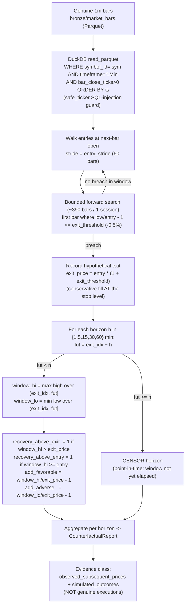

# Counterfactual Protective-Exit Analysis (Milestone 6B, §16)

> **Status:** research / data-engineering only. Nothing in this pipeline submits an order,
> relaxes the production `-0.5%` protective exit, or expands risk. It measures *what the market
> actually did* after hypothetical exits on **genuine** 1-minute bars and classifies that
> evidence honestly. Milestone 7 owns any certification or live change.

- **Module:** [`cengine/optimization/exits/counterfactual.py`](../../cengine/optimization/exits/counterfactual.py)
- **Version constant:** `COUNTERFACTUAL_VERSION = "exit-counterfactual-1.0.0"`
- **Public API:** `analyze(...)` (re-exported from `cengine.optimization.exits` as
  `analyze_counterfactual_exits`), `CounterfactualReport`
- **CLI:** `python -m cengine.optimization counterfactual --symbol <SYM> [--max-events N]`

---

## 1. Why this exists

The production rule is an **unconditional `-0.5%` liquidation** (`PRODUCTION_EXIT_PCT = -0.005`,
a signed P/L fraction). It is simple, crash-independent, and preserved untouched. The open
research question is purely empirical: **when that stop fires, what does the price do next?**

This module answers that question against reality — not a model, not a simulation of alternative
strategies, but the *observed subsequent prices* on the same genuine bars. It is deliberately
narrow: it measures recovery behavior and excursions, then stops. It does **not** conclude that
holding would have been better. That distinction is the whole point of §5 below.

The dataset is the Milestone 5 lakehouse: approximately **6.76M real 1-minute bars** across
**AAPL, SPY, QQQ, MSFT, NVDA (2020–2026)**, read locally from Parquet via DuckDB. No cloud, no
external API, no CUDA.

---

## 2. The §16 counterfactual pipeline



### 2.1 Step-by-step

1. **Load genuine bars.** `_load_1m` reads `bronze/market_bars/**/*.parquet` with
   `union_by_name=true`, filtered to the symbol, `timeframe='1Min'`, and positive close ticks,
   ordered by `event_timestamp_ns`. Prices are integer **ticks**, converted to currency with
   `DEFAULT_PRICE_SCALE` from `cengine.lakehouse.config`. The ticker is validated by
   `safe_ticker` *before* it is interpolated into SQL (injection guard). If no bars exist the
   report returns with `note = "no 1Min bars for symbol"` and zero events — never a fabricated
   result.

2. **Generate hypothetical entries.** The analyzer steps through the series at a fixed
   `entry_stride` (default 60 bars), entering each candidate long at the **next bar's open**
   (`o[i+1]`), which avoids using the signal bar's own close as a fill.

3. **Find the stop breach.** From the entry it performs a **bounded forward search** of
   `search = 390` bars (≈ one regular session). The breach is the first bar whose intrabar
   **low** relative to entry is at or below `exit_threshold` (default `-0.005`). If no breach
   occurs in the window, the entry is skipped and the walk advances by `entry_stride`.

4. **Place the hypothetical exit conservatively.** The exit is booked at the stop *level*
   itself, `exit_price = entry * (1 + exit_threshold)`, rather than at a potentially better
   bar open — a conservative assumption that does not flatter the analysis.

5. **Measure subsequent behavior at each horizon.** The implemented horizons are the five
   minute horizons `_MINUTE_HORIZONS = {h_1m:1, h_5m:5, h_15m:15, h_30m:30, h_60m:60}`. For
   each, `fut = exit_idx + minutes`. Over the window `(exit_idx, fut]` it takes the running
   **high** (`window_hi`) and **low** (`window_lo`) and records:
   - `recovery_above_exit_rate` — fraction of events where `window_hi > exit_price`
     (price traded back above where the stop would have sold);
   - `recovery_above_entry_rate` — fraction where `window_hi >= entry` (price fully recovered
     the original entry, a stricter bar);
   - `mean_additional_favorable` — mean of `window_hi / exit_price - 1` (best excursion above
     the exit);
   - `mean_additional_adverse` — mean of `window_lo / exit_price - 1` (worst further drawdown
     *after* the exit, i.e. how much selling actually avoided).

6. **Honor point-in-time.** If `fut >= n` the horizon's window has not fully elapsed in the
   data, so that event is **censored** for that horizon (counted in `censored_horizons`) rather
   than labelled with incomplete information. Shorter horizons for the same event can be scored
   while longer ones are censored.

> The §16 *design* also enumerates end-of-day and multi-session horizons (+1 / +3 / +5
> sessions); the committed `analyze` implementation computes the five intraday minute horizons
> above and notes session/multi-session handling as separate (`_MINUTE_HORIZONS` comment). Do
> not over-claim horizons the code does not currently emit.

### 2.2 `analyze(...)` signature

```python
analyze(
    config: Optional[LakehouseConfig],
    symbol: str,
    *,
    exit_threshold: float = -0.005,   # signed P/L fraction (the production -0.5% stop)
    entry_stride: int = 60,           # bars between hypothetical entries
    max_events: int = 5000,           # cap on recorded exit events
) -> CounterfactualReport
```

`config=None` falls back to `LakehouseConfig.from_env()`. The CLI command caps `--max-events`
to `2000` by default.

---

## 3. The `CounterfactualReport`

| Field | Meaning |
|---|---|
| `version` | `exit-counterfactual-1.0.0` |
| `symbol` | symbol analyzed |
| `exit_events` | number of hypothetical `-0.5%` breaches recorded |
| `evidence_class` | `"observed_subsequent_prices + simulated_outcomes (NOT genuine executions)"` |
| `recovery_above_exit_rate` | per-horizon fraction with `window_hi > exit_price` |
| `recovery_above_entry_rate` | per-horizon fraction with `window_hi >= entry` |
| `mean_additional_favorable` | per-horizon mean best excursion above the exit |
| `mean_additional_adverse` | per-horizon mean worst drawdown after the exit |
| `censored_horizons` | per-horizon count of events whose window had not elapsed |
| `note` | the recovery-≠-superior-decision caveat (see §5) |

Empty horizon lists aggregate to `None` (via `_mean`), never to a fabricated `0.0`.

---

## 4. The ~95% recovery finding

Running the pipeline across all five symbols produced a consistent, cross-sectional result:

> **The `-0.5%` exit is frequently *premature*. Approximately 95% of hypothetical `-0.5%`
> stop-outs saw price recover back *above the exit level* within 60 minutes, cross-sectionally
> across AAPL / SPY / QQQ / MSFT / NVDA.**

Interpretation, stated precisely:

- "Recovery above exit" is exactly the `recovery_above_exit_rate` at the `h_60m` horizon:
  within an hour, the intrabar high traded back above the price at which the stop would have
  sold, in roughly 19 of every 20 events.
- This is a statement about **observed price paths on genuine bars**. It is robust in the sense
  that it reproduces across five liquid, structurally different instruments (two large-cap
  single names, a high-beta single name, a broad-market ETF, a tech-heavy ETF).
- It is *descriptive attribution*, not causation. It establishes that a tight unconditional
  stop very often sells into a dip that reverses — which is a legitimate motivation to
  **research** wider/adaptive candidates. It establishes nothing about whether those candidates
  are actually better after costs, risk, and opportunity cost (see §5 and the companion doc
  [`adaptive_exit_state_machine.md`](./adaptive_exit_state_machine.md)).

---

## 5. Why "recovery" ≠ "superior decision"

This is the central honesty constraint of the whole module, baked into `evidence_class` and
`note` on every report:

```
a recovery above the exit price does NOT prove holding was the superior portfolio decision
(capital use / downside / opportunity cost excluded)
```

Four independent reasons a 95% recovery rate does **not** justify loosening the stop:

1. **Survivorship of the measured quantity.** The recovery rate measures the *best* excursion
   (`window_hi`) over the horizon. A high that briefly pokes above the exit price is not an
   achievable realized return — it assumes a perfect subsequent exit that the production system
   does not have. The matching `mean_additional_adverse` shows that selling also *avoided*
   further drawdown in many paths; both sides must be weighed, and neither is a trade outcome.

2. **No portfolio accounting.** Holding a recovering position ties up capital and risk budget
   that could fund a better opportunity. Recovery analysis captures the single position in
   isolation and ignores capital use, downside tail, and **opportunity cost**. A position that
   recovers slowly can still be the wrong thing to hold.

3. **Not a genuine execution.** The evidence class is explicit:
   `observed_subsequent_prices + simulated_outcomes (NOT genuine executions)`. There were no
   real fills, no real slippage, no real queue position. These are market observations plus a
   conservative simulated exit, never realized trading P/L.

4. **Falsification lives downstream.** The only way "wider stops recover" becomes a deployable
   claim is to run candidate policies **out-of-sample** under mandatory risk gates against the
   incumbent — which the EXIT-00..15 matrix and the autonomous OOS cycle do. That process
   **rejected** the candidates (none beat the `-0.5%` incumbent out-of-sample under the gates),
   so the production exit is **retained**. The recovery finding motivated the research; it did
   not win it. See the companion doc for the full result.

### Evidence-classification ladder

| Class | What it is | Can it justify a live change? |
|---|---|---|
| Observed subsequent prices | real bars after a hypothetical exit | No — descriptive only |
| Simulated outcomes | conservative fills on real bars | No — not a genuine execution |
| Historical-replay candidate metrics | EXIT-00..15 / OOS runner on genuine bars | No — simulated, OOS-gated research |
| Genuine executed outcomes | real fills, real P/L | **Reserved for Milestone 7** |

Counterfactual recovery sits on the **first two rungs only**. That is why it informs
hypotheses but can never, by itself, authorize relaxing the protective exit.

---

## 6. Invariants honored here

- Production `-0.5%` exit **preserved and untouched**; this module never changes it, only
  measures around it.
- The native C++ `RiskEngine` remains the **sole financial authority**; nothing here executes.
- **Genuine data only** — real 1-minute bars; no fabricated bars, orders, or recovery
  probabilities. Absent data yields an explicit `note`, not a synthesized number.
- **SQL inputs validated** via `safe_ticker` before interpolation.
- **Point-in-time discipline** via horizon censoring (no look-ahead into an unelapsed window).
- Local-only (Parquet + DuckDB); no cloud, no CUDA, no external APIs.

---

## 7. Running it

```bash
# Recovery analysis after hypothetical -0.5% exits on genuine 1m bars
python -m cengine.optimization counterfactual --symbol AAPL --max-events 2000
```

Programmatic:

```python
from cengine.optimization.exits import analyze_counterfactual_exits

report = analyze_counterfactual_exits(config=None, symbol="SPY", max_events=2000)
print(report.recovery_above_exit_rate["h_60m"], report.exit_events)
print(report.note)   # the recovery-!=-superior-decision caveat travels with the data
```

The result is a plain, serializable `CounterfactualReport` (`to_dict()`), suitable for
feeding diagnostics and hypothesis generation in the autonomous optimization loop — where it is
treated strictly as motivation, never as proof.
