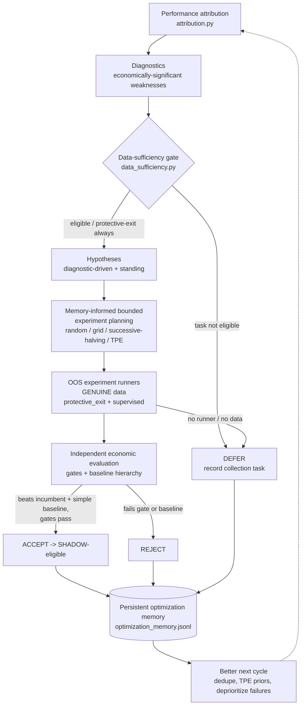

# Daily & Weekly Autonomous Optimization Workflow (Milestone 6B, §22)

The operational face of the closed loop. This document describes how the autonomous
optimization platform (`cengine/optimization/`) runs on a cadence, why it is kept
**off the trading-critical path**, and what reliability properties let it be scheduled
unattended.

Everything here is **research / shadow-only**. No step activates a live policy, expands
risk, relaxes the production **−0.5% protective exit**, enables live exploration, or
modifies the engine's own code. Milestone 7 owns certification and controlled live
deployment (see `milestone7_boundary.md`).

## What runs, and what it builds on

The workflow builds on — and never rebuilds — the Milestone 5 lakehouse
(Parquet / DuckDB) and the Milestone 6 learning layer (MLX models, economic evaluation).
It is **local-only**: no cloud, no CUDA, no external model APIs. Compute is **GPU-first
via MLX (Apple Metal) with a documented CPU fallback** — the protective-exit replay
runners in fact run on CPU (`device="cpu"` in `exits/runner.py`), and only the supervised
search escalates to Metal when available.

A cycle is driven by `cengine/optimization/orchestration.py`:

- `AutonomousOptimizationCycle.run(...)` / `run_autonomous_cycle(config, symbol=...)`
  wires the genuine experiment runners into the `MetaOptimizer` and executes one pass.
- `MetaOptimizer.run(...)` (`controller.py`) is the closed loop itself.

Invoke a single cycle from the CLI:

```
python -m cengine.optimization optimize --symbol AAPL
```

## The closed loop (one cycle)



Step by step, as implemented in `MetaOptimizer.run`:

1. **Attribute → diagnose.** `PerformanceAttributionEngine.attribute()` reads genuine
   gold `position_outcomes`. With no live session yet, it honestly emits an
   `INSUFFICIENT_DATA` diagnostic instead of fabricating weaknesses.
2. **Data-sufficiency gate.** `DataSufficiencyController.assess()` returns the
   experiment-eligible tasks and prioritized collection tasks. A task-bound search space
   whose task is not eligible is **DEFERRED** (infrastructure present, conclusion withheld)
   and recorded to memory with reason `insufficient_data`.
3. **Hypotheses.** `HypothesisGenerator.generate(diagnostics)` plus `standing(...)`. The
   protective-exit matrix is a **standing** hypothesis that always runs on genuine bars
   via the replay environment (it needs no closed-position outcomes); the supervised search
   fires only when `forward_return_prediction` is eligible.
4. **Bounded planning.** `ExperimentPlanner.plan(hypothesis, budget=...)` samples the
   approved, versioned search space using the configured method
   (`random` / `grid` / `successive_halving` / `tpe`), then validates, dedupes against
   memory, and drops repeatedly-failing fingerprints — so no compute is spent on work
   already done or known to fail.
5. **OOS experiment execution on genuine data.** Pluggable `runners` keyed by search space:
   - `protective_exit` → `exits/runner.py` (multi-timeframe historical replay on genuine
     1-minute bars, fit on TRAIN, scored on VALIDATION, incumbent **EXIT-00 (−0.5%)** +
     a simple baseline scored on the same window).
   - `supervised_model` → `supervised_runner.py` (OOS forward-return model vs the sklearn
     baseline).
6. **Independent economic evaluation.** `compare_to_baselines(...)` applies mandatory risk
   gates and the baseline hierarchy. A candidate must pass its gates **and** beat both the
   incumbent and a simple baseline on the economic score to become shadow-eligible — never
   promoted to live here.
7. **Accept(shadow) / reject / defer → memory.** Every outcome is appended to persistent
   memory, which feeds the next cycle's dedupe, TPE priors, and failure deprioritization.

> **Honest result to date.** On genuine data, the protective-exit matrix shows wider stops
> out-score the −0.5% baseline **in exit-isolation**, but the autonomous OOS cycle
> **rejected** every candidate (none beat the incumbent out-of-sample under the risk gates),
> so the production −0.5% exit is **retained**. No economic edge is claimed, and
> historical-replay results are **simulated, not actual trading performance**.

## Daily vs weekly cadence

The platform is designed to be scheduled unattended. Because every command is
non-ordering and reads immutable lakehouse history, the split below is a recommended
operating rhythm, not a hard-coded scheduler.

| Cadence | Activity | Entry point |
| --- | --- | --- |
| **Daily** (after the close) | Run one optimization cycle per primary symbol; append the cycle summary to the ledger. | `python -m cengine.optimization optimize --symbol <SYM>` |
| **Daily** | Refresh attribution + data-sufficiency so collection tasks stay current. | `attribute`, `data-sufficiency` |
| **Weekly** | Review optimization-memory effectiveness (compute per improvement, duplicate rate); refresh OOS windows as the data span grows; re-run the protective-exit counterfactual and EXIT-00..15 matrix across the five symbols for a cross-sectional read. | `memory`, `validation-windows`, `counterfactual`, `exit-matrix` |
| **Weekly** | Confirm the production −0.5% exit remains the retained incumbent (expect continued rejection of candidates). | review `optimization_memory.jsonl` decisions |

Primary research universe: AAPL, SPY, QQQ, MSFT, NVDA (~6.76M genuine 1-minute bars,
2020–2026; 1m canonical, 5m strategic). Multi-timeframe historical replay is the primary
research environment.

## Off the trading-critical path

The workflow is deliberately isolated from live trading:

- **No orders, ever.** Every CLI command and every runner is non-ordering and
  recommendation-only. The native C++ `RiskEngine` remains the sole financial authority
  (see `native_risk_authority.md`); nothing in `cengine/optimization/` submits, amends, or
  authorizes an order.
- **Shadow-only outcomes.** Accepted candidates are marked `eligible_for_shadow`; the
  production policy and the −0.5% exit are untouched.
- **Runs outside the session by default.** `OptimizationConfig.training_during_market_hours`
  defaults to `False` (`CENGINE_OPT_TRAIN_IN_SESSION`), so training/search does not contend
  with the live hot path for Metal/CPU during market hours.
- **Reads, does not mutate production state.** Runners read immutable bronze/gold Parquet
  via DuckDB; the only writes are to the gitignored `<lakehouse_root>/_optimization/`
  ledgers.

## Scheduler reliability

The cycle is built to survive being run repeatedly and unattended:

- **Idempotent / resumable via memory.** Persistent memory
  (`_optimization/optimization_memory.jsonl`) is append-only and `fsync`-flushed on every
  `record(...)`. `ExperimentPlanner` dedupes candidate configs against this ledger by
  fingerprint, so re-running a cycle does not repeat completed experiments and an
  interrupted session resumes without redundant compute.
- **Fault isolation.** In `MetaOptimizer._process_hypothesis`, a single runner raising an
  exception is caught, recorded under `errors`, and **never aborts** the loop; the next
  config/hypothesis proceeds.
- **Best-effort reporting.** `AutonomousOptimizationCycle._record` writes a compact summary
  to `_optimization/cycle_runs.jsonl`; an `OSError` there is swallowed so a logging failure
  never fails the research run.
- **Honest deferral under missing data.** When a runner's data is ineligible or its model
  context does not yet exist, the runner declines / the gate defers — the cycle records a
  deferral rather than fabricating a result.
- **Deterministic & bounded.** Search is seeded (`ExperimentBudget.seed`) and budgeted
  (`max_configs_per_hypothesis`), bounding per-cycle compute for predictable scheduling.
- **Disabled-safe.** If `CENGINE_OPT_ENABLED` is off, a cycle returns immediately with
  `skipped: "optimization disabled"`.

## Related

- `operations.md` — CLI reference, `CENGINE_OPT_*` configuration, reports, OOS windows,
  troubleshooting.
- `native_risk_authority.md` — the native financial authority and the inactive candidate
  emergency stop.
- `milestone7_boundary.md` — what this workflow does vs what Milestone 7 owns.
