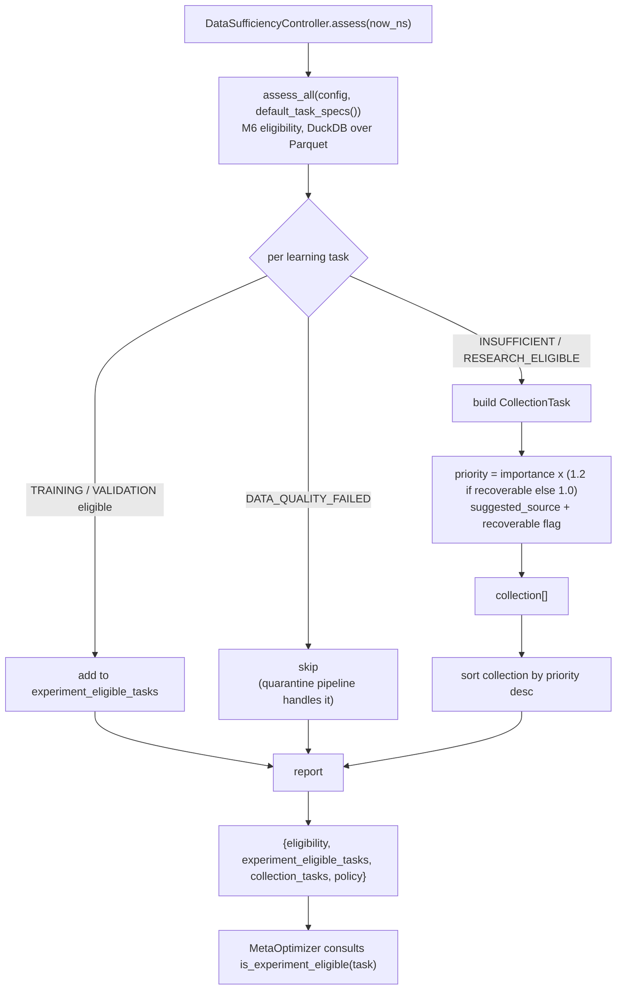
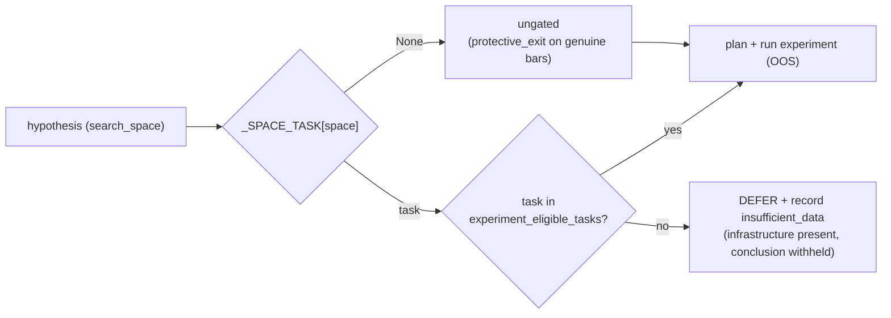

# Milestone 6B — Data Sufficiency Controller

`DataSufficiencyController` (`cengine/optimization/data_sufficiency.py`) is the autonomous
**data-sufficiency gate** that stands between the meta-optimizer and any experiment. Its job
is to answer a single honest question for every learning task:

> *Do we have enough genuine, eligible evidence to reach a reliable conclusion — and if not,
> what evidence is missing and where could it come from?*

If the answer is no, the controller emits a **prioritized data-collection task**, never
synthetic data. The meta-optimizer consults this controller before launching any experiment,
so it **never spends compute on a question the data cannot answer**.

`DATA_SUFFICIENCY_VERSION = "data-sufficiency-controller-1.0.0"`.

This milestone **builds on** the M6 dataset-eligibility semantics
(`cengine/learning/datasets/eligibility.py`) — reused, not reinvented — and adds (1) a
collection-task generator, (2) an economic-importance prioritization, and (3) the
experiment-eligibility gate the controller exposes to the `MetaOptimizer`. Everything is
**local** (Parquet + DuckDB); no cloud, CUDA, or external API.

---

## 1. The no-fabrication rule (foundational invariant)

The controller **never fabricates observations, orders, fills, rewards, or behavior-policy
probabilities.** A deficiency yields a **collection task**, not synthetic data. This is the
same cardinal rule the M6 eligibility layer enforces: *a model with insufficient evidence
receives no fabricated examples and no automatic promotion — it stays untrained /
research-only while genuine evidence accumulates.*

Why it matters structurally: synthetic rows would corrupt the economic evaluator's baseline
hierarchy and the optimization memory's effectiveness scoring, and would let the optimizer
"conclude" something that reality never demonstrated. The honest path is to **defer**.

---

## 2. Eligibility states

The controller reuses `EligibilityState` from the M6 eligibility module
(`ELIGIBILITY_VERSION = "dataset-eligibility-1.0.0"`):

| State | Value | Meaning |
|---|---|---|
| `INSUFFICIENT_DATA` | `insufficient_data` | below the research threshold, or missing required labels/rewards/action-support/materialization |
| `DATA_QUALITY_FAILED` | `data_quality_failed` | a quality violation (e.g. point-in-time lookahead) — handled by quarantine, **not** collection |
| `RESEARCH_ELIGIBLE` | `research_eligible` | enough to explore / prototype, but **not** to fit a champion |
| `TRAINING_ELIGIBLE` | `training_eligible` | enough to fit a model |
| `VALIDATION_ELIGIBLE` | `validation_eligible` | enough for a held-out economic verdict |

Only the two **trainable** states clear the experiment gate:

```python
_TRAINABLE = {TRAINING_ELIGIBLE, VALIDATION_ELIGIBLE}
```

How a task reaches each state (`assess_task` in the M6 eligibility module): the dataset must
be materialized and pass the **data-quality gate first** (any `point_in_time_violations > 0`
⇒ `DATA_QUALITY_FAILED`). Then an **effective sample size** is computed — labeled rows if the
task `requires_labeled_outcomes`, reward rows if it `requires_reward`, else raw rows — because
raw bar counts are *not* independent trading outcomes (24k serially-dependent bars of a few
instruments are not 24k labeled lifecycles). That effective size, together with the required
instruments and sessions, is compared against the task's declared `min_rows_research` /
`min_rows_training` / `min_rows_validation` thresholds to assign the state.

---

## 3. Assessment flow



`assess(now_ns)` calls `assess_all(self.config, specs=default_task_specs())` once, then for
each task:

- **Trainable** (`TRAINING_ELIGIBLE` / `VALIDATION_ELIGIBLE`) → appended to
  `experiment_eligible_tasks`.
- **`DATA_QUALITY_FAILED`** → skipped (a quality failure is a quarantine concern, not a
  collection concern — more data won't fix lookahead).
- **Everything else** (`INSUFFICIENT_DATA`, `RESEARCH_ELIGIBLE`) → a `CollectionTask` is
  generated.

The returned report:

```python
{
  "report": "data_sufficiency",
  "version": "data-sufficiency-controller-1.0.0",
  "generated_ns": <int>,
  "eligibility": { task: state_value, ... },
  "experiment_eligible_tasks": [ ...task names... ],
  "collection_tasks": [ ...sorted CollectionTask dicts... ],
  "policy": "no fabricated observations; deficiencies become collection tasks",
}
```

Inspect it directly:

```
python -m cengine.optimization data-sufficiency
```

---

## 4. Collection-task generation

When a task lacks eligible evidence, the controller emits a `CollectionTask`
(`contracts.py`) describing *what* is missing, *whether it is historically recoverable*, and
*where* it could come from — a prioritized acquisition request, not a fabrication.

`CollectionTask` fields:

| Field | Source |
|---|---|
| `task_id` | `stable_id("collect", task, now_ns)` (deterministic) |
| `learning_task` | the deficient task name |
| `missing_evidence` | human-readable deficiency + first few eligibility `reasons` (`_missing_evidence`) |
| `recoverable_historically` | from `_RECOVERABLE` (can backfill vs. requires live/mock evidence) |
| `priority` | `_IMPORTANCE[task] × (1.2 if recoverable else 1.0)` |
| `estimated_economic_importance` | `_IMPORTANCE[task]` prior |
| `suggested_source` | from `_RECOVERABLE` — where the evidence could be recovered |
| `status` | `"open"` |

Tasks are sorted **by `priority` descending**, so the most economically important,
historically recoverable gaps surface first.

### Economic-importance priors (`_IMPORTANCE`)

| Learning task | Importance |
|---|---|
| `strategy_net_return` | 1.0 |
| `policy_bandit` | 0.9 |
| `offline_rl_execution` | 0.9 |
| `probability_positive_return` | 0.8 |
| `execution_quality` | 0.7 |
| `regime_transition` | 0.5 |
| `forward_return_prediction` | 0.4 |

(Default 0.5 for any unlisted task.)

### Recoverability & suggested source (`_RECOVERABLE`)

| Learning task | Suggested source | Recoverable historically? |
|---|---|---|
| `forward_return_prediction` | `historical_sip_bars` | **Yes** |
| `regime_transition` | `historical_sip_bars` | **Yes** |
| `strategy_net_return` | `live_or_mock_execution_outcomes` | No |
| `probability_positive_return` | `live_or_mock_execution_outcomes` | No |
| `execution_quality` | `genuine_order_fill_events` | No |
| `policy_bandit` | `logged_policy_actions_with_rewards` | No |
| `offline_rl_execution` | `logged_sequential_transitions` | No |

The `1.2×` recoverability multiplier intentionally boosts gaps that can be closed from
existing historical bars (forward-return, regime) above those that require **genuine**
execution lifecycles — which can only accrue from real or mock execution, never from
invented data.

---

## 5. The experiment-eligibility gate

```python
def is_experiment_eligible(self, task, *, now_ns=None) -> bool:
    return task in self.assess(now_ns=now_ns)["experiment_eligible_tasks"]
```

This is the single call the `MetaOptimizer` consults before launching a task-bound
experiment. In `MetaOptimizer.run()` the controller is invoked once per cycle and the
resulting `experiment_eligible_tasks` set gates hypothesis processing via the `_SPACE_TASK`
map (`controller.py`):

| Search space | Gating learning task |
|---|---|
| `supervised_model` | `forward_return_prediction` |
| `rl_reward` | `offline_rl_execution` |
| `entry_policy` | `strategy_net_return` |
| `strategy_policy` | `strategy_net_return` |
| `protective_exit` | `None` (ungated — runs on genuine bars via counterfactual / replay) |

If a task-bound space's gating task is **not** eligible, the hypothesis is **DEFERRED** — the
controller records a `DEFERRED` memory row with `rejection_reason="insufficient_data"`, and no
compute is spent. The `protective_exit` space is deliberately `None`-gated because its
research runs on genuine 1-minute bars through the counterfactual / replay environment and
does **not** require closed-position outcomes.



---

## 6. Current honest status

Running `data-sufficiency` today reflects the genuine data reality:

- **`forward_return_prediction`** — eligible against the ~6.76M real 1-minute bars
  (AAPL/SPY/QQQ/MSFT/NVDA, 2020–2026); the supervised-model search can run OOS.
- **`regime_transition`** — historically recoverable from bars.
- **`strategy_net_return`, `probability_positive_return`, `execution_quality`,
  `policy_bandit`, `offline_rl_execution`** — `INSUFFICIENT_DATA`. There are **no genuine
  execution lifecycles / order-fill events / logged policy transitions** yet, so these
  surface as high-priority (but not historically recoverable) collection tasks. Their
  learning infrastructure is validated but **untrained / research-only** until real evidence
  accrues.

This is by design: the controller keeps the optimizer honest, deferring everything it cannot
genuinely evaluate and never substituting fabricated data. Milestone 7 owns economic
certification against the untouched holdout and any live deployment.

See also [`meta_optimization_cycle.md`](./meta_optimization_cycle.md) for how these
eligibility verdicts drive the full closed loop.
