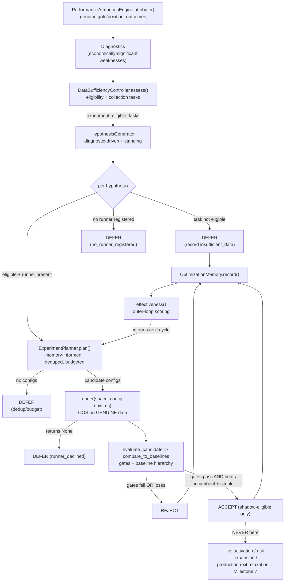
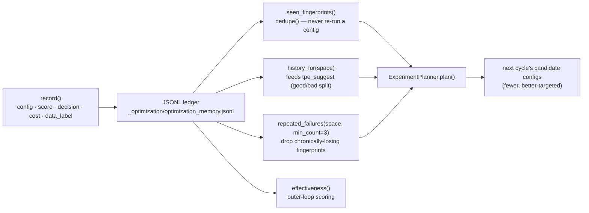

# Milestone 6B — The Meta-Optimization Cycle

The persistent, performance-driven **ML/RL meta-optimizer** that closes the loop around
C-Engine's own behavior: it measures what happened, diagnoses weaknesses, proposes bounded
experiments, runs them out-of-sample on **genuine** data, judges them economically against a
baseline hierarchy, and remembers every outcome so the *next* cycle is better-informed.

It optimizes the **learning process**, not just model weights. Accepted candidates become
**shadow-eligible only** — there is **no live activation**, **no risk expansion**, and **no
relaxation of the production -0.5% protective exit**. Milestone 7 owns economic certification
and any live deployment.

> **Honest-research framing.** This document describes validated infrastructure and a
> working closed loop over real historical bars. Historical-replay results are **simulated,
> not actual trading performance**, and **no economic edge is claimed**. The autonomous cycle
> has in fact *rejected* every protective-exit candidate out-of-sample under the risk gates —
> the production -0.5% exit is **retained** (see `exit_research.md` / the protective-exit
> docs).

This milestone **builds on** the M5 lakehouse (Parquet + DuckDB) and the M6 learning layer
(MLX GPU-first with a documented CPU fallback). It adds no cloud, CUDA, or external-API
dependency — everything runs **locally**.

Source package: `cengine/optimization/`.

---

## 1. Where the loop lives

| Concern | Module | Primary symbol |
|---|---|---|
| Controller (the loop itself) | `controller.py` | `MetaOptimizer` |
| Performance attribution | `attribution.py` | `PerformanceAttributionEngine` |
| Data-sufficiency gate | `data_sufficiency.py` | `DataSufficiencyController` (see [`data_sufficiency.md`](./data_sufficiency.md)) |
| Hypothesis generation | `hypotheses.py` | `HypothesisGenerator` |
| Bounded search spaces + methods | `search.py` | `SearchSpace`, `default_search_spaces()`, `random_search`, `grid_search`, `successive_halving`, `tpe_suggest` |
| Experiment planning / manifests | `experiments.py` | `ExperimentPlanner`, `ExperimentBudget` |
| Persistent optimization memory | `memory.py` | `OptimizationMemory` |
| Independent economic evaluation | `economic.py` | `evaluate_candidate`, `compare_to_baselines`, `EconomicScoreConfig` |
| Shared contracts | `contracts.py` | `Diagnostic`, `Hypothesis`, `ExperimentManifest`, `ExperimentStatus` |
| Orchestration (wires runners in) | `orchestration.py` | `AutonomousOptimizationCycle`, `run_autonomous_cycle` |
| Governed config | `config.py` | `OptimizationConfig`, `load_config` |
| CLI | `cli.py` / `__main__.py` | `python -m cengine.optimization …` |

Version constant: `META_OPTIMIZER_VERSION = "meta-optimizer-1.0.0"` (`controller.py`).

---

## 2. The closed loop



The sequence is implemented in `MetaOptimizer.run()`:

1. **Attribution → diagnostics.** `PerformanceAttributionEngine.attribute()` reads genuine
   trading records (gold `position_outcomes` / `daily_performance` / fills) from the
   lakehouse via DuckDB and emits descriptive `Diagnostic` records. It never infers
   causation; each finding merely *recommends a controlled experiment*. When no closed
   positions exist (the current reality — no live session has produced outcome lifecycles),
   it honestly emits an `INSUFFICIENT_DATA` diagnostic rather than inventing weaknesses.
2. **Data sufficiency.** `DataSufficiencyController.assess()` returns the `eligibility` map,
   `collection_tasks`, and the set of `experiment_eligible_tasks`. See
   [`data_sufficiency.md`](./data_sufficiency.md).
3. **Hypotheses.** `HypothesisGenerator.generate(diags)` turns diagnostics into testable
   `Hypothesis` objects; `HypothesisGenerator.standing(eligible_tasks=…)` adds standing
   research questions that don't need a prior diagnostic. The list is capped at
   `max_hypotheses` (default 6).
4. **Per-hypothesis processing** (`_process_hypothesis`) — the eligibility gate, runner
   dispatch, planning, execution, evaluation, and memory write (section 5).
5. **Report.** Outcomes are bucketed into `accepted` / `rejected` / `deferred` / `errors`,
   `memory.effectiveness()` is attached, and a `boundary` note restates the shadow-only
   invariant.

---

## 3. Bounded search spaces (`search.py`)

Only parameters inside **approved, versioned search spaces** are tunable. Hard risk limits
and the mandatory emergency protection are **not in any search space** and therefore can
never be reached by the optimizer. `SEARCH_VERSION = "search-spaces-1.0.0"`.

A `SearchSpace` is a named tuple of parameters (`Choice`, `IntRange`, `FloatRange`) and
supports `sample(rng)`, `validate(config) -> (ok, reasons)`, `clip(config)`, and
`grid_size()`. Validation rejects unknown parameters and out-of-bounds / out-of-choice
values; `clip` coerces values back inside bounds before any compute is spent.

`default_search_spaces()` defines five spaces:

| Space | Tunable parameters (bounds) |
|---|---|
| `supervised_model` | `model_family` ∈ {`mlx_quantile`,`mlx_regressor`,`sklearn_hgbr`,`ridge`}; `hidden_width` 16–128 (log); `hidden_depth` 1–3; `learning_rate` 1e-4–5e-3 (log); `batch_size` 512–8192 (log); `horizon_bars` 1–12; `weight_decay` 1e-5–1e-2 (log) |
| `rl_reward` | `turnover_penalty` 0–1; `drawdown_penalty` 0–2; `tail_risk_penalty` 0–2; `concentration_penalty` 0–1 |
| `protective_exit` | `policy` ∈ {`fixed`,`atr`,`volatility`,`regime`,`recovery_prob`,`rl`,`hybrid`,`tightening_only`}; `initial_stop_pct` 0.5–2.5; `max_stop_pct` 1.0–2.5; `atr_multiplier` 0.5–4.0 |
| `entry_policy` | `confidence_threshold` 0.5–0.95; `min_relative_volume` 1.0–3.0 |
| `strategy_policy` | `regime_conditioning` ∈ {True, False}; `strategy_weight_decay` 0.0–0.5 |

> The `protective_exit` space tunes only *candidate* exit policies evaluated in isolation and
> under risk-normalized portfolios. The **production -0.5% exit is never a member** and is
> preserved untouched; the native emergency stop is outside every search space (section 7).

### Search methods

All sampling is **seeded and reproducible**.

- `random_search(space, n, seed=7)` — uniform (log-uniform where declared), clipped.
- `grid_search(space, max_points=256)` — coarse product grid (continuous axes use 3 points).
- `successive_halving(candidates, eval_fn, budgets=(1,3,9), keep_fraction=0.34)` —
  multi-fidelity: evaluate all at low budget, keep the best fraction, escalate.
- `tpe_suggest(space, history, n, seed=7, good_quantile=0.25)` — the **Bayesian option**: a
  dependency-free TPE-style sampler that splits prior `(config, score)` history into
  good/bad by a score quantile and samples preferentially near good configs. It is honestly
  labeled a lightweight surrogate (**not** a full Gaussian process) and **falls back to
  random search when history is thin** (< 8 scored records).

---

## 4. Experiment planning (`experiments.py`)

`ExperimentPlanner.plan(hypothesis, budget)` converts a hypothesis + its approved search
space + **prior memory** into a bounded, deduplicated, budgeted list of candidate configs.
Work that would exceed the budget, duplicate prior experiments, or target a
repeatedly-failing region is **dropped before any compute is spent**.

`ExperimentBudget` (dataclass):

| Field | Default | Meaning |
|---|---|---|
| `max_configs_per_hypothesis` | `8` | hard cap on configs evaluated per hypothesis |
| `method` | `"tpe"` | `"random"` \| `"grid"` \| `"tpe"` |
| `seed` | `7` | reproducibility |

Planning logic:

1. Resolve the `SearchSpace` for `hypothesis.search_space`; return `[]` if unknown.
2. Oversample `2 × n` candidates with the chosen method. For `method="tpe"` it feeds
   `memory.history_for(space)` into `tpe_suggest`; `grid` is used only when
   `space.grid_size() <= 64`.
3. **Validate** each candidate against the space; drop invalid ones.
4. **Drop repeatedly-failing fingerprints** (`memory.repeated_failures(space)` — configs
   rejected ≥ 3 times).
5. **Dedupe** against memory (`memory.dedupe`) so no previously-evaluated config is re-run.
6. Truncate to `n = max_configs_per_hypothesis`.

`ExperimentPlanner.manifest(...)` builds a fully reproducible `ExperimentManifest`
(`contracts.py`): experiment/parent/diagnostic/hypothesis IDs, search-space version, model
family + architecture, hyperparameters, feature/dataset/window/reward definitions, seed,
execution device, runtime, resource usage, git commit, artifact hashes, economic + risk
metrics, statistical uncertainty (net-return CI), the evaluation result, the decision, any
rejection reason, and a `data_label` (`real` | `synthetic`).

---

## 5. Per-hypothesis processing & the eligibility gate

`MetaOptimizer._process_hypothesis` enforces, in order:

1. **Data-collection hypotheses short-circuit.** `search_space ∈ {"none",""}` is handled by
   the sufficiency controller, not run here.
2. **Task eligibility gate.** `_SPACE_TASK` maps each space to the learning task whose
   eligibility gates it:

   | Space | Gating task |
   |---|---|
   | `supervised_model` | `forward_return_prediction` |
   | `rl_reward` | `offline_rl_execution` |
   | `entry_policy` | `strategy_net_return` |
   | `strategy_policy` | `strategy_net_return` |
   | `protective_exit` | `None` — always allowed (runs on genuine bars via counterfactual/replay) |

   If a task-bound space's task is **not** in `experiment_eligible_tasks`, the hypothesis is
   **DEFERRED** (`task_not_eligible:<task>`) and a `DEFERRED` memory row with
   `rejection_reason="insufficient_data"` is written. Infrastructure is present; the
   conclusion is withheld rather than faked.
3. **Runner presence.** A space with no registered runner is **DEFERRED**
   (`no_runner_registered`). Runners are pluggable `runner(space, config, now_ns) -> dict`
   callables keyed by space name (section 6).
4. **Planning.** `planner.plan(h, budget)`; empty result ⇒ **DEFERRED**
   (`no_candidate_configs (dedup/budget)`).
5. **Execution + evaluation.** For each config the runner is called inside a `try/except` so
   **one runner failure never aborts the loop** (it is bucketed into `errors`). A returned
   `None` ⇒ **DEFERRED** (`runner_declined`). Otherwise `_evaluate` runs the economic
   comparison and the outcome (`eligible_for_shadow` or `rejected`) plus score, metrics,
   `data_label`, and `cost_s` is recorded to memory. The best shadow-eligible config per
   hypothesis is promoted into `accepted`.

### Runner contract

A runner returns at least:

```python
{
  "evaluation": {...},                 # CandidateEvaluation-like dict (score, metrics, gates…)
  "baselines": {name: {...}},          # e.g. {"incumbent": {...}}
  "data_label": "real" | "synthetic",  # genuine vs synthetic provenance
  "runtime_s": float,
  "device": str,                        # e.g. "cpu" or the MLX device
}
```

Returning `None` means the runner *declined* (treated as deferred, never as a result).

---

## 6. Independent economic evaluation (`economic.py`)

Candidates are judged on **transaction-cost-adjusted, risk-adjusted trading performance** —
predictive metrics are supporting diagnostics only. The scoring method is **fixed before any
candidate is observed**. `ECONOMIC_EVAL_VERSION = "optimization-economic-eval-1.0.0"`.

- `evaluate_candidate(net_returns, label, data_label, cfg, risk_expanded)` computes M6
  economic metrics (net return/expectancy, Sharpe, Sortino, profit factor, win rate, max
  drawdown, avg win/loss), a dependence-aware bootstrap net-return CI, the fixed
  `economic_score`, and **mandatory gates**. A high return can **never** buy past a gate.
- **Mandatory gates** (`EconomicScoreConfig`): `max_drawdown_limit = 0.25` (25% ceiling),
  `min_sample = 30`, and `require_no_risk_expansion = True` (any `risk_expanded=True`
  candidate fails `unauthorized_risk_expansion`).
- `compare_to_baselines(candidate, baselines)` applies the **baseline hierarchy**: a
  candidate must pass its gates **and** beat the `incumbent` **and** a simple baseline
  (`simple_statistical` or `deterministic`) on score to earn `eligible_for_shadow`;
  otherwise `reject`. The verdict explicitly notes it is **never promoted to live here** and
  that **synthetic data is never genuine economic evidence**.

`MetaOptimizer._evaluate` adapts the runner's plain dicts to this interface via `_AsEval`
and returns the verdict dict consumed in section 5.

---

## 7. Invariants enforced at this layer

These are enforced structurally, not by convention:

1. **Production -0.5% exit preserved untouched.** It is not a member of any search space;
   `OptimizationConfig.validate()` raises `ConfigError` if `production_exit_pct != -0.005`.
2. **Native C++ `RiskEngine` is the sole financial authority.** Nothing in
   `cengine/optimization/` submits an order or grants financial authority — these are
   research records only.
3. **Candidate native emergency stop is INACTIVE.** `risk/protective_exit_candidate.hpp`
   defines a pure, stateless, crash-independent emergency trigger
   (`kCandidateEmergencyThreshold = -0.03`, `evaluate_emergency_exit`,
   `clamp_emergency_threshold`, `EmergencyExitDecision`). It is **not wired into
   `RiskEngine::evaluate`** or any live path, it **never overrides a tighter active stop**
   (`overrides_tighter_stop` is always `false`), and `clamp_emergency_threshold` guarantees
   the optimizer can **never loosen** it (a more-negative/wider threshold is rejected). It
   is inspected read-only via `python -m cengine.optimization emergency-check
   --unrealized-return <x>` through the `_cengine_native.evaluate_emergency_exit` binding.
4. **No live activation, no risk expansion, no hard-stop tuning, no live exploration, no
   self-code-modification.** `OptimizationConfig.validate()` hard-fails if
   `production_activation_enabled`, `autonomous_live_activation`,
   `autonomous_risk_expansion`, `hard_stop_optimization`, or `live_exploration` are set. The
   memory may improve the *selection policy*; the optimizer never edits its own executable
   code.
5. **No fabricated data/orders/rewards/behavior-probabilities.** Deficiencies become
   collection tasks (see [`data_sufficiency.md`](./data_sufficiency.md)); synthetic results
   are labeled and never treated as economic evidence.
6. **OOS discipline.** Chronological, purged + embargoed train/validation splits; an
   **untouched certification holdout** the optimizer never accesses (Milestone 7 owns it).

---

## 8. Persistent optimization memory & the outer loop (`memory.py`)

The memory is what distinguishes **autonomous optimization** from ordinary scheduled
retraining. The controller remembers every prior experiment — config, dataset/regime, cost,
economic outcome, decision, failure reason — and uses it to avoid redundant work, focus on
promising regions, deprioritize repeatedly-failing configs, resume interrupted sessions, and
**score its own experiment-selection process (the outer loop)**.

`OPTIMIZATION_MEMORY_VERSION = "optimization-memory-1.0.0"`. Storage is an **append-only
JSONL ledger**, fsync'd on every write, under the lakehouse root at
`<root>/_optimization/optimization_memory.jsonl` (local, gitignored). `OptimizationMemory`
may improve the selection *policy* via this evidence; it **never modifies its own executable
code**.

### How prior experiments inform selection



- **Deduplication** — `config_fingerprint` (SHA-256 of the sorted config, prefixed by
  space) gives each config a stable identity. `dedupe` drops any config whose fingerprint is
  already in the ledger (any data label), so a config is **never evaluated twice**.
- **History-guided sampling** — `history_for(space)` returns `(config, score)` pairs feeding
  `tpe_suggest`, concentrating new samples near historically-good regions.
- **Failure avoidance** — `repeated_failures(space, min_count=3)` returns fingerprints
  rejected ≥ 3 times; the planner excludes them.
- **Resumability** — because the ledger is append-only and read in full on demand, an
  interrupted session resumes with no lost knowledge.

### Outer-loop effectiveness

`OptimizationMemory.effectiveness()` (surfaced in every cycle report and via `python -m
cengine.optimization memory`) scores the optimizer's *own* efficiency:

| Metric | Meaning |
|---|---|
| `experiments_attempted` | total ledger rows |
| `experiments_completed` | rows with a terminal decision (not deferred/error) |
| `improvements_identified` | `eligible_for_shadow` rows |
| `improvements_retained` | shadow-eligible rows later confirmed (`shadow_retained is True`) |
| `compute_seconds_total` | summed `cost_s` |
| `compute_per_improvement_s` | compute cost per improvement found |
| `duplicate_configs_in_memory` | attempted − unique fingerprints (dedup effectiveness) |

This lets the cycle quantify whether its search is getting *cheaper per useful discovery*
over time — the defining property of a self-improving outer loop.

---

## 9. Orchestration & running a cycle

`AutonomousOptimizationCycle` (`orchestration.py`,
`ORCHESTRATION_VERSION = "autonomous-orchestration-1.0.0"`) is the operational face of the
loop. It:

1. Loads the governed `OptimizationConfig` (`load_config()`), honoring `enabled`.
2. Builds the **genuine** runners for the symbol — `make_exit_runner` (protective-exit
   matrix/replay on real bars) and `make_supervised_runner` (forward-return model on real
   bars) — tolerating absence of either.
3. Constructs a `MetaOptimizer` with an `EconomicScoreConfig` (drawdown penalty from the
   governed reward coefficients) and an `ExperimentBudget` (from
   `max_configs_per_hypothesis` + `search_method`), runs one cycle, and appends a summary to
   `<root>/_optimization/cycle_runs.jsonl`.
4. Returns a report ending with the `boundary` note: *shadow-only; no live activation / risk
   expansion / production-exit relaxation; Milestone 7 certifies.*

`run_autonomous_cycle(config, symbol="AAPL")` is the convenience entry point.

The supervised runner (`supervised_runner.py`) is illustrative of the OOS discipline: it
sorts genuine bar features by timestamp, uses a chronological 60/20/20 split (last 20% is
OOS), fits the candidate family and an `sklearn_hgbr` **baseline**, scores both as paper
long-if-predicted-positive **net** returns (with cost), labels the result
`DATA_LABEL_HISTORICAL_REPLAY`, and returns `None` (declines) when < 2000 bars are
available. No profitability is claimed — forward-return edge is marginal and the result is
historical-replay, not live.

### CLI

```
python -m cengine.optimization attribute               # performance-attribution diagnostics
python -m cengine.optimization data-sufficiency        # eligibility + collection tasks
python -m cengine.optimization memory                  # optimization-memory effectiveness
python -m cengine.optimization optimize --symbol AAPL  # run one OOS autonomous cycle
python -m cengine.optimization counterfactual --symbol SPY --max-events 2000
python -m cengine.optimization exit-matrix --symbol QQQ [--risk-normalized]
python -m cengine.optimization validation-windows --symbol AAPL
python -m cengine.optimization emergency-check --unrealized-return -0.031
```

All commands are **non-ordering, research/shadow-only**. `--root` (or
`CENGINE_LAKEHOUSE_ROOT`) selects the lakehouse root.

### Governed configuration (`CENGINE_OPT_*`)

`load_config()` reads defaults + environment overrides and **validates** them
(`OptimizationConfig.validate()`), rejecting any unsafe setting.

| Env var | Field | Default |
|---|---|---|
| `CENGINE_OPT_ENABLED` | `enabled` | `True` |
| `CENGINE_OPT_TRAIN_IN_SESSION` | `training_during_market_hours` | `False` |
| `CENGINE_OPT_DEVICE` | `preferred_device` | `metal_gpu` |
| `CENGINE_OPT_MAX_CONFIGS` | `max_configs_per_hypothesis` | `8` |
| `CENGINE_OPT_SEARCH` | `search_method` | `tpe` |

Hard-off safety toggles (`production_activation_enabled`, `autonomous_live_activation`,
`autonomous_risk_expansion`, `hard_stop_optimization`, `live_exploration`) are **not
env-overridable to `True`** — `validate()` raises `ConfigError` if any is set, if
`production_exit_pct != -0.005`, if the candidate emergency threshold is loosened beyond
`-0.030`, or if the candidate initial stop is wider than the candidate max stop.

---

## 10. Status (honest)

- The **protective-exit** and **supervised-model** runners operate on genuine 1-minute bars
  (~6.76M real bars across AAPL/SPY/QQQ/MSFT/NVDA, 2020–2026; 1m canonical, 5m strategic;
  multi-timeframe historical replay is the primary research environment).
- **Outcome / execution / bandit / RL** tasks remain `INSUFFICIENT_DATA` — there are no
  genuine execution lifecycles yet. Their infrastructure is validated but **untrained /
  research-only**, and the controller **defers** rather than fabricates.
- Every accepted candidate is **shadow-eligible only**. The autonomous OOS cycle has
  rejected all protective-exit candidates under the risk gates; the production -0.5% exit is
  **retained**. **No economic edge is claimed.** Milestone 7 owns economic certification and
  live deployment.
