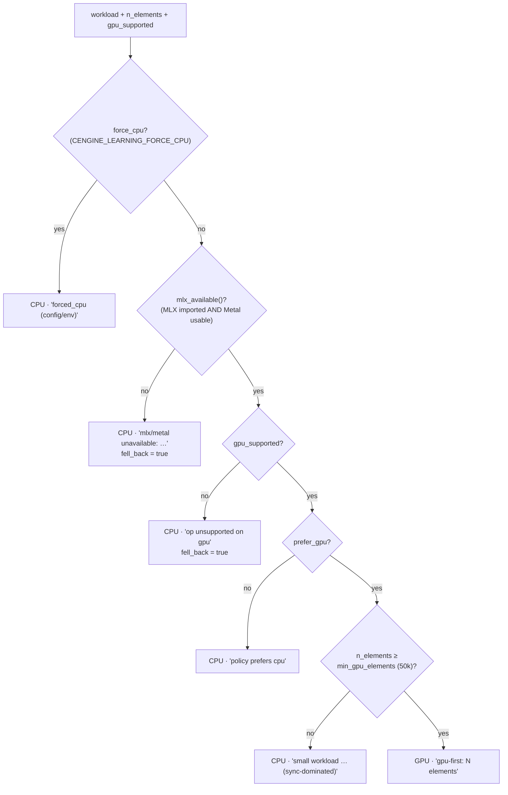

# Metal GPU Compute (Milestone 6B)

How the Milestone 6B autonomous-optimization layer uses the Apple-silicon **Metal GPU** via
[MLX](https://github.com/ml-explore/mlx), and — just as importantly — where it deliberately
runs on the **CPU**. The design is **GPU-first with a documented, observable, measurable CPU
fallback**: the platform never silently claims GPU acceleration when work actually ran on the
CPU. Every placement decision is recorded with a reason.

Milestone 6B **reuses** the M6 learning layer's device machinery rather than introducing a
new one — there is **no rebuild**. The authority on placement is
[`cengine/learning/hardware.py`](../../cengine/learning/hardware.py) (`DevicePolicy`,
`inspect_hardware`, `mlx_available`), already documented for the learning layer in
[`../learning/metal_gpu_training.md`](../learning/metal_gpu_training.md) and
[`../learning/mlx_architecture.md`](../learning/mlx_architecture.md). This page describes how
the optimization layer *consumes* it.

Local-only stack: Parquet / PyArrow / DuckDB + MLX. **No cloud, no CUDA, no external model or
compute APIs.**

| Constant / setting | Value |
|---|---|
| `HARDWARE_REPORT_VERSION` | `learning-hardware-1.0.0` |
| `BENCHMARK_VERSION` (`gpu_benchmarks.py`) | `gpu-benchmarks-1.0.0` |
| `OptimizationConfig.preferred_device` | `metal_gpu` (env `CENGINE_OPT_DEVICE`) |
| `OptimizationConfig.allow_silent_cpu_fallback` | `False` |
| `DevicePolicy.min_gpu_elements` (default) | `50_000` |
| Force-CPU override | env `CENGINE_LEARNING_FORCE_CPU` |

---

## 1. The device policy, in one picture

`DevicePolicy.choose(workload, n_elements=…, gpu_supported=…)` returns a
`PlacementDecision(workload, device, reason, gpu_eligible, fell_back)`. The decision order is
fixed and every outcome is appended to `self.decisions` so `summary()` can *prove* where
computation ran (`placements` by device, `fallback_count`).

Two of these outcomes count as a **fallback** (`fell_back=true`, incrementing
`fallback_count`): MLX/Metal unavailable, and op-unsupported-on-GPU. The other CPU outcomes
(forced, policy-prefers-CPU, small-workload) are *deliberate CPU placements*, not failures —
but they are still recorded and observable.

### `mlx_available()` — the ground-truth probe

`mlx_available()` is `True` only when MLX imported **and** `mx.metal.is_available()` (with a
newer-MLX `default_device()` fallback). MLX import is guarded (`try/except` in
`hardware.py`): on a non-arm64 / non-Darwin host, or when MLX is not installed, the module
degrades to CPU-only and reports `mlx_available() == False` rather than raising. The optional
`import mlx.core` **never hard-fails** the engine.

### `inspect_hardware()` — nothing is hardcoded

`inspect_hardware()` probes the **actual** runtime: `sysctl` for unified memory and CPU
brand, `mx.device_info()` for device name / architecture / working-set limits, and a live
precision round-trip (`_validate_precisions()` matmuls `float32` / `float16` / `bfloat16` on
the GPU and keeps only those that succeed). It also records `native_metallib_present` purely
as a **coexistence signal** — the native Objective-C++ Metal runtime (`cengine.metallib`) and
MLX share the same physical GPU but are independent software stacks.

---

## 2. Where the GPU is used

In the Milestone 6B optimization layer, Metal-GPU compute flows through **MLX neural models**,
reached from one place:

**Supervised-model optimization runner**
([`cengine/optimization/supervised_runner.py`](../../cengine/optimization/supervised_runner.py)).
This runner autonomously tunes the forward-return model over the `supervised_model` search
space, trained and evaluated **out-of-sample on genuine market bars**. Its `_fit_predict`
helper dispatches to MLX when the candidate `model_family` starts with `"mlx"` **and**
`mlx_is_available()`:

- `MLXRegressor` / `MLXQuantileRegressor`
  ([`cengine/learning/supervised/mlx_models.py`](../../cengine/learning/supervised/mlx_models.py))
  train with MLX autodiff. Internally `_MLXBase._mx_device()` calls
  `DevicePolicy.choose("train_<type>", n_elements = n_features × 20_000)` — a training
  workload that comfortably clears the 50k GPU threshold — and the **actual device is recorded
  on the `FitResult`** and surfaced in the runner's result dict as `"device"`.
- If MLX is unavailable or the MLX path raises, `_fit_predict` **falls through to a CPU
  sklearn model** (`SklearnRegressor`, ridge / HGBR) and returns `device = "cpu"`.

Critically, a GPU-trained candidate is **never preferred just for running on the GPU**: the
runner always also fits the `sklearn_hgbr` CPU baseline on the same split and the candidate
must beat it **out-of-sample** under the independent economic evaluation
([`economic.py`](../../cengine/optimization/economic.py)) to be accepted (shadow-only).

GPU is also available to the broader learning components the loop can exercise — MLX
supervised trainers, the neural contextual bandit, offline-RL value/policy nets, the regime
transition model, and batched inference — all of which route through the same `DevicePolicy`.
Those tasks, however, currently sit at `INSUFFICIENT_DATA` (no genuine execution lifecycles):
their GPU infrastructure is validated but untrained and research-only.

---

## 3. Where the CPU is used (by design)

Most of the Milestone 6B optimization *spine* is relational / statistical work that belongs on
the CPU, and runs there intentionally:

| Component | Substrate | Why CPU |
|---|---|---|
| Performance attribution (`attribution.py`) | DuckDB SQL | group-by aggregation over lakehouse Parquet |
| Data-sufficiency, validation windows | DuckDB SQL | eligibility counts, chronological split math |
| Protective-exit counterfactual (`exits/counterfactual.py`) | DuckDB + numpy | per-event horizon scans over genuine 1m bars |
| EXIT-00..15 matrix (`exits/experiment_matrix.py`) | DuckDB + numpy | deterministic replay over genuine bars |
| Economic evaluation (`economic.py`) | numpy | metrics + dependence-aware bootstrap CIs |
| sklearn baselines (ridge / HGBR) | numpy / sklearn | the independent CPU baseline hierarchy |
| Native emergency-exit candidate (`risk/protective_exit_candidate.hpp`) | native C++ | pure, stateless, **crash-independent** — must work when Python/MLX/GPU fail |
| Small MLX workloads (`n_elements < 50k`) | CPU via MLX | sync-dominated; GPU would be slower |

The native candidate emergency stop
([`risk/protective_exit_candidate.hpp`](../../risk/protective_exit_candidate.hpp),
`evaluate_emergency_exit`, exposed via the Python binding and the `emergency-check` CLI) is
deliberately **not** a GPU path. It is a deterministic, side-effect-free C++ function so it
remains operational in degraded / fallback contexts where Python, MLX, the GPU, or model
loading are unavailable. It is **INACTIVE**: a candidate `-3%` liquidation level, not wired
into `RiskEngine::evaluate`, never overriding a tighter active stop, never loosened by the
optimizer (`clamp_emergency_threshold` only ever keeps the tighter of two thresholds), and
gated behind Milestone 7 certification. The native C++ `RiskEngine` remains the **sole
financial authority**; nothing on the GPU can bypass it.

---

## 4. Honest small-workload CPU-comparability

GPU is not universally faster, and the platform says so. The crossover is measured, not
assumed, by
[`cengine/learning/benchmarks/gpu_benchmarks.py`](../../cengine/learning/benchmarks/gpu_benchmarks.py),
which times GPU vs CPU **correctly**: warm-up / compilation is excluded, and `mx.eval()`
forces MLX's lazy computation to actually complete before the clock stops — asynchronous
dispatch is never mis-reported as finished work.

The findings honour the honesty requirement:

- **Training throughput** (`benchmark_training_throughput`) reports `gpu_speedup_x` and will
  show it **below 1.0** on workloads where the GPU is not worth the host/device sync.
- **Inference latency** (`benchmark_inference_latency`) sweeps batch sizes `1 … 4096` and
  tags each row with `faster_device`. Its `crossover_note` states it plainly: *"GPU wins at
  large batches; CPU wins at tiny batches (sync-dominated) — reported honestly, not hidden."*

This is exactly why `DevicePolicy` sends any workload below `min_gpu_elements` (**50,000**) to
the CPU with the reason `small workload … (sync-dominated)`: for latency-bound, small jobs the
CPU is genuinely comparable or faster, and placing them on the GPU would be counterproductive.
Small MLX placements are a *correct engineering choice*, recorded as such — not a degraded
failure.

---

## 5. Configuration

`OptimizationConfig`
([`cengine/optimization/config.py`](../../cengine/optimization/config.py),
`optimization-config-1.0.0`) carries the compute intent, loaded from `CENGINE_OPT_*` env vars
and validated:

| Field | Default | Env | Meaning |
|---|---|---|---|
| `preferred_device` | `metal_gpu` | `CENGINE_OPT_DEVICE` | GPU-first intent |
| `allow_silent_cpu_fallback` | `False` | — | fallbacks must stay observable, never silent |
| `training_during_market_hours` | `False` | `CENGINE_OPT_TRAIN_IN_SESSION` | keep heavy GPU training out of live hours |

Runtime placement is still governed by `DevicePolicy` (which reads
`CENGINE_LEARNING_FORCE_CPU` to force CPU across the board). `preferred_device` expresses
intent; `DevicePolicy` makes — and records — the actual decision against the real hardware.

---

## 6. Invariants honoured

- **GPU-first, honest fallback.** Never silently claim GPU acceleration; every placement is
  recorded with a reason, and `fallback_count` is observable.
- **No GPU dependency for correctness.** MLX import is guarded; the whole optimization layer
  runs CPU-only when MLX / Metal is absent, degrading rather than crashing.
- **GPU is not an argument for acceptance.** A GPU-trained candidate must still beat the CPU
  baseline out-of-sample under the economic gates; running on the GPU earns no preference.
- **Risk authority stays native and CPU-side.** The native C++ `RiskEngine` is the sole
  financial authority; the candidate emergency stop is INACTIVE, crash-independent, never
  loosened, never overriding a tighter stop (Milestone 7 certifies).
- **Local-only.** MLX / DuckDB / Parquet on this machine; no CUDA, no cloud, no external
  compute. Historical-replay results are simulated, not actual trading performance.
