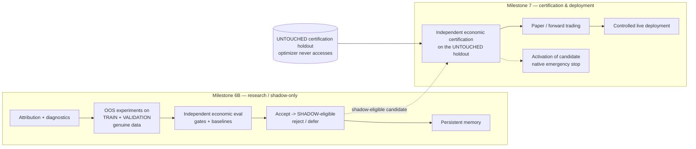

# Milestone 6B / Milestone 7 Boundary

This document draws the hard line between what the autonomous optimization platform
(Milestone 6B, `cengine/optimization/`) **does** and what Milestone 7 **owns**. The boundary
is not a convention — it is enforced in code (`OptimizationConfig.validate`), in the
out-of-sample split (`validation.py`), and in the native authority
(`risk/protective_exit_candidate.hpp`).

## One-line summary

> **Milestone 6B discovers and falsifies improvement candidates on genuine data and promotes
> survivors to SHADOW-eligible only. Milestone 7 owns independent economic certification,
> paper trading, and controlled live deployment — including any activation of the candidate
> native emergency stop and any access to the reserved certification holdout.**

## What Milestone 6B does

A governed, closed research loop, entirely off the trading-critical path:

- **Measures** actual trading-system performance (`PerformanceAttributionEngine`) from
  genuine lakehouse records, honestly reporting `INSUFFICIENT_DATA` where no genuine outcomes
  exist.
- **Gates** on data sufficiency (`DataSufficiencyController`) so no experiment runs that
  cannot reach a reliable conclusion; deficiencies become prioritized collection tasks, never
  synthetic data.
- **Hypothesizes & plans** bounded, deduplicated, budgeted experiments
  (`HypothesisGenerator`, `ExperimentPlanner`) over approved, versioned search spaces using
  `random` / `grid` / `successive-halving` / `TPE`, informed by persistent memory.
- **Runs experiments OOS on GENUINE data** (`exits/runner.py`, `supervised_runner.py`):
  fit/select on TRAIN, score on VALIDATION, always against the incumbent (EXIT-00 / −0.5%)
  and a simple baseline on the same window.
- **Evaluates independently** on transaction-cost-adjusted economics with mandatory risk
  gates and a baseline hierarchy (`economic.py`). A high return can never buy its way past a
  violated hard risk constraint.
- **Decides** accept(**shadow-eligible**) / reject / defer, and records everything to
  persistent optimization memory for a better next cycle.

Empirical result to date: the protective-exit matrix shows wider stops out-score the −0.5%
baseline **in exit-isolation**, but the autonomous OOS cycle **rejected** all candidates
(none beat the incumbent out-of-sample under the risk gates). The production −0.5% exit is
**retained**. No economic edge is claimed; all historical-replay results are **simulated, not
actual trading performance**.

## What Milestone 6B does NOT do (and Milestone 7 owns)

| Concern | Milestone 6B | Milestone 7 |
| --- | --- | --- |
| Data windows | `train` + `validation` only (chronological, purged, embargoed) | The **UNTOUCHED certification holdout** reserved by `validation.py` |
| Best outcome for a candidate | `eligible_for_shadow` | Certified → paper → controlled live |
| Live activation | **Never** (`production_activation_enabled` / `autonomous_live_activation` forced `False`) | Owns the decision and the activation |
| Production −0.5% exit | **Preserved untouched** (`production_exit_pct == -0.005`) | Any change requires M7 certification |
| Candidate native emergency stop (−3%) | **INACTIVE** — not wired into `RiskEngine::evaluate`; never overrides a tighter stop; never loosened | Owns certification and any activation |
| Risk limits | Not in any search space; no expansion | Any change is an M7 decision |
| Exploration | No live exploration | N/A (M6B boundary) |
| Self-modification | Never modifies its own executable code | N/A |

## The reserved certification holdout

`validation.py` splits each symbol's genuine data span into `train` / `validation` /
`holdout`. The optimizer is handed only `train` + `validation`. The `holdout` is the
certification set and **must never be accessed** by Milestone 6B for feature selection,
tuning, reward optimization, or experiment selection. Its `to_dict()` is explicit:
*"holdout is reserved for Milestone 7; optimizer uses train+validation only."* This is what
makes a Milestone 7 certification genuinely out-of-sample: the optimizer has never seen the
data it will be judged on.

## Invariants that hold across the boundary

These are preserved by Milestone 6B and remain Milestone 7's to change (only under
certification):

- Production **−0.5%** protective exit preserved untouched.
- Native C++ `RiskEngine` is the **sole** financial authority
  (`native_risk_authority.md`).
- Candidate native emergency stop (−3%) stays **INACTIVE**; never wired into `evaluate`,
  never overrides a tighter stop, never loosened.
- No live activation, no risk expansion, no hard-stop / mandatory-protection tuning, no live
  exploration, no self-code-modification.
- No fabricated data, orders, rewards, or behavior-policy probabilities; SQL inputs
  validated.

## Readiness handed to Milestone 7

When a candidate survives the Milestone 6B loop, what crosses the boundary is **evidence, not
authority**:

- A reproducible `ExperimentManifest` (config, train/eval windows, reward definition, seed,
  device, economic + risk metrics, statistical uncertainty, decision, data label).
- Its place in the persistent memory ledger (`optimization_memory.jsonl`), marked
  `eligible_for_shadow`.
- The untouched holdout, still unseen, ready for independent certification.

Milestone 7 then decides — on the holdout, then paper, then controlled live — whether that
evidence justifies deployment. Milestone 6B never makes that call.

## Related

- `daily_workflow.md` — the off-critical-path cycle that produces shadow-eligible candidates.
- `operations.md` — CLI, configuration, reports, OOS windows, troubleshooting.
- `native_risk_authority.md` — the native authority and the inactive candidate emergency stop.
