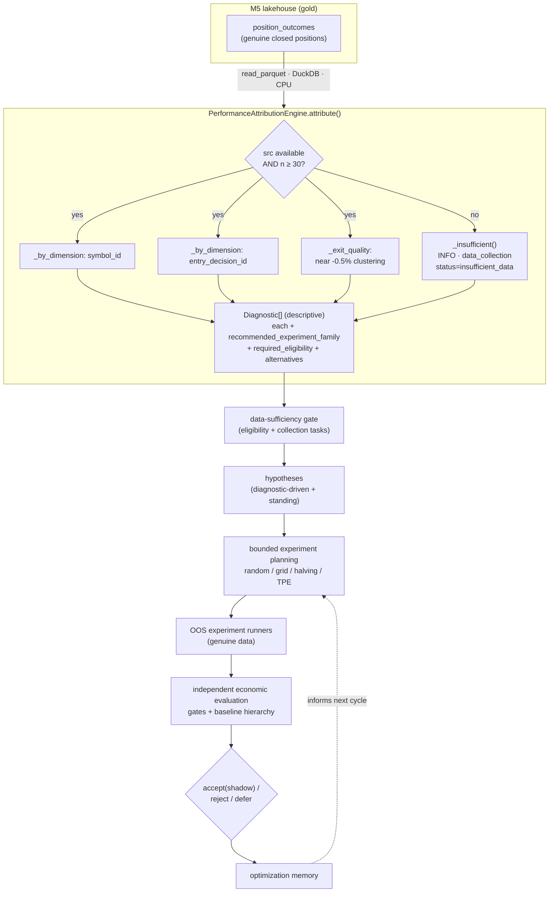

# Performance Attribution (Milestone 6B, §8)

The autonomous **performance-attribution engine** is the first stage of the Milestone 6B
closed optimization loop. It reads the engine's own genuine trading records from the M5
lakehouse, slices them along economically-meaningful dimensions, and emits descriptive
**`Diagnostic`** records that name a suspected weakness and recommend a *controlled
experiment* to test it. It never asserts causation, and when genuine outcome data is absent
— the current honest reality — it emits an `INSUFFICIENT_DATA` diagnostic rather than
inventing weaknesses.

Source: [`cengine/optimization/attribution.py`](../../cengine/optimization/attribution.py)
(engine) and [`cengine/optimization/contracts.py`](../../cengine/optimization/contracts.py)
(the `Diagnostic` / `Severity` record types).

| Constant | Value |
|---|---|
| `ATTRIBUTION_ENGINE_VERSION` | `performance-attribution-1.0.0` |
| `OPTIMIZATION_CONTRACTS_VERSION` | `optimization-contracts-1.0.0` |

Local-only stack (Parquet / DuckDB / numpy). The engine runs entirely on the CPU via DuckDB
SQL over the lakehouse — no MLX / Metal / GPU, no cloud, no external APIs. It builds on the
M5 lakehouse and the M6 learning layer with **no rebuild**.

---

## 1. Honest-data reality (read this first)

Attribution requires **genuine closed-position outcomes**. No live trading session has yet
run against this engine, so the `gold/position_outcomes` dataset is empty or too small, and
the honest output today is a single `INSUFFICIENT_DATA` diagnostic — *not* a weakness in the
engine, but a data-coverage gap. The pipeline, the dimension slices, and the weakness
detectors below are **validated infrastructure**; their conclusions are withheld until
genuine outcomes exist. Milestone 7 owns the execution lifecycle that will populate them.

This matches the platform-wide stance: outcome / execution / bandit / RL tasks remain
`INSUFFICIENT_DATA`; their infrastructure is validated but untrained and research-only.

---

## 2. Position in the closed loop

Attribution is **step 1** of the `MetaOptimizer` cycle
([`cengine/optimization/controller.py`](../../cengine/optimization/controller.py),
`META_OPTIMIZER_VERSION = "meta-optimizer-1.0.0"`). Its diagnostics are what the rest of the
loop reacts to:



The `recommended_experiment_family` and `required_eligibility` fields on each diagnostic are
the handoff contract: the hypothesis generator turns a family into a testable intervention,
and the data-sufficiency controller decides whether the required evidence actually exists
before any experiment runs. A diagnostic never triggers an action on its own.

---

## 3. Data source and the sufficiency gate

`attribute(now_ns=None)` returns a machine-readable report dict. Its data source is resolved
by `_outcomes_src()`, which globs `gold/position_outcomes` and wraps it in
`read_parquet('…/**/*.parquet', union_by_name=true)`. The engine docstring names the broader
intended §8.1 inputs (`position_outcomes` / `daily_performance` / `fills`); the committed
code slices **`position_outcomes`** — the net-return-per-closed-position grain.

Two gates precede any attribution:

| Gate | Condition | Result |
|---|---|---|
| Source present | no `gold/position_outcomes` parquet exists | `INSUFFICIENT_DATA` diagnostic; `data_available=false` |
| Minimum sample | `count(*) < 30` closed positions | `INSUFFICIENT_DATA` diagnostic (carries `n`) |

Only when both pass does `data_available` become `true` and the report populate
`closed_positions`, `avg_net_return`, `win_rate`, and `dimensions_analyzed =
["symbol", "entry_signal", "exit_behavior"]`.

The whole body is wrapped so that **attribution can never crash the optimization cycle**: any
exception is caught and surfaced as `report["error"]`, and the DuckDB connection is always
closed.

---

## 4. Dimensions (§8.1)

Attribution slices realized **net return** along three dimensions. All numbers are computed
in DuckDB SQL over the genuine records.

| Dimension | `report` label | Column | Detector |
|---|---|---|---|
| Per-symbol | `symbol` | `symbol_id` | `_by_dimension` |
| Per-entry-signal | `entry_signal` | `entry_decision_id` | `_by_dimension` |
| Exit behaviour | `exit_behavior` | `net_return` distribution near threshold | `_exit_quality` |

Headline aggregates (`avg_net_return`, `win_rate`) are reported alongside the per-dimension
findings so a reader can judge each flagged bucket against the overall population.

---

## 5. Weakness detection (§8.2)

### 5.1 Negative-return buckets — `_by_dimension`

For `symbol_id` and `entry_decision_id`, the detector groups by the dimension, keeps only
buckets with **≥ 20 observations** (`HAVING c >= 20`), orders by mean net return ascending,
and inspects the worst three. A bucket is flagged only when its **mean net return is < 0**.

Per flagged bucket the engine records:

- `est_economic_impact = avg_net_return × count` (the aggregate drag, a signed estimate).
- `severity = MEDIUM` when `avg < -0.002` (-0.2%), otherwise `LOW`.
- `priority = |avg_net_return| × count`.
- `recommended_experiment_family`: `entry_optimization` for the entry-signal dimension,
  `strategy_optimization` otherwise.
- `required_eligibility = genuine_execution_outcomes`.

### 5.2 Exit-quality clustering — `_exit_quality`

This detector is the attribution-side companion to the protective-exit research. It counts
closed positions whose net return lands in the **[-0.7%, -0.4%]** band — i.e. clustered just
around the production **-0.5%** protective threshold — and flags a possible
*premature-liquidation* pattern when that band holds **> 15%** of a sample of **≥ 30**
positions.

The resulting diagnostic is `severity = HIGH`, `component = protective_exit`,
`recommended_experiment_family = protective_exit_matrix`, and
`required_eligibility = counterfactual_exit_observations`. It is a **signal to investigate**,
not a verdict: it hands off to the counterfactual / EXIT-00..15 matrix research, which runs
on genuine 1-minute bars. (That research found the -0.5% exit is frequently premature in
*exit-isolation*, yet the autonomous OOS cycle **rejected** every wider-stop candidate under
the risk gates, so the production -0.5% exit is **retained**. No economic edge is claimed.)

---

## 6. The `Diagnostic` record (§8.3)

Every finding is an instance of the `Diagnostic` dataclass in `contracts.py`. It is a
**research record only** — it executes nothing and grants no financial authority.

| Field | Meaning |
|---|---|
| `diagnostic_id` | deterministic id from `stable_id(prefix, *parts)` (SHA-256, reproducible) |
| `detected_ns` | detection time (ns) |
| `component` | what was analysed, e.g. `symbol:AAPL`, `entry_signal:…`, `protective_exit`, `trading_outcomes` |
| `period` / `sample_size` | window and n behind the finding |
| `est_economic_impact` | signed estimate of the drag (or `None` when not quantified) |
| `uncertainty` | optional uncertainty on the estimate |
| `severity` | `Severity` enum: `info` / `low` / `medium` / `high` / `critical` |
| `suspected_cause` | plain-language description of the observed pattern |
| `alternatives` | **competing non-causal explanations** (see §7) |
| `recommended_experiment_family` | which experiment family should test it |
| `required_eligibility` | the evidence a test would need |
| `priority` | rank for downstream selection |
| `status` | `open` (default) or `insufficient_data` |
| `causal_note` | explicit statement that this is descriptive attribution only |

`stable_id` makes diagnostic ids **content-addressed and reproducible**: the same finding on
the same data at the same timestamp yields the same id, so the loop can dedup and the memory
layer can track a finding across cycles.

---

## 7. Causal-uncertainty stance

Attribution is **descriptive, never causal**. This is enforced in the data, not just the
prose:

1. **No causation is asserted.** The report carries a top-level `causal_note`:
   *"descriptive attribution; each finding recommends a controlled experiment — no causation
   is asserted"*, and every `Diagnostic` carries its own `causal_note` restating that
   causation requires a controlled experiment.
2. **Competing explanations are recorded, not resolved.** Each flagged bucket lists
   `alternatives` — e.g. `["regime effect", "small-sample noise", "cost drag"]` for a
   negative-return bucket, or `["genuine stop-losses", "regime-driven losses"]` for the exit
   cluster. The engine does not choose among them; it hands the question to an experiment.
3. **A finding is a hypothesis trigger, not a change.** The only thing a diagnostic can
   cause is a *proposed, bounded, out-of-sample experiment*, which is independently
   economically evaluated before anything is accepted — and acceptance is **shadow-eligible
   only** (no live activation, no risk expansion, no touching the production exit; Milestone 7
   certifies).
4. **Absence of evidence is reported as such.** `INSUFFICIENT_DATA` is a first-class
   outcome, kept distinct from "no weaknesses found."

---

## 8. Running it

Standalone CLI
([`cengine/optimization/cli.py`](../../cengine/optimization/cli.py) →
[`__main__.py`](../../cengine/optimization/__main__.py)), non-ordering and research-only:

```bash
python -m cengine.optimization attribute
```

This prints the full attribution report (JSON) via `PerformanceAttributionEngine(config)
.attribute()`. Programmatically:

```python
from cengine.optimization.attribution import PerformanceAttributionEngine
report = PerformanceAttributionEngine().attribute()   # LakehouseConfig.from_env() by default
```

Inside the loop it is invoked automatically by `MetaOptimizer.run()` (step 1), which rebuilds
`Diagnostic` objects from the report and feeds them to the data-sufficiency gate and the
hypothesis generator.

---

## 9. Invariants honoured

- **Honest evidence only.** No fabricated outcomes, weaknesses, or impacts; missing data
  yields `INSUFFICIENT_DATA`, never a manufactured finding.
- **Descriptive, not causal.** Correlation is never reported as causation; every finding
  recommends a test and lists alternatives.
- **SQL inputs validated.** Dataset globs are escaped; ticker inputs elsewhere in the module
  pass through `safe_ticker` (`^[A-Z0-9.\-]{1,12}$`) before interpolation.
- **No authority.** Diagnostics are records; they submit no orders, do not touch the native
  C++ `RiskEngine`, and do not relax the production **-0.5%** protective exit.
- **Research-only results.** Any downstream acceptance is shadow-eligible; historical-replay
  results are simulated, not actual trading performance. Milestone 7 owns certification.
