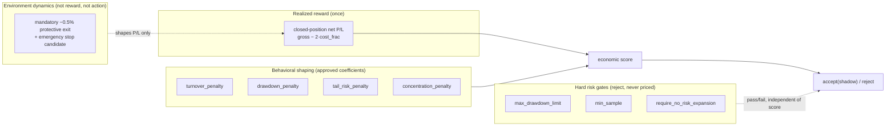

# Constrained RL Reward Optimization (Milestone 6B)

How the autonomous optimizer is *allowed* to touch the reinforcement-learning
reward — and, far more importantly, everything it is **not** allowed to do. The
reward is a construction with sharp edges: it is built from realized economics
only, it never double-counts, a fixed catalogue of exploits is structurally
impossible, only approved coefficients are tunable, and the hard risk constraints
sit **outside** the reward entirely so no return can ever buy past them.

This layer builds on (does not rebuild) the Milestone 6 learning layer. The base
reward construction lives in `docs/learning/reward_engineering.md`; this document
covers the Milestone 6B *optimization* extension: the `rl_reward` search space,
the economic scoring that consumes the same penalty family, and the governance
that keeps both honest.

> **Status.** The RL reward search targets the `offline_rl_execution` learning
> task, which is currently `INSUFFICIENT_DATA` (no genuine execution lifecycles
> exist yet). Every `rl_reward` experiment is therefore **DEFERRED** by the
> controller — the infrastructure is validated, but untrained and research-only.
> No economic edge is claimed. Historical-replay results are simulated, not
> actual trading performance. Milestone 7 owns economic certification and any
> live deployment.

---

## 1. Where the reward comes from (constrained construction)

The reward is **realized net return on closed positions only**. It is never a
prediction, never a shaped surrogate of a future price, and never fabricated.

- **Replay/transition source.** `cengine/learning/environment/replay.py::_close`
  stamps each closed round-trip with `reward = net_return`, where
  `net = gross - 2 * cost_frac` (entry crossing cost + exit crossing cost). That
  is the *only* place a reward value is minted, and it is minted once, after the
  position is flat.
- **Unknown rewards stay unknown.** In
  `cengine/learning/offline_rl/transitions.py`, `TransitionDataset.rewards` is
  `NaN` wherever the outcome is not realized, masked by `reward_known`. There is
  no imputation, no zero-fill-as-reward, no carry-forward. Learners train on the
  `reward_known` subset (`dataset.subset(dataset.reward_known)` in FQE / CQL /
  IQL).
- **Behavior probabilities are never invented.** `action_probability_if_known`
  is *always* `None`. Any estimator that needs a logging-policy density
  (IPS / weighted doubly-robust) is gated off upstream; the shipped methods
  (BC / FQE / CQL / IQL) deliberately do not require it
  (`_BEHAVIOR_PROB_METHODS` is empty). A row that *does* carry a fabricated
  behavior probability is counted as a `point_in_time_violation` and the dataset
  is marked `DATA_QUALITY_FAILED`.
- **The protective exit is environment dynamics, not an action.** The reserved
  `MANDATORY_EXIT_ACTIONS` labels (`mandatory_exit`, `protective_exit`,
  `stop_loss_exit`, …) are excluded from the learnable action space. No learner
  can model, imitate, or recommend the protective exit as a *policy choice*, so
  the reward can neither credit nor discredit it. This is the single structural
  fact that the rest of the "no double-counting" argument rests on.

---

## 2. What is tunable: approved coefficients only

The optimizer may tune reward **shaping coefficients**, nothing else. The one
approved, versioned search space is `rl_reward` in
`cengine/optimization/search.py::default_search_spaces`:

| Coefficient            | Type                | Bounds  |
| ---------------------- | ------------------- | ------- |
| `turnover_penalty`     | `FloatRange`        | 0.0 – 1.0 |
| `drawdown_penalty`     | `FloatRange`        | 0.0 – 2.0 |
| `tail_risk_penalty`    | `FloatRange`        | 0.0 – 2.0 |
| `concentration_penalty`| `FloatRange`        | 0.0 – 1.0 |

`SearchSpace.validate` rejects any config that contains an **unknown** parameter
(`unknown_param:*`) or an out-of-bounds value (`out_of_range:*`); `SearchSpace.clip`
clamps to the declared interval before any config is used. The governed defaults
live in `OptimizationConfig.reward_coefficients`
(`turnover_penalty=0.1`, `drawdown_penalty=1.0`, `tail_risk_penalty=0.5`).

From `search.py`, verbatim: *"Only parameters inside approved, versioned search
spaces are tunable. Hard risk limits and the mandatory emergency protection are
NOT in any search space."* There is no search-space axis for stop distances,
leverage, position size, the production exit, or the emergency threshold — they
cannot be reached by the sampler even in principle.

**Bounded experiment planning.** `ExperimentPlanner.plan`
(`cengine/optimization/experiments.py`) turns an `rl_reward` hypothesis into a
*deduplicated, budgeted* candidate list via random / grid / TPE sampling
(`CENGINE_OPT_SEARCH`, default `tpe`), capped at
`max_configs_per_hypothesis` (`CENGINE_OPT_MAX_CONFIGS`, default `8`), with
configs already in memory dropped (`OptimizationMemory.dedupe`) and
repeatedly-failing fingerprints deprioritized (`repeated_failures`).

---

## 3. No double-counting

Each economic fact is charged to the objective in exactly one place.



- **Transaction cost is subtracted once.** The crossing cost is already inside
  the realized reward (`net = gross - 2*cost_frac`). The evaluator's
  `turnover_penalty` is a *behavioral* term — it penalizes churn/overtrading, not
  the spread — so it does not re-charge a cost that reward already paid.
- **The protective exit is counted zero times as a decision.** It shapes the
  realized P/L (a stopped trade simply closes at the stop) but is excluded from
  the action space and is not a reward term. It cannot appear on both the reward
  side and the policy side.
- **Risk is enforced, not re-priced.** The mandatory gates in §4 are evaluated
  as pass/fail *outside* the score. A drawdown that trips `max_drawdown_limit`
  rejects the candidate outright; it is **not** also folded into the reward a
  second time as a penalty-that-can-be-outweighed.
- **Metrics are reused, not re-derived.** `economic.evaluate_candidate` calls the
  Milestone 6 `economic_metrics` + `bootstrap_metric_ci`; the optimizer does not
  maintain a parallel P/L accounting that could drift from the learning layer.

The evaluation score formula (`economic.economic_score`), which consumes the same
penalty family the `rl_reward` space tunes:

```
score = net_return
        − drawdown_penalty  · |max_drawdown|
        − tail_risk_penalty · CVaR_proxy(avg_loss)
        − turnover_penalty  · turnover
        − instability_penalty · max(0, −sortino)
```

The formula is **fixed before candidates are observed** (`economic.py`
docstring). Coefficients are tuned within bounds; the *shape* of the objective is
not negotiable per-candidate.

---

## 4. Hard constraints are independent of the reward

A high return can never purchase its way past a risk constraint. The gates live
in `economic.EconomicScoreConfig` and are checked in
`economic.evaluate_candidate` *before and separately from* the score:

| Gate                       | Default | Failure token |
| -------------------------- | ------- | ------------- |
| `max_drawdown_limit`       | 0.25    | `drawdown_exceeds_limit:*` |
| `min_sample`               | 30      | `insufficient_sample:*` |
| `require_no_risk_expansion`| `True`  | `unauthorized_risk_expansion` |

`CandidateEvaluation.gates_passed` must be `True` for a candidate to be even
*considered*; `compare_to_baselines` short-circuits to `reject` otherwise,
regardless of how high `score` is.

Beyond the evaluator, the configuration layer refuses to construct an unsafe
world at all (`cengine/optimization/config.py::OptimizationConfig.validate`):

- `production_activation_enabled` / `autonomous_live_activation` → must be off.
- `autonomous_risk_expansion` → prohibited.
- `hard_stop_optimization` → prohibited (hard-stop / mandatory-protection tuning
  is never allowed).
- `live_exploration` → prohibited.
- `production_exit_pct` → must equal `-0.005` (the production −0.5% exit is
  preserved unchanged).
- `candidate_emergency_pct` → may be **tightened**, never loosened beyond `-0.03`.

The native C++ `RiskEngine` remains the **sole financial authority**. The
candidate native emergency stop
(`risk/protective_exit_candidate.hpp`, `kCandidateEmergencyThreshold = -0.03`) is
**INACTIVE** — not wired into `RiskEngine::evaluate` — and its
`clamp_emergency_threshold` guard only ever returns the *tighter* of
(proposed, current), so the optimizer cannot loosen it. A tighter active stop
always takes precedence; the emergency candidate never overrides it.

---

## 5. Prohibited reward exploits (and the mechanism that blocks each)

| Exploit (how an RL reward is usually gamed) | Why it is impossible here |
| ------------------------------------------- | ------------------------- |
| Invent / assume future returns              | Reward is realized only; unrealized outcomes stay `NaN` and are masked out of training. |
| Leak future information into the reward      | Chronological **purged + embargoed** train/validation split (`oos_windows`, `purged_walk_forward`); the certification holdout is reserved and never touched (Milestone 7 owns it). |
| Fabricate rewards or behavior probabilities | `DataSufficiencyController` emits a *collection task* instead of synthetic data; `transitions.py` forces `action_probability_if_known=None` and flags fabricated values as `DATA_QUALITY_FAILED`. |
| Reward risk expansion                        | `require_no_risk_expansion` gate + `autonomous_risk_expansion` hard-off in config. |
| Reward loosening the protective exit         | `production_exit_pct` pinned at `-0.005`; not a search-space axis; the exit is environment dynamics, not a learnable action. |
| Reward loosening the emergency stop          | `hard_stop_optimization` prohibited; `clamp_emergency_threshold` refuses looser thresholds; the stop is INACTIVE and M7-gated regardless. |
| Treat synthetic P/L as genuine edge          | Synthetic data is never promotable (`TrainingGuard.require(..., promote=True)` raises `SyntheticDataError`); synthetic scores are labeled research-only in `compare_to_baselines`. |
| Reward the protective exit *as a policy*     | Mandatory-exit action labels are excluded from the action space (`MANDATORY_EXIT_ACTIONS`). |

---

## 6. Data gating — why `rl_reward` is deferred today

The controller maps the `rl_reward` space to the `offline_rl_execution` task
(`controller._SPACE_TASK`). A task-bound space only runs when its data is
`TRAINING_ELIGIBLE` / `VALIDATION_ELIGIBLE`; otherwise the hypothesis is
**DEFERRED** and recorded in optimization memory as `insufficient_data` — the
conclusion is withheld, not faked. Because no genuine logged execution
transitions exist yet, `offline_rl_execution` stays `INSUFFICIENT_DATA` and the
reward-coefficient search never spends compute on a conclusion it cannot
support. The `TrainingGuard` reinforces this at the learner boundary: a method
that needs reward (`FQE` / `CQL` / `IQL`) refuses to train when
`n_reward_known == 0`.

When genuine execution lifecycles accrue, the same bounded search, the same
double-counting-free score, and the same independent gates apply unchanged — only
the eligibility state flips.

---

## 7. Operating it

```bash
# eligibility snapshot — shows offline_rl_execution = INSUFFICIENT_DATA today
python -m cengine.optimization data-sufficiency

# one governed cycle (rl_reward hypotheses deferred until data is eligible)
python -m cengine.optimization optimize --symbol AAPL

# optimizer self-effectiveness (attempts, improvements identified vs retained)
python -m cengine.optimization memory
```

Relevant environment overrides (`CENGINE_OPT_*`, read by
`config.load_config`): `CENGINE_OPT_ENABLED`, `CENGINE_OPT_SEARCH`
(`random|grid|tpe`), `CENGINE_OPT_MAX_CONFIGS`, `CENGINE_OPT_DEVICE`,
`CENGINE_OPT_TRAIN_IN_SESSION`.

---

## 8. Invariants (summary)

- Reward = realized closed-position net P/L, minted once; unknown stays `NaN`.
- Behavior probabilities never fabricated; IPS/WDR gated off.
- Only the four `rl_reward` coefficients are tunable, within bounds; hard risk
  limits and the mandatory emergency protection are in **no** search space.
- Transaction cost, the protective exit, and risk gates are each accounted for
  exactly once — never double-counted.
- Hard constraints are pass/fail, evaluated independently of the score; a high
  return cannot buy past them.
- Production −0.5% exit preserved; emergency threshold never loosened; candidate
  native stop INACTIVE; native C++ `RiskEngine` is the sole financial authority.
- No live activation, no risk expansion, no self-code-modification. Accepted
  candidates are shadow-eligible only. Milestone 7 certifies.
